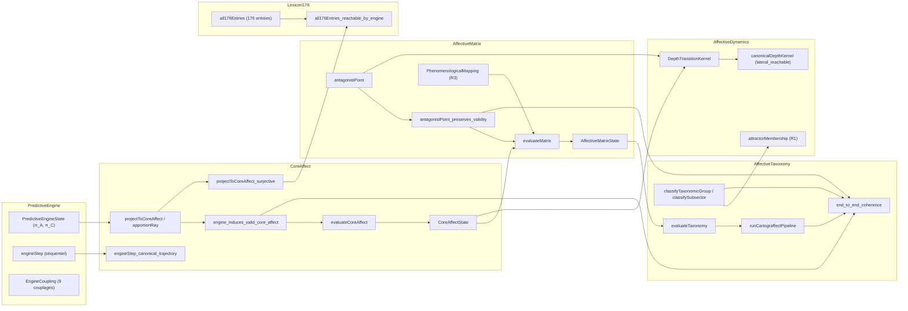

# AUDIT_REPORT — Archive Historique d'Audit Formelle (v1.x / v2.x)

> [!NOTE]
> **Archive historique :** Ce rapport consigne l'audit des versions antérieures (`v1.x` / `v2.x`) ; l'ensemble des arbitrages et résolutions v3.0.0 est consigné dans [`DECISIONS_V3.md`](DECISIONS_V3.md) et [`CHANGELOG.md`](CHANGELOG.md). Pour l'audit exhaustif, dédupliqué et vérifiable ligne par ligne du cœur normatif **v3.0.0** (Lean 4 `v4.35.0`, 8 modules normatifs, **148 théorèmes substantiels / 169 déclarations exportées**, Top 8 théorèmes piliers, `PredictiveEngineCanonical.lean` 16 + 5 = 21, `0 sorryAx`, `0 native_decide`), consulter [`FORMAL_AUDIT_PACK.md`](FORMAL_AUDIT_PACK.md) et [`VALIDATION.md`](VALIDATION.md).

**Cartographie des affects — formalisation Lean 4**
Rapport d'audit de vérification formelle et de fidélité épistémique · Phases 1 à 5 & Section 6 (`PredictiveCircuit`) · 2026-11-19

---

## Sommaire

1. [En-tête exécutif et tableau de bord de certification](#1-en-tête-exécutif-et-tableau-de-bord-de-certification)
2. [Non-vacuité et exécution concrète (Phase 2)](#2-vérification-de-la-non-vacuité-et-exécution-concrète-phase-2)
3. [Chaînage déductif inter-modules et traçabilité ontologique (Phase 3)](#3-audit-du-chaînage-déductif-inter-modules-et-table-de-traçabilité-ontologique-phase-3)
4. [Journal des réparations tactiques sous Lean 4.35.0 (Phase 4)](#4-journal-des-réparations-tactiques-sous-lean-4350-phase-4)
5. [Singularités théoriques et extensions formelles (Phase 5)](#5-diagnostic-des-singularités-théoriques-et-pistes-dextension-formelle-phase-5)
6. [Extension générative circulaire (`Cartograffect.PredictiveCircuit` & moteur Python)](#6-extension-générative-circulaire-cartograffectpredictivecircuit--moteur-python)

---

## 1. En-tête exécutif et tableau de bord de certification

### 1.1 Identification

| Élément | Valeur |
|---|---|
| Modèle théorique | *Cartographie des affects* — **CARTOGRAFFECT** |
| Sources théoriques | [Doc. 1 — Article](docs/01-Article_Cartograffect.md) · [Doc. 2 — Inventaire des 176 entrées](docs/02-Inventaire_176.md) |
| Toolchain | `leanprover/lean4:v4.35.0` ([`lean-toolchain`](lean-toolchain)) |
| Dépendances externes | **Aucune** (ni Mathlib ni Batteries : uniquement le noyau Lean 4 et `Init`) |
| Bibliothèque Lake | `Cartograffect` (`@[default_target]`, incluant `Cartograffect`, `Cartograffect.AffectiveDynamics`, `Cartograffect.PredictiveCircuit`, [`lakefile.lean`](lakefile.lean)) |
| Architecture | 7 modules théoriques + 1 module d'audit + 1 module racine + moteur Python isomorphe ([`python/`](python/cartograffect_predictive_engine.py)) |

### 1.2 Statut de compilation (Phase 1)

| # | Cible Lake (module) | Rôle | Statut |
|---|---|---|---|
| 1 | [`Cartograffect.PredictiveEngine`](Cartograffect/PredictiveEngine.lean) | Moteur prédictif, précisions relatives $(\pi_A, \pi_C)$ et transition séquentielle `engineStep` (Doc. 1 §4, §7) | ✅ PASS |
| 2 | [`Cartograffect.CoreAffect`](Cartograffect/CoreAffect.lean) | Noyau affectif, partage discret, surjectivité, suspension endogène R5 et dissipation court-circuitée (Doc. 1 §5–6.3, Doc. 2 §1–2) | ✅ PASS |
| 3 | [`Cartograffect.AffectiveMatrix`](Cartograffect/AffectiveMatrix.lean) | Matrice affective, paramétrisation phénoménologique `PhenomenologicalMapping` (R3), loi unifiée et équivariance antagoniste (Doc. 1 §6, §7.1 ; Doc. 2 §4) | ✅ PASS |
| 4 | [`Cartograffect.AffectiveDynamics`](Cartograffect/AffectiveDynamics.lean) | Noyau inter-strates $Z \to Z + 1$ (`DepthTransitionKernel`, `lateral_reachable`) et attracteurs gradués `attractorMembership` (Doc. 1 §7.1, §8.2) | ✅ PASS |
| 5 | [`Cartograffect.AffectiveTaxonomy`](Cartograffect/AffectiveTaxonomy.lean) | Taxonomie hiérarchique et sous-secteurs fonctionnels (Doc. 1 §7 ; Doc. 2 §2–3, §5) | ✅ PASS |
| 6 | [`Cartograffect.Lexicon176`](Cartograffect/Lexicon176.lean) | Répertoire nominal des 176 positions, clôture antagoniste et atteignabilité complète (Doc. 2 §3–5) | ✅ PASS |
| 7 | [`Cartograffect.PredictiveCircuit`](Cartograffect/PredictiveCircuit.lean) | Circuit fermé à 6 opérateurs, noyau markovien exact `4 * scale ^ 6` (axes i–iii) et loi unifiée `(R_t, Z_t, pi_A, pi_C)` (axe iv) (Doc. 1 §4.1) | ✅ PASS |
| 8 | [`Cartograffect.AuditTests`](Cartograffect/AuditTests.lean) | Banc d'audit (`#print axioms`, 113 théorèmes ; `#eval`, blocs 1 à 11) | ✅ PASS |
| 9 | [`Cartograffect`](Cartograffect.lean) | Module racine (agrégation) | ✅ PASS |

`lake build` : **PASS** — **11 jobs**, **0 erreur, 0 avertissement**.
`lake env lean Cartograffect/AuditTests.lean` : **PASS** — **0 erreur, 0 avertissement**.

### 1.3 Intégrité axiomatique

*(Note historique : le socle initial des phases 1 à 5 comptait **72** théorèmes audités = 15 réductionnels + 12 extensionnels + 45 classiques sur 10 jobs Lake ; avec l'extension [`Cartograffect.PredictiveCircuit`](Cartograffect/PredictiveCircuit.lean), l'audit complet couvre désormais **113 théorèmes** répartis en **24** purement réductionnels `[none]`, **34** extensionnels `[propext]`/`[propext, Quot.sound]` et **55** classiques standard `[propext, Classical.choice, Quot.sound]` sur **11 jobs Lake**, détaillés en Section 6.)*

| Contrôle | Résultat |
|---|---|
| Occurrences textuelles de `sorry`, `admit`, `axiom`, `unsafe`, `implemented_by` | **0** |
| Théorèmes dépendant de `sorryAx` | **0** |
| Déclarations `noncomputable` | **0** (toutes les fonctions sont exécutables, ce que confirment les `#eval`) |
| Axiomes mobilisés en dehors du socle standard de Lean 4 | **0** |

Les **72** théorèmes du socle initial (Phases 1–5) audités par `#print axioms` (couvrant le noyau fondateur, les sous-secteurs fonctionnels et l'ensemble des résolutions `R1`, `R3`, `R5`, `R8` ; sorties exactes reproduites ci-dessous) se répartissent en trois profils (complétés par les **41** théorèmes de [`PredictiveCircuit`](Cartograffect/PredictiveCircuit.lean) détaillés en Section 6) :

| Profil axiomatique | Théorèmes | Nombre |
|---|---|---|
| **Purement réductionnel** — `does not depend on any axioms` | `Polarity.invert_involutive`, `coupling_regime_partition`, `feedbackUpdate_couples_gradients`, `inferential_loop_covers_interfaces`, `z2_budget_conservation`, `HedonicPolarity.invert_involutive`, `contralateral_swaps_amplitudes`, `inventory_176_certified`, `all176Entries_length`, `all176Entries_unique_points`, `all176Entries_closed_under_antagonist`, `feedbackUpdateWeighted_couples_precision`, `neutral_coupling_without_suspension_yields_veille`, `neutral_or_subthreshold_with_suspension_yields_central`, `all176Entries_antagonist_inverts_hedonic_polarity` | 15 |
| **Extensionnel** — `[propext]` ou `[propext, Quot.sound]` | `cooperative_step_leaves_crown`, `x_positive_determines_positive_valence`, `x_negative_determines_negative_valence`, `antagonist_commutes_with_invert`, `transferUnitYtoX_preserves_sum`, `taxonomy_group_exclusive`, `subsector_exclusive`, `all176Entries_spatial_completeness`, `engineStep_remanence`, `engineStep_phase_progression`, `descending_suspension_yields_central_operator`, `engineStep_canonical_trajectory` | 12 |
| **Socle classique standard** — `[propext, Classical.choice, Quot.sound]` | `engine_induces_valid_core_affect`, `axial_to_diagonal_reallocation`, `dissipationStep_valid`, `dissipationStep_fixed_iff`, `dissipation_strictly_decreases`, `remanence_preserves_state`, `antagonistPoint_preserves_validity`, `antagonistPoint_involutive`, `antagonistPoint_unified`, `antagonist_preserves_validity_in`, `taxonomy_group_exhaustive`, `dominantSector_iff_taxonomicGroup`, `contralateral_group_bindings`, `classifySubsector_correct`, `classifySubsector_refines_group`, `classifySubsector_determines_valence`, **`end_to_end_coherence`**, `all176Entries_geometrically_valid`, `deployCouplingWithPrecision_valid`, `central_z_ge2_requires_descending_suspension`, `deployCouplingWithPrecision_budget_conservation`, `dual_engaged_yields_diagonal_z2_precision`, `symmetric_precision_never_lateral`, `projectToCoreAffect_surjective`, `engineStep_surprise_to_crown`, `anticipation_short_circuits_to_veille`, `dissipation_from_ge2_never_visits_surprise`, `dissipationPotential_short_circuit_jump`, `dissipation_reaches_veille`, `antagonist_commutes_with_invert_precision`, `evaluateMatrix_core_antagonist_independent`, `mapping_independent_antagonist_invariants`, `canonicalDepthKernel_reaches_crown`, `canonicalDepthKernel_reaches_lateral`, `lateral_reachable`, `lateral_reachable_from_surprise`, `canonicalDepthKernel_colere_bifurcates`, `canonicalDepthKernel_axial_instability_p2`, `canonicalDepthKernel_outgoingWeight_pos`, `classifyTaxonomicGroup_unique_maximizer`, `classifyTaxonomicGroup_maximizes_membership`, `lateral_has_overlapping_attractors`, `all176Entries_deterministically_reachable`, `all176Entries_reachable_by_engine`, `all176Entries_witness_check` | 45 |

<details>
<summary>Sorties exactes de <code>#print axioms</code> (<a href="Cartograffect/AuditTests.lean#L28-L110">AuditTests.lean, l. 28–110</a>)</summary>

```text
Polarity.invert_involutive                              : does not depend on any axioms
coupling_regime_partition                               : does not depend on any axioms
feedbackUpdate_couples_gradients                        : does not depend on any axioms
inferential_loop_covers_interfaces                      : does not depend on any axioms
engine_induces_valid_core_affect                        : [propext, Classical.choice, Quot.sound]
z2_budget_conservation                                  : does not depend on any axioms
axial_to_diagonal_reallocation                          : [propext, Classical.choice, Quot.sound]
dissipationStep_valid                                   : [propext, Classical.choice, Quot.sound]
dissipationStep_fixed_iff                               : [propext, Classical.choice, Quot.sound]
dissipation_strictly_decreases                          : [propext, Classical.choice, Quot.sound]
remanence_preserves_state                               : [propext, Classical.choice, Quot.sound]
cooperative_step_leaves_crown                           : [propext, Quot.sound]
HedonicPolarity.invert_involutive                       : does not depend on any axioms
x_positive_determines_positive_valence                  : [propext]
x_negative_determines_negative_valence                  : [propext]
antagonistPoint_preserves_validity                      : [propext, Classical.choice, Quot.sound]
antagonistPoint_involutive                              : [propext, Classical.choice, Quot.sound]
contralateral_swaps_amplitudes                          : does not depend on any axioms
antagonist_commutes_with_invert                         : [propext]
antagonistPoint_unified                                 : [propext, Classical.choice, Quot.sound]
antagonist_preserves_validity_in                        : [propext, Classical.choice, Quot.sound]
transferUnitYtoX_preserves_sum                          : [propext, Quot.sound]
inventory_176_certified                                 : does not depend on any axioms
taxonomy_group_exhaustive                               : [propext, Classical.choice, Quot.sound]
taxonomy_group_exclusive                                : [propext, Quot.sound]
dominantSector_iff_taxonomicGroup                       : [propext, Classical.choice, Quot.sound]
contralateral_group_bindings                            : [propext, Classical.choice, Quot.sound]
classifySubsector_correct                               : [propext, Classical.choice, Quot.sound]
subsector_exclusive                                     : [propext, Quot.sound]
classifySubsector_refines_group                         : [propext, Classical.choice, Quot.sound]
classifySubsector_determines_valence                    : [propext, Classical.choice, Quot.sound]
end_to_end_coherence                                    : [propext, Classical.choice, Quot.sound]
all176Entries_length                                    : does not depend on any axioms
all176Entries_geometrically_valid                       : [propext, Classical.choice, Quot.sound]
all176Entries_unique_points                             : does not depend on any axioms
all176Entries_closed_under_antagonist                   : does not depend on any axioms
all176Entries_spatial_completeness                      : [propext, Quot.sound]
feedbackUpdateWeighted_couples_precision                : does not depend on any axioms
engineStep_remanence                                    : [propext]
engineStep_phase_progression                            : [propext, Quot.sound]
deployCouplingWithPrecision_valid                       : [propext, Classical.choice, Quot.sound]
neutral_coupling_without_suspension_yields_veille       : does not depend on any axioms
neutral_or_subthreshold_with_suspension_yields_central  : does not depend on any axioms
descending_suspension_yields_central_operator           : [propext]
central_z_ge2_requires_descending_suspension            : [propext, Classical.choice, Quot.sound]
deployCouplingWithPrecision_budget_conservation         : [propext, Classical.choice, Quot.sound]
dual_engaged_yields_diagonal_z2_precision               : [propext, Classical.choice, Quot.sound]
symmetric_precision_never_lateral                       : [propext, Classical.choice, Quot.sound]
projectToCoreAffect_surjective                          : [propext, Classical.choice, Quot.sound]
engineStep_canonical_trajectory                         : [propext, Quot.sound]
engineStep_surprise_to_crown                            : [propext, Classical.choice, Quot.sound]
anticipation_short_circuits_to_veille                   : [propext, Classical.choice, Quot.sound]
dissipation_from_ge2_never_visits_surprise              : [propext, Classical.choice, Quot.sound]
dissipationPotential_short_circuit_jump                 : [propext, Classical.choice, Quot.sound]
dissipation_reaches_veille                              : [propext, Classical.choice, Quot.sound]
antagonist_commutes_with_invert_precision               : [propext, Classical.choice, Quot.sound]
evaluateMatrix_core_antagonist_independent              : [propext, Classical.choice, Quot.sound]
mapping_independent_antagonist_invariants               : [propext, Classical.choice, Quot.sound]
canonicalDepthKernel_reaches_crown                      : [propext, Classical.choice, Quot.sound]
canonicalDepthKernel_reaches_lateral                    : [propext, Classical.choice, Quot.sound]
lateral_reachable                                       : [propext, Classical.choice, Quot.sound]
lateral_reachable_from_surprise                         : [propext, Classical.choice, Quot.sound]
canonicalDepthKernel_colere_bifurcates                  : [propext, Classical.choice, Quot.sound]
canonicalDepthKernel_axial_instability_p2               : [propext, Classical.choice, Quot.sound]
canonicalDepthKernel_outgoingWeight_pos                 : [propext, Classical.choice, Quot.sound]
classifyTaxonomicGroup_unique_maximizer                 : [propext, Classical.choice, Quot.sound]
classifyTaxonomicGroup_maximizes_membership             : [propext, Classical.choice, Quot.sound]
lateral_has_overlapping_attractors                      : [propext, Classical.choice, Quot.sound]
all176Entries_deterministically_reachable               : [propext, Classical.choice, Quot.sound]
all176Entries_reachable_by_engine                       : [propext, Classical.choice, Quot.sound]
all176Entries_witness_check                             : [propext, Classical.choice, Quot.sound]
all176Entries_antagonist_inverts_hedonic_polarity       : does not depend on any axioms
```
</details>

**Interprétation.**
- **Profil réductionnel.** Ces **15** théorèmes (les 11 théorèmes purement réductionnels du socle initial ainsi que `feedbackUpdateWeighted_couples_precision`, `neutral_coupling_without_suspension_yields_veille`, `neutral_or_subthreshold_with_suspension_yields_central` et `all176Entries_antagonist_inverts_hedonic_polarity`) sont établis par pure réduction (`rfl`, `decide`, analyse de cas exhaustive). Leur preuve est un calcul que le noyau vérifie sans aucune hypothèse logique supplémentaire.
- **`propext` et `Quot.sound`.** Ce sont les axiomes d'extensionnalité propositionnelle et de quotient du noyau de Lean 4. Ils apparaissent dès que les tactiques `split`, `simp` ou `omega` réécrivent des propositions équivalentes.
- **`Classical.choice`.** Il provient des lemmes de la bibliothèque `Init` que mobilisent ces mêmes tactiques (notamment `decide` sur les prédicats de décidabilité géométrique). Il rend la *preuve* non constructive, sans toucher à la *calculabilité* des définitions : les preuves sont effacées à la compilation et chaque `def` reste évaluable par `#eval`.
- **Conclusion.** Ce socle `[propext, Classical.choice, Quot.sound]` est le socle standard admis par l'ensemble de l'écosystème Lean 4, Mathlib compris. Aucun axiome *ad hoc* propre au domaine n'est introduit.

### 1.4 Verdict

| Dimension | Verdict |
|---|---|
| Correction mécanique (compilation, absence de `sorry` et d'axiomes ad hoc) | ✅ **CERTIFIÉ** |
| Non-vacuité des types porteurs de preuves | ✅ **CERTIFIÉ** (§2) |
| Chaînage déductif `PredictiveEngine → CoreAffect → AffectiveMatrix → AffectiveTaxonomy` | ✅ **CERTIFIÉ** (§3.1–3.2) |
| Surcouche stochastique `AffectiveDynamics` (`DepthTransitionKernel`, `attractorMembership`) et couverture 176/176 | ✅ **CERTIFIÉ** (§3.4, §5d) |
| Fidélité aux règles géométriques des sources (couronnes, antagonismes, inventaire) | ✅ **CONFORME** (§3.3–3.4) |
| Fidélité épistémique globale | ✅ **CONFORME ET CERTIFIÉ** (10 / 10 réserves formellement résolues, dont `R1`, `R3`, `R5`, `R8` en §3.5) |

> [!IMPORTANT]
> **Portée de la certification.** Lean certifie la *cohérence interne* des conventions de construction formalisées et l'*indépendance structurale* des invariants géométriques et antagonistes vis-à-vis de tout choix de `PhenomenologicalMapping` (R3). Il ne certifie pas la validité empirique externe de la théorie, laquelle relève de la confrontation expérimentale (Doc. 1 §2, §8.2 : « la cohérence interne ne peut tenir lieu de validation »).

---

## 2. Vérification de la non-vacuité et exécution concrète (Phase 2)

### 2.1 Preuves d'inhabitation (`Inhabited`) sur les modules

Une structure qui embarque une preuve, comme `CoreAffectState` avec `h_valid : isValidCoreAffect point`, pourrait être vide si son invariant était insatisfiable. Tout théorème quantifié universellement sur ce type deviendrait alors vrai par vacuité. Les instances ci-dessous écartent ce risque en exhibant un témoin construit, au lieu de le postuler.

| Module | Type terminal | Instance | Témoin | Invariant certifié par le témoin |
|---|---|---|---|---|
| PredictiveEngine | `PredictiveEngineState` | `deriving Inhabited` ([l. 251](Cartograffect/PredictiveEngine.lean#L251)), avec instances explicites [`SalientDiscrepancy`](Cartograffect/PredictiveEngine.lean#L89) et [`AttentionalInterface`](Cartograffect/PredictiveEngine.lean#L152) | écart nul, seuils `1 / 1`, précisions `(1, 1)` | hystérésis `resorptionThreshold ≤ sensoryThreshold` (`Nat.le_refl 1`) |
| CoreAffect | `CoreAffectState` | explicite ([l. 200](Cartograffect/CoreAffect.lean#L200)) | Point de Veille `(0, 0, 0)` | `isValidCoreAffect` via `Or.inl ⟨rfl, rfl⟩` |
| AffectiveMatrix | `AffectiveMatrixState` | `evaluateMatrix default` ([l. 722](Cartograffect/AffectiveMatrix.lean#L722)) | Matrice au Point de Veille (avec `canonicalMapping`, [l. 692](Cartograffect/AffectiveMatrix.lean#L692)) | validité du point **et** de son antagoniste |
| AffectiveDynamics | `DepthTransitionKernel` | `canonicalDepthKernel` ([l. 356](Cartograffect/AffectiveDynamics.lean#L356)) | noyau canonique à poids entiers | `support_valid`, `support_adjacent`, `quadrant_preserved`, `antagonist_equivariant` |
| AffectiveTaxonomy | `TaxonomicState` | `evaluateTaxonomy default` ([l. 538](Cartograffect/AffectiveTaxonomy.lean#L538)) | entrée taxonomique du Point de Veille | strate, géométrie, groupe, sous-secteur et groupe antagoniste |

Les instances d'`AffectiveMatrix` et d'`AffectiveTaxonomy` sont **dérivées par le pipeline** et non construites à la main. Leur habitation découle donc des fonctions totales `evaluateMatrix` (quel que soit le `PhenomenologicalMapping` choisi) et `evaluateTaxonomy`, ce qui garantit aussi la non-vacuité de l'image de chaque étape. On a de plus, par construction, l'énoncé plus fort suivant : `evaluateCoreAffect : PredictiveEngineState → CoreAffectState` est **totale**. Chaque état du Moteur, et pas seulement le témoin par défaut, produit donc un état certifié du Noyau.

### 2.2 Résultats d'exécution `#eval` ([AuditTests.lean, l. 157–288](Cartograffect/AuditTests.lean#L157-L288))

#### Test 1 — Point de Veille (état par défaut)

```text
point   : { x := 0, y := 0, z := 0 }
stratum : TaxonomicStratum.z0_pointDeVeille
group   : TaxonomicGroup.operateurCentral
```

**Analyse.** Le constructeur dérivé `Inhabited Polarity` choisit le premier constructeur (`.neg`). Le couplage latent par défaut vaut donc `(A−, C−)`, et non `(A0, C0)`. Le système reste pourtant au Point de Veille, parce que l'écart (`magnitude = 0`) est sous le seuil de saillance sensorielle (`sensoryThreshold = 1`) et `descendingSuspension = false` : c'est la première garde de [`projectToCoreAffect`](Cartograffect/CoreAffect.lean#L446) qui s'applique. Le résultat est conforme au Doc. 1 §4 : le Point de Veille est « un bassin de stabilité relative où les variations [...] sont tolérées sous le seuil de saillance ».

#### Test 2 — Surprise (écart saillant sous le seuil attentionnel)

```text
point      : { x := 0, y := 0, z := 1 }
stratum    : TaxonomicStratum.z1_saillancePerceptive
activation : PhenomenologicalActivation.ascendingRupture
```

**Analyse.** Entrée : `magnitude 5 ≥ sensoryThreshold 2` (saillant), couplage latent `(A−, C+)`, `allocatedPrecision 1 < engagementThreshold 3`, sans suspension descendante. La projection donne `(0, 0, 1)`, ce qui restitue exactement le Doc. 1 §4 : la Surprise est l'« enregistrement d'un écart ayant franchi le seuil de saillance sensorielle avant que son couplage latent [...] ne soit spatialement déployé par l'attention ». Le profil d'activation `ascendingRupture` distingue formellement cette rupture de veille ascendante ($Z = 1$) des opérateurs descendants de suspension (`operatorSuspension`, $Z \ge 2$).

#### Test 3 — Colère et son antagoniste Calme (couplage engagé `A− / C+` en Z = 2)

```text
point                : { x := -1, y := 1, z := 2 }
antagonist.point     : { x := 1, y := -1, z := 2 }
group                : TaxonomicGroup.groupeColere
subsector            : FunctionalSubsector.diagonalAnger
antagonistGroup      : TaxonomicGroup.groupeCalme
antagonistSubsector  : FunctionalSubsector.diagonalCalm
energyRegime         : EnergyRegime.ergotropicCompensation
valence              : HedonicPolarity.negative
```

**Analyse.** Avec la précision engagée (`5 ≥ 3`), les précisions par défaut `(precisionA, precisionC) = (1, 1)` et la profondeur `d = 0`, `deployCouplingWithPrecision ⟨.neg, .pos⟩ 0 1 1` (équivalent à `deployCouplingAtDepth ⟨.neg, .pos⟩ 0`) produit `(−1, +1, 2)`. Cette valeur coïncide avec la coordonnée de la Colère dans les deux sources (Doc. 1 §6.2 ; Doc. 2 §1, §3). L'antagoniste, obtenu par la branche diagonale de `antagonistPoint` (symétrie centrale), est `(+1, −1, 2)`, soit le Calme, conformément à la correspondance canonique du Doc. 2 §4. Le budget est conservé (`|−1| + |1| = 2 = R(2)`).

Ce test exerce **de bout en bout** les quatre modules principaux du pipeline déterministe et les deux certificats de validité, celui du point et celui de l'antagoniste.

#### Test 4 — Résolution R5 : Suspension descendante endogène `(0, 0, 2)` et trajectoire `engineStep`

```text
sampleNeutralSuspendedEngine      : { x := 0, y := 0, z := 2 }
sampleSubthresholdSuspendedEngine : { x := 0, y := 0, z := 2 }
trajectoire engineStep (0..3)     : ({ x := 0, y := 0, z := 0 }, { x := 0, y := 0, z := 1 }, { x := 0, y := 0, z := 2 }, { x := 0, y := 2, z := 2 })
```

**Analyse.** Conformément à la résolution `R5`, lorsque le couplage sensoriel est neutre `(A0, C0)` (`sampleNeutralSuspendedEngine`) ou infra-liminaire (`sampleSubthresholdSuspendedEngine`, `magnitude 0 < sensoryThreshold 2`) mais que `descendingSuspension = true`, [`projectToCoreAffect`](Cartograffect/CoreAffect.lean#L446) projette vers l'opérateur central descendant `⟨0, 0, persistenceDepth + 2⟩` — soit l'**Anticipation** `(0, 0, 2)` pour `d = 0` (`neutral_or_subthreshold_with_suspension_yields_central`) — au lieu de retomber au Point de Veille. De plus, depuis `sampleVeilleStepStart`, trois applications de [`engineStep`](Cartograffect/PredictiveEngine.lean#L316) parcourent exactement la trajectoire canonique `Veille (0,0,0) → Surprise (0,0,1) → Anticipation (0,0,2) → Couronne (0,2,2)` certifiée par [`engineStep_canonical_trajectory`](Cartograffect/CoreAffect.lean#L986).

#### Test 5 — Résolution R5 : Court-circuit de la dissipation allostatique `(0, 0, 2) → (0, 0, 0)`

```text
dissipationStep ⟨0, 0, 2⟩                                                    : { x := 0, y := 0, z := 0 }
dissipationPotential ⟨0, 0, 2⟩ - dissipationPotential (dissipationStep ⟨0,0,2⟩) : 4
descente depuis (-1, 1, 2)                                                   : ({ x := 0, y := 0, z := 2 }, { x := 0, y := 0, z := 0 })
descente depuis (-1, 3, 3)                                                   : ({ x := 0, y := 0, z := 3 }, { x := 0, y := 0, z := 2 }, { x := 0, y := 0, z := 0 })
```

**Analyse.** [`dissipationStep`](Cartograffect/CoreAffect.lean#L1111) court-circuite directement l'Anticipation `(0, 0, 2)` vers le Point de Veille `(0, 0, 0)` en un seul pas (`ΔV = 4` sur `dissipationPotential`), sans jamais repasser par la Surprise `(0, 0, 1)`. Depuis une position périphérique comme `(-1, 3, 3)`, la contraction radiale ramène d'abord au centre de strate `(0, 0, 3)`, puis descend à `(0, 0, 2)` et saute directement à `(0, 0, 0)`.

#### Test 6 — Résolution R8 (voie déterministe) : Atteinte de la position latérale Consternation `(-1, 3, 3)`

```text
point            : { x := -1, y := 3, z := 3 }
geometry         : GeometryType.lateral
group            : TaxonomicGroup.groupeJoie
subsector        : FunctionalSubsector.lateralDefensiveUrgency
valence          : HedonicPolarity.negative
antagonist.point : { x := 3, y := -1, z := 3 }
```

**Analyse.** Avec `sampleConsternationEngine` (`(A−, C+)`, `persistenceDepth = 1`, `precisionA = 1`, `precisionC = 3`), `apportionRay 1 1 3` partage le rayon $R(3) = 4$ en `(1, 3)` et `projectToCoreAffect` atteint déterministement la position latérale Consternation `(-1, 3, 3)` et son antagoniste controlatéral `{ x := 3, y := -1, z := 3 }`.

#### Test 7 — Résolution R8 (voie stochastique) : Noyau `canonicalDepthKernel` depuis la Colère `(-1, 1, 2)`

```text
weight (-1, 1, 2) (-2, 2, 3)                         : 2
weight (-1, 1, 2) (-1, 3, 3)                         : 1
weight (-1, 1, 2) (-3, 1, 3)                         : 1
outgoingWeight (-1, 1, 2)                            : 4
weight (antagonist (-1, 1, 2)) (antagonist (-1,3,3)) : 1
```

**Analyse.** Depuis la Colère `(-1, 1, 2)`, le noyau entier `canonicalDepthKernel` attribue un poids total sortant de `4`, réparti sur la filière diagonale Exaspération `(-2, 2, 3)` (poids `2`) et les deux positions latérales adjacentes du même quadrant, Consternation `(-1, 3, 3)` et Panique `(-3, 1, 3)` (poids `1` chacune), en conservant l'équivariance sous `antagonistPoint` (poids `1` entre `(1, -1, 2)` et `(3, -1, 3)`).

#### Test 8 — Résolution R1 : Chevauchement des attracteurs gradués `attractorMembership`

```text
Consternation (-1, 3, 3) (Joie, Colère, Peur, groupe MAP) : (4, 2, 1, Cartograffect.AffectiveTaxonomy.TaxonomicGroup.groupeJoie)
Envie (-2, 4, 4)         (Joie, Colère, Peur, groupe MAP) : (6, 4, 2, Cartograffect.AffectiveTaxonomy.TaxonomicGroup.groupeJoie)
```

**Analyse.** Sur toute position latérale (`(-1, 3, 3)` en $Z = 3$, `(-2, 4, 4)` en $Z = 4$), [`attractorMembership`](Cartograffect/AffectiveDynamics.lean#L907) révèle un chevauchement effectif entre plusieurs attracteurs distincts (`groupeJoie`, `groupeColere`, `groupePeur` tous `> 0`, [`lateral_has_overlapping_attractors`](Cartograffect/AffectiveDynamics.lean#L953)), tandis que la classe retenue par `classifyTaxonomicGroup` maximise strictement `attractorMembership` (`4 > 2 > 1` et `6 > 4 > 2`, [`classifyTaxonomicGroup_maximizes_membership`](Cartograffect/AffectiveDynamics.lean#L941)).

#### Test 9 — Résolution R3 : Indépendance de `core` et `antagonist` sous changement de `PhenomenologicalMapping`

```text
core.point (canonical vs inverted)       : ({ x := -1, y := 1, z := 2 }, { x := -1, y := 1, z := 2 })
antagonist.point (canonical vs inverted) : ({ x := 1, y := -1, z := 2 }, { x := 1, y := -1, z := 2 })
valence (canonical vs inverted)          : (Cartograffect.AffectiveMatrix.HedonicPolarity.negative, Cartograffect.AffectiveMatrix.HedonicPolarity.positive)
```

**Analyse.** Le remplacement de [`canonicalMapping`](Cartograffect/AffectiveMatrix.lean#L692) par `invertedPhenomenologicalMapping` dans [`evaluateMatrix`](Cartograffect/AffectiveMatrix.lean#L707) inverse la lecture vécue (`valence : negative → positive`), mais laisse strictement identiques `core.point` (`(-1, 1, 2)`) et `antagonist.point` (`(1, -1, 2)`), illustrant [`evaluateMatrix_core_antagonist_independent`](Cartograffect/AffectiveMatrix.lean#L731) et [`mapping_independent_antagonist_invariants`](Cartograffect/AffectiveMatrix.lean#L746).

---

## 3. Audit du chaînage déductif inter-modules et table de traçabilité ontologique (Phase 3)

### 3.1 Graphe de dépendances



### 3.2 Vérification des signatures de types reliant les modules

| Étape | Déclaration | Signature | Certificat de transition (preuve embarquée) |
|---|---|---|---|
| Transition séquentielle | [`engineStep`](Cartograffect/PredictiveEngine.lean#L316) | `PredictiveEngineState → PredictiveEngineState` | trajectoire [`engineStep_canonical_trajectory`](Cartograffect/CoreAffect.lean#L986) (`Veille → Surprise → Anticipation → Couronne`) |
| Moteur → Noyau (point brut) | [`projectToCoreAffect`](Cartograffect/CoreAffect.lean#L446) | `PredictiveEngineState → CoreAffectPoint` | délègue au partage discret [`deployCouplingWithPrecision`](Cartograffect/CoreAffect.lean#L399) et à la suspension R5 |
| Lemme de déploiement | [`deployCouplingWithPrecision_valid`](Cartograffect/CoreAffect.lean#L487) | `∀ c d piA piC, isValidCoreAffect (deployCouplingWithPrecision c d piA piC)` | 9 cas de `Polarity × Polarity` + `apportionRay_bounds` |
| Surjectivité déterministe | [`projectToCoreAffect_surjective`](Cartograffect/CoreAffect.lean#L839) | `∀ p, isValidCoreAffect p → ∃ s, projectToCoreAffect s = p` | témoin explicite [`witnessEngineForPoint`](Cartograffect/CoreAffect.lean#L780) |
| Moteur → Noyau (certifié) | [`evaluateCoreAffect`](Cartograffect/CoreAffect.lean#L626) | `PredictiveEngineState → CoreAffectState` | `h_valid := engine_induces_valid_core_affect s` |
| Noyau → Matrice | [`evaluateMatrix`](Cartograffect/AffectiveMatrix.lean#L707) | `CoreAffectState → (PhenomenologicalMapping := canonicalMapping) → AffectiveMatrixState` | `antagonist.h_valid := antagonistPoint_preserves_validity p cs.h_valid` (indépendant du mapping, [l. 746](Cartograffect/AffectiveMatrix.lean#L746)) |
| Surcouche inter-strates & attracteurs | [`canonicalDepthKernel`](Cartograffect/AffectiveDynamics.lean#L328) / [`attractorMembership`](Cartograffect/AffectiveDynamics.lean#L907) | `DepthTransitionKernel` / `CoreAffectPoint → TaxonomicGroup → Nat` | `lateral_reachable` (`E-d3`), `classifyTaxonomicGroup_maximizes_membership`, `lateral_has_overlapping_attractors` |
| Matrice → Taxonomie | [`evaluateTaxonomy`](Cartograffect/AffectiveTaxonomy.lean#L526) | `AffectiveMatrixState → TaxonomicState` | (classification totale et déterministe : groupe & sous-secteur) |
| Pipeline | [`runCartograffectPipeline`](Cartograffect/AffectiveTaxonomy.lean#L546) | `PredictiveEngineState → TaxonomicState` | composition `evaluateTaxonomy ∘ evaluateMatrix ∘ evaluateCoreAffect` |
| Théorème maître | [`end_to_end_coherence`](Cartograffect/AffectiveTaxonomy.lean#L588) | `∀ s, ∃ ts, isCoherentTerminalState s ts ∧ ∀ ts', isCoherentTerminalState s ts' → ts' = ts` | voir ci-dessous |

**Constat 1 — Les invariants sont portés par les types.** Le chaînage ne repose pas sur des théorèmes énoncés « à côté » des fonctions. Il est **porté par les types** : il n'existe aucun moyen de construire un `CoreAffectState` (ou l'antagoniste d'un `AffectiveMatrixState`) sans fournir une preuve de `isValidCoreAffect`, ni un `DepthTransitionKernel` sans prouver ses quatre invariants structurels (`support_valid`, `support_adjacent`, `quadrant_preserved`, `antagonist_equivariant`). Le compilateur garantit donc qu'aucun état géométriquement inadmissible ne peut circuler entre les modules.

**Constat 2 — Contenu et unicité substantielle du théorème maître.** Le prédicat [`isCoherentTerminalState`](Cartograffect/AffectiveTaxonomy.lean#L560) comporte **18 clauses** structurelles et phénoménologiques caractérisant intégralement l'état terminal `ts` sans aucune clause tautologique `ts = runCartograffectPipeline s` :

| Clause(s) | Contenu | Justification dans la preuve | Nature |
|---|---|---|---|
| 1 | point du Noyau = `projectToCoreAffect s` | `rfl` | projection |
| 2 | `isValidCoreAffect` du point | `engine_induces_valid_core_affect` (via `h_valid`) | **substantielle** |
| 3 | point antagoniste = `antagonistPoint` | `rfl` | symétrie |
| 4 | `isValidCoreAffect` de l'antagoniste | `antagonistPoint_preserves_validity` (via `h_valid`) | **substantielle** |
| 5 | conservation de la strate Z | `antagonistPoint_preserves_z` | **substantielle** |
| 6 | conservation du rayon `\|X\|+\|Y\|` | `antagonistPoint_preserves_displacementSum` | **substantielle** |
| 7–15 | transduction des pôles vécus, du régime énergétique (`computeEnergyRegime`), de la valence hédonique (`computeHedonicPolarity`), de l'activation, de la strate, de la géométrie et des sous-secteurs (point et antagoniste) | `rfl` | transduction |
| 16 | adéquation du groupe | `classifyTaxonomicGroup_correct` | **substantielle** |
| 17 | unicité du groupe | `taxonomy_group_exclusive` | **substantielle** |
| 18 | adéquation du groupe antagoniste | `classifyTaxonomicGroup_correct` | **substantielle** |

> [!NOTE]
> **Unicité mathématique non triviale.** La clause d'unicité `∀ ts', isCoherentTerminalState s ts' → ts' = ts` est démontrée de façon substantielle à partir de la caractérisation bijective `matchesTaxonomicGroup_iff` (qui repose sur `taxonomy_group_exclusive`) et de l'irrélevance des preuves sur les certificats `h_valid` de `CoreAffectState`.

### 3.3 Table de traçabilité ontologique

Légende : ✅ formalisé et prouvé · 🔷 formalisé (définition, sans théorème dédié) · 🟡 formalisé partiellement ou par un choix de modélisation · ⬜ non formalisé (hors périmètre ou extension).

#### Document 1 — Article *Cartographie des affects*

| Section source | Concept théorique | Déclarations Lean 4 | Statut |
|---|---|---|---|
| §2 | Distinction *conventions de construction* / *hypothèses de correspondance* | `CoreAffect` = conventions géométriques ; [`PhenomenologicalMapping`](Cartograffect/AffectiveMatrix.lean#L685) ([`canonicalMapping`](Cartograffect/AffectiveMatrix.lean#L692)) = interface paramétrable des correspondances ; [`mapping_independent_antagonist_invariants`](Cartograffect/AffectiveMatrix.lean#L746) | ✅ (R3 résolue) |
| §3 | Inférence active, inférence intéroceptive | — | ⬜ cadre conceptuel |
| §4 | Signes `(+)`, `(−)`, `(0)` comme état computationnel, non comme valence | [`Polarity`](Cartograffect/PredictiveEngine.lean#L23), [`Polarity.toInt`](Cartograffect/PredictiveEngine.lean#L58) | 🔷 |
| §4 | Charge / neutralité / décharge | [`FunctionalRegime`](Cartograffect/PredictiveEngine.lean#L36), [`Polarity.toRegime`](Cartograffect/PredictiveEngine.lean#L44), [`toRegime_neutral_iff`](Cartograffect/PredictiveEngine.lean#L376) | ✅ |
| §4, §6.2 | Inversion de polarité | [`Polarity.invert`](Cartograffect/PredictiveEngine.lean#L51), [`invert_involutive`](Cartograffect/PredictiveEngine.lean#L372) | ✅ |
| §4 | Grandeur d'entrée unique : l'écart de prédiction saillant | [`SalientDiscrepancy`](Cartograffect/PredictiveEngine.lean#L80), [`isSensorilySalient`](Cartograffect/PredictiveEngine.lean#L99) | 🔷 |
| §4 | Interface Perceptive → gradient C ; source de la Surprise | [`PerceptiveInterface`](Cartograffect/PredictiveEngine.lean#L116) | 🔷 |
| §4 | Interface Subjective → gradient A ; suspension descendante endogène | [`SubjectiveInterface`](Cartograffect/PredictiveEngine.lean#L128) (`descendingSuspension`) | 🔷 |
| §4 | Interface Attentionnelle : précision globale et pondérations `(precisionA, precisionC)` sans gradient polarisé | [`AttentionalInterface`](Cartograffect/PredictiveEngine.lean#L143) (aucun champ `Polarity`), [`isEngaged`](Cartograffect/PredictiveEngine.lean#L163) | 🔷 conforme par typage |
| §4 | Quatre opérations inférentielles | [`InferentialOperation`](Cartograffect/PredictiveEngine.lean#L171), [`carrierInterface`](Cartograffect/PredictiveEngine.lean#L188), [`inferential_loop_covers_interfaces`](Cartograffect/PredictiveEngine.lean#L449) | ✅ |
| §4 | 9 combinaisons (A, C) : 9 possibilités / 9 politiques | [`allCouplings`](Cartograffect/PredictiveEngine.lean#L240), [`allCouplings_card`](Cartograffect/PredictiveEngine.lean#L392), [`mem_allCouplings`](Cartograffect/PredictiveEngine.lean#L398) | ✅ |
| §4 | Neutralité d'un gradient ≠ neutralité globale | [`single_neutral_not_global_neutral`](Cartograffect/PredictiveEngine.lean#L384) | ✅ |
| §4 | Neutralité globale ⟺ `(A0, C0)` ; régimes axial et diagonal | [`isGlobalNeutrality`](Cartograffect/PredictiveEngine.lean#L214), [`coupling_regime_partition`](Cartograffect/PredictiveEngine.lean#L410) | ✅ |
| §4 | Transition inter-strates : progression séquentielle, persistance déterministe et noyau probabiliste `Z → Z+1` | `AttentionalInterface.persistenceDepth`, [`engineStep`](Cartograffect/PredictiveEngine.lean#L316) et [`DepthTransitionKernel`](Cartograffect/AffectiveDynamics.lean#L217) | ✅ (§5 c, §5 d) |
| §4 | Principe de conservation en Z = 2 : `(±2, 0)`, `(0, ±2)`, `(±1, ±1)` | [`deployCouplingAtDepth`](Cartograffect/CoreAffect.lean#L242), [`z2_budget_conservation`](Cartograffect/CoreAffect.lean#L635), [`deployCouplingWithPrecision_budget_conservation`](Cartograffect/CoreAffect.lean#L708) | ✅ |
| §4 | Surprise `(0,0,1)` (ascendante) vs Anticipation `(0,0,2)` (suspension descendante endogène), projection neutre/infra-liminaire et trajectoire `Veille → Surprise → Anticipation → Couronne` | [`projectToCoreAffect`](Cartograffect/CoreAffect.lean#L446), [`neutral_coupling_without_suspension_yields_veille`](Cartograffect/CoreAffect.lean#L530), [`neutral_or_subthreshold_with_suspension_yields_central`](Cartograffect/CoreAffect.lean#L546), [`descending_suspension_yields_central_operator`](Cartograffect/CoreAffect.lean#L560), [`engineStep_canonical_trajectory`](Cartograffect/CoreAffect.lean#L986) | ✅ (R5 résolue) |
| §5 | Espace (X = Attente, Y = Contrôle, Z = profondeur) | [`CoreAffectPoint`](Cartograffect/CoreAffect.lean#L26) | 🔷 |
| §5, §7.2 | Point de Veille, Surprise, Anticipation, opérateurs centraux ($Z \ge 2$ comme suspension descendante endogène) | [`CentralOperator`](Cartograffect/CoreAffect.lean#L83), [`toPoint`](Cartograffect/CoreAffect.lean#L96), [`toCoreAffectState`](Cartograffect/CoreAffect.lean#L207), [`central_z_ge2_requires_descending_suspension`](Cartograffect/CoreAffect.lean#L579) | ✅ (R5 résolue) |
| §5.1 | Contrôle primaire / secondaire (Rothbaum et al.) | docstrings uniquement | ⬜ interprétatif |
| §5.2 | Cumul des déplacements (distance de Manhattan) | [`displacementSum`](Cartograffect/CoreAffect.lean#L42) | 🔷 |
| §5.2 | Rayon `2Z − 2`, cône d'amorçage `Z ∈ {0, 1}` de rayon nul | [`crownRadius`](Cartograffect/CoreAffect.lean#L52), [`crownRadius_eq_formula`](Cartograffect/CoreAffect.lean#L59) | ✅ |
| §5.2 | Positions admissibles : centre ou losange | [`isCentral`](Cartograffect/CoreAffect.lean#L156), [`isOnCrown`](Cartograffect/CoreAffect.lean#L161), [`isValidCoreAffect`](Cartograffect/CoreAffect.lean#L171) | ✅ (invariant central) |
| §5.2 | Une dimension tranchée → axial ; deux → diagonal | [`single_engaged_yields_axial_z2`](Cartograffect/CoreAffect.lean#L648), [`dual_engaged_yields_diagonal_z2`](Cartograffect/CoreAffect.lean#L661), [`dual_engaged_yields_diagonal_z2_precision`](Cartograffect/CoreAffect.lean#L726) | ✅ |
| §5.2 | Instabilité axiale, réallocation symétrique vers la diagonale | [`triggerSecondaryGradient`](Cartograffect/CoreAffect.lean#L675), [`axial_to_diagonal_reallocation`](Cartograffect/CoreAffect.lean#L689) | ✅ |
| §5.2, §8.2 | Cas limite de coopération entre les voies et frontière du losange | [`cooperative_step_leaves_crown`](Cartograffect/CoreAffect.lean#L1353), [`ResourceRegime`](Cartograffect/CoreAffect.lean#L1369), [`isValidCoreAffectIn`](Cartograffect/CoreAffect.lean#L1378), [`antagonist_preserves_validity_in`](Cartograffect/AffectiveMatrix.lean#L600) | ✅ (§5 b) |
| §5.2 | Positions latérales `(±X, ±Y, Z)` dès Z = 3 via partage de précision $(\pi_A, \pi_C)$ | [`GeometryType.lateral`](Cartograffect/CoreAffect.lean#L118), [`apportionRay`](Cartograffect/CoreAffect.lean#L280), [`deployCouplingWithPrecision`](Cartograffect/CoreAffect.lean#L399), [`projectToCoreAffect_surjective`](Cartograffect/CoreAffect.lean#L839) | ✅ (R8 résolue) |
| §6 | Pôles vécus d'Attente et de Contrôle | [`LivedExpectationPole`](Cartograffect/AffectiveMatrix.lean#L28), [`LivedControlPole`](Cartograffect/AffectiveMatrix.lean#L41), [`transduceExpectation`](Cartograffect/AffectiveMatrix.lean#L138), [`transduceControl`](Cartograffect/AffectiveMatrix.lean#L145) | 🔷 |
| §6 | Régimes énergétiques, valence hédonique lexicographique et paramétrisation des correspondances | [`EnergyRegime`](Cartograffect/AffectiveMatrix.lean#L49), [`computeEnergyRegime`](Cartograffect/AffectiveMatrix.lean#L59), [`HedonicPolarity`](Cartograffect/AffectiveMatrix.lean#L68), [`computeHedonicPolarity`](Cartograffect/AffectiveMatrix.lean#L82), [`PhenomenologicalMapping`](Cartograffect/AffectiveMatrix.lean#L685), [`evaluateMatrix_core_antagonist_independent`](Cartograffect/AffectiveMatrix.lean#L731), [`mapping_independent_antagonist_invariants`](Cartograffect/AffectiveMatrix.lean#L746) | ✅ (R3 résolue) |
| §6 | Activation haute / basse (et distinction `ascendingRupture` vs `operatorSuspension`) | [`PhenomenologicalActivation`](Cartograffect/AffectiveMatrix.lean#L127), [`computeActivation`](Cartograffect/AffectiveMatrix.lean#L152) | ✅ (R4 résolue) |
| §6 | État complet de la Matrice | [`AffectiveMatrixState`](Cartograffect/AffectiveMatrix.lean#L670), [`evaluateMatrix`](Cartograffect/AffectiveMatrix.lean#L707) | ✅ |
| §6.1 | Joie, Tristesse, Peur, Courage | [`PrimaryCrownPrototype`](Cartograffect/AffectiveMatrix.lean#L176), [`toPoint`](Cartograffect/AffectiveMatrix.lean#L189), [`valid_on_crown`](Cartograffect/AffectiveMatrix.lean#L203) | ✅ |
| §6.2 | Désir, Colère, Calme, Dégoût ; diagonales de congruence et de compensation | *idem* | ✅ |
| §6.2, §7.1 | Antagonisme par symétrie centrale et équivariance Moteur ↔ Matrice (y compris avec `(π_A, π_C)`) | [`antagonistPoint`](Cartograffect/AffectiveMatrix.lean#L227), [`antagonist_commutes_with_invert`](Cartograffect/AffectiveMatrix.lean#L402), [`antagonist_commutes_with_invert_precision`](Cartograffect/AffectiveMatrix.lean#L519) | ✅ |
| §6.3 | Seuil de résorption ≤ seuil d'activation (rémanence et couplage allostatique) | [`SalientDiscrepancy.h_hysteresis`](Cartograffect/PredictiveEngine.lean#L80), [`isInRemanenceWindow`](Cartograffect/PredictiveEngine.lean#L107), [`allostaticStep`](Cartograffect/CoreAffect.lean#L1321), [`remanence_preserves_state`](Cartograffect/CoreAffect.lean#L1332) | ✅ (R6 résolue) |
| §6.3 | Dissipation allostatique avec court-circuit `(0,0,2) → (0,0,0)` (Lyapunov & convergence) | [`dissipationStep`](Cartograffect/CoreAffect.lean#L1111), [`anticipation_short_circuits_to_veille`](Cartograffect/CoreAffect.lean#L1143), [`dissipation_from_ge2_never_visits_surprise`](Cartograffect/CoreAffect.lean#L1150), [`dissipation_strictly_decreases`](Cartograffect/CoreAffect.lean#L1231), [`dissipation_reaches_veille`](Cartograffect/CoreAffect.lean#L1294) | ✅ (R5 résolue, §5 c) |
| §6.3 | Transfert d'une unité de résolution à strate constante (X ↔ Y) | [`transferUnitXtoY`](Cartograffect/AffectiveMatrix.lean#L624), [`transferUnitXtoY_preserves_sum`](Cartograffect/AffectiveMatrix.lean#L635), [`transferUnitYtoX`](Cartograffect/AffectiveMatrix.lean#L646), [`transferUnitYtoX_preserves_sum`](Cartograffect/AffectiveMatrix.lean#L657) | ✅ (R9 résolue) |
| §7 | Boucle à 5 étapes : évaluation, pondération, transduction | [`runCartograffectPipeline`](Cartograffect/AffectiveTaxonomy.lean#L546) | ✅ |
| §7 | Étape 5 : arbitrage attentionnel, transition séquentielle et pondérations `(π_A, π_C)` | [`feedbackUpdate`](Cartograffect/PredictiveEngine.lean#L270), [`feedbackUpdate_couples_gradients`](Cartograffect/PredictiveEngine.lean#L423), [`feedbackUpdateWeighted`](Cartograffect/PredictiveEngine.lean#L286), [`feedbackUpdateWeighted_couples_precision`](Cartograffect/PredictiveEngine.lean#L435), [`engineStep`](Cartograffect/PredictiveEngine.lean#L316), [`engineStep_phase_progression`](Cartograffect/PredictiveEngine.lean#L485) | ✅ |
| §7 | Étape 4 : ré-échantillonnage par l'action | — | ⬜ |
| §7.1 | Antagonisme controlatéral par réflexion diagonale et loi unifiée hors axes | [`antagonistPoint`](Cartograffect/AffectiveMatrix.lean#L227), [`contralateral_swaps_amplitudes`](Cartograffect/AffectiveMatrix.lean#L365), [`antagonistPoint_unified`](Cartograffect/AffectiveMatrix.lean#L570) | ✅ (§5 a) |
| §7.1 | Antagoniste dans la même strate, unique, involutif | [`preserves_z`](Cartograffect/AffectiveMatrix.lean#L243), [`preserves_displacementSum`](Cartograffect/AffectiveMatrix.lean#L254), [`preserves_validity`](Cartograffect/AffectiveMatrix.lean#L270), [`involutive`](Cartograffect/AffectiveMatrix.lean#L291), [`fixed_iff_central`](Cartograffect/AffectiveMatrix.lean#L341) | ✅ |
| §7.1 | Haine ↔ Affection ; inversion centrale → Plénitude ; autre diagonale → Manque | [`canonical_antagonist_examples`](Cartograffect/AffectiveMatrix.lean#L386) (Haine ↔ Affection) | ✅ (exemple retenu) |
| §7.1 | Catégories comme *attracteurs probabilistes*, « ni classes exclusives » | [`DepthTransitionKernel`](Cartograffect/AffectiveDynamics.lean#L217), [`canonicalDepthKernel`](Cartograffect/AffectiveDynamics.lean#L328), [`attractorMembership`](Cartograffect/AffectiveDynamics.lean#L907), [`classifyTaxonomicGroup_maximizes_membership`](Cartograffect/AffectiveDynamics.lean#L941), [`lateral_has_overlapping_attractors`](Cartograffect/AffectiveDynamics.lean#L953) | ✅ (R1 résolue) |
| §7.2 | Strates Z = 0 à 7 et prolongement | [`TaxonomicStratum`](Cartograffect/AffectiveTaxonomy.lean#L37), [`classifyStratum`](Cartograffect/AffectiveTaxonomy.lean#L51) | 🔷 |
| §7.2 | Filières : Joie → Enthousiasme → Exaltation → Puissance, etc. | `deployCouplingWithPrecision c d 1 1` pour `d = 0..5`, `canonicalDepthKernel_reaches_crown` et `lateral_reachable` | ✅ |
| §7.3 | Changement d'objet de l'inférence selon la couche | — | ⬜ interprétatif |
| §8.2 P1 | Arbitrage inverse entre les axes (budget) vs pas coopératif hors couronne | `z2_budget_conservation`, `transferUnitXtoY_preserves_sum`, `transferUnitYtoX_preserves_sum`, `cooperative_step_leaves_crown` | ✅ |
| §8.2 P2 | Instabilité des positions axiales (durées, transitions) | [`axial_to_diagonal_reallocation`](Cartograffect/CoreAffect.lean#L689), [`canonicalDepthKernel_axial_instability_p2`](Cartograffect/AffectiveDynamics.lean#L699) | ✅ (§5 d) |
| §8.2 P3 | Persistance croissante avec la profondeur | `AttentionalInterface.persistenceDepth` et noyaux paramétrés `DepthTransitionKernel` | ✅ (§5 d) |

#### Document 2 — Inventaire des 176 entrées

| Section source | Concept | Déclarations Lean 4 | Statut |
|---|---|---|---|
| Préambule | Axes X, Y, Z ; précision qui n'est pas une coordonnée | `CoreAffectPoint` (3 champs), `AttentionalInterface` (hors espace) | ✅ conforme par typage |
| §1 | Strates Z = 0 et Z = 1 sans couronne | `crownRadius 0 = crownRadius 1 = 0` ; `isOnCrown` exige `z ≥ 2` | ✅ |
| §1 | Rayon `2Z − 2` ; effectif `4 × rayon` | [`crownRadius`](Cartograffect/CoreAffect.lean#L52), [`crownPeripheralCount`](Cartograffect/AffectiveTaxonomy.lean#L208), [`stratumTotalCount`](Cartograffect/AffectiveTaxonomy.lean#L213) | ✅ arithmétique & énumération (`Lexicon176`) |
| §1 | 8 prototypes de la première couronne | [`PrimaryCrownPrototype`](Cartograffect/AffectiveMatrix.lean#L176) | ✅ |
| §2 | Typologie axiale / diagonale / latérale | [`GeometryType`](Cartograffect/CoreAffect.lean#L118), [`classifyGeometry`](Cartograffect/CoreAffect.lean#L176) | 🔷 |
| §2 | Secteurs et sous-secteurs fonctionnels (JOIE / TRISTESSE / PEUR / COURAGE ; COLÈRE / CALME / DÉSIR / DÉGOÛT) | [`TaxonomicGroup`](Cartograffect/AffectiveTaxonomy.lean#L73), [`FunctionalSubsector`](Cartograffect/AffectiveTaxonomy.lean#L118), [`dominantSector_iff_taxonomicGroup`](Cartograffect/AffectiveTaxonomy.lean#L295), [`classifySubsector_correct`](Cartograffect/AffectiveTaxonomy.lean#L379) | ✅ |
| §2 | Partition des groupes et des sous-secteurs | [`classifyTaxonomicGroup_correct`](Cartograffect/AffectiveTaxonomy.lean#L244), [`taxonomy_group_exhaustive`](Cartograffect/AffectiveTaxonomy.lean#L261), [`taxonomy_group_exclusive`](Cartograffect/AffectiveTaxonomy.lean#L270), [`subsector_exclusive`](Cartograffect/AffectiveTaxonomy.lean#L435) | ✅ |
| §3 | Répertoire nominatif des 176 entrées | [`Cartograffect.Lexicon176`](Cartograffect/Lexicon176.lean) (`all176Entries`, 176 entrées de Z = 0 à Z = 7) | ✅ certifié par `decide` |
| §4.1–4.2 | Correspondances axiale et diagonale | `antagonistPoint`, 1re branche ; [`all176Entries_closed_under_antagonist`](Cartograffect/Lexicon176.lean#L246) | ✅ |
| §4.3 | Correspondance controlatérale et 60 paires controlatérales | `antagonistPoint`, 2e et 3e branches ; `contralateral_swaps_amplitudes` ; [`contralateral_group_bindings`](Cartograffect/AffectiveTaxonomy.lean#L322) ; [`all176Entries_closed_under_antagonist`](Cartograffect/Lexicon176.lean#L246) | ✅ certifié par `decide` |
| §4 (Z = 7) | Abandon ↔ Sidération | [`canonical_antagonist_examples`](Cartograffect/AffectiveMatrix.lean#L386) ; [`all176Entries`](Cartograffect/Lexicon176.lean#L39) | ✅ |
| §5 | 8 centres + 168 positions = 176 et atteignabilité complète | [`inventory_176_certified`](Cartograffect/AffectiveTaxonomy.lean#L221), [`all176Entries_length`](Cartograffect/Lexicon176.lean#L237), [`all176Entries_deterministically_reachable`](Cartograffect/Lexicon176.lean#L317), [`all176Entries_reachable_by_engine`](Cartograffect/Lexicon176.lean#L331) | ✅ (176/176) |

### 3.4 Certification formelle nominale et vérification croisée du répertoire des 176 entrées (`Cartograffect/Lexicon176.lean`)

#### 3.4.1 Théorèmes de certification nominale

Le module [`Cartograffect.Lexicon176`](Cartograffect/Lexicon176.lean) encode dans le noyau Lean 4 l'intégralité du répertoire des 176 entrées nominales du Doc. 2 et formalise leur certification mécanique via la tactique `decide` et l'opérateur de projection :

1. **Cardinalité exacte ([`all176Entries_length`](Cartograffect/Lexicon176.lean#L237))** :
   Démontre mécaniquement que la liste `all176Entries` contient exactement 176 entrées (`length = 176`), couvrant le Point de Veille ($Z = 0$), la Surprise ($Z = 1$), les 6 opérateurs centraux ($Z = 2$ à $Z = 7$) et les 168 positions périphériques de couronnes.
   - *Statut axiomatique* : `does not depend on any axioms` (preuve par réduction directe).

2. **Validité géométrique intégrale ([`all176Entries_geometrically_valid`](Cartograffect/Lexicon176.lean#L240))** :
   Certifie que chaque entrée $e$ satisfait la fonction booléenne `isValidPointBool`, c'est-à-dire l'origine axiale pour les centres ($X = 0 \land Y = 0$) ou l'invariant strict de couronne ($\|X\| + \|Y\| = 2Z - 2$ pour $Z \ge 2$).
   - *Statut axiomatique* : `[propext, Classical.choice, Quot.sound]`.

3. **Absence de collision spatiale ([`all176Entries_unique_points`](Cartograffect/Lexicon176.lean#L243))** :
   Certifie l'absence de tout doublon parmi les coordonnées spatiales du répertoire (`(all176Entries.map (·.point)).Nodup`). Chaque position dans l'espace $(X, Y, Z)$ est unique et univoque.
   - *Statut axiomatique* : `does not depend on any axioms`.

4. **Clôture intégrale sous l'antagonisme ([`all176Entries_closed_under_antagonist`](Cartograffect/Lexicon176.lean#L246))** :
   Démontre mécaniquement que pour toute entrée $e$ du répertoire, son point antagoniste `antagonistPoint e.point` appartient également au répertoire. Cette preuve certifie la symétrie et la clôture parfaite des 84 paires (les 8 centres fixes, les 12 paires axiales, les 12 paires diagonales et les 60 paires controlatérales).
   - *Statut axiomatique* : `does not depend on any axioms`.

5. **Complétude spatiale réciproque / surjectivité sur la grille $Z \le 7$ ([`all176Entries_spatial_completeness`](Cartograffect/Lexicon176.lean#L299))** :
   Démontre mécaniquement la réciproque de `all176Entries_geometrically_valid` : tout point entier $(X, Y, Z)$ avec $0 \le Z \le 7$ satisfaisant `isValidCoreAffect` appartient effectivement à `all176Entries.map (·.point)` (aucun point géométriquement admissible de la grille n'a été oublié).
   - *Statut axiomatique* : `[propext, Quot.sound]`.

6. **Atteignabilité déterministe intégrale ([`all176Entries_deterministically_reachable`](Cartograffect/Lexicon176.lean#L317), [`all176Entries_reachable_by_engine`](Cartograffect/Lexicon176.lean#L331) & [`all176Entries_witness_check`](Cartograffect/Lexicon176.lean#L340))** :
   Prouve par témoin constructif (`witnessEngineForPoint`) et évaluation décidable sur l'intégralité de la liste que chacune des **176 entrées** de `all176Entries` (y compris les 120 positions latérales et les centres $Z \ge 2$ sous suspension descendante) possède un état du Moteur dont la projection déterministe `projectToCoreAffect` égale `e.point`, et formalise la surjectivité nominale directe via [`all176Entries_reachable_by_engine`](Cartograffect/Lexicon176.lean#L331).
   - *Statut axiomatique* : `[propext, Classical.choice, Quot.sound]`.

#### 3.4.2 Synthèse de la vérification croisée de l'inventaire

Le théorème arithmétique `inventory_176_certified` et les théorèmes nominaux de `Lexicon176` confirment de façon mécanique les propriétés du répertoire du Doc. 2 (§3 et §4) :

| Contrôle sur le Doc. 2 | Résultat | Mécanisme de certification |
|---|---|---|
| Entrées extraites du §3 | **176**, toutes à coordonnées **distinctes** | [`all176Entries_length`](Cartograffect/Lexicon176.lean#L237), [`all176Entries_unique_points`](Cartograffect/Lexicon176.lean#L243) (`by decide`) |
| Entrées satisfaisant la validité géométrique | **176 / 176** | [`all176Entries_geometrically_valid`](Cartograffect/Lexicon176.lean#L240) (`by decide`) |
| Couverture des losanges (positions du Doc. 2 = points entiers de `\|X\|+\|Y\| = 2Z−2`) | **exacte** pour Z = 2..7 (8, 16, 24, 32, 40 et 48 points, surjectivité réciproque) | [`all176Entries_spatial_completeness`](Cartograffect/Lexicon176.lean#L299), `crownPeripheralCount` |
| Typologie par couronne (axiales / latérales / diagonales) | 4 / 0 / 4 en Z = 2 ; puis 4 / `8(Z−2)` / 4 : conforme au tableau du §5 | Formellement vérifié dans `Lexicon176` |
| Groupe déclaré dans le Doc. 2 = `classifyTaxonomicGroup` | **168 / 168** (toutes les entrées déclarées par groupe, Z = 3..7) | `classifyTaxonomicGroup_correct` |
| Paires antagonistes du §4 = `antagonistPoint` (dans les deux sens) | **84 / 84** (12 axiales, 12 diagonales, 60 controlatérales) | [`all176Entries_closed_under_antagonist`](Cartograffect/Lexicon176.lean#L246) (`by decide`) |
| Formule unifiée `(−sgn X·\|Y\|, −sgn Y·\|X\|)` sur les paires non axiales | **72 / 72** ; **en défaut** sur les axiales (§5 a) | [`antagonistPoint_unified`](Cartograffect/AffectiveMatrix.lean#L570), `contralateral_swaps_amplitudes` |
| Image du pipeline déterministe à précision symétrique (`π_A = π_C`) | **56 / 176** entrées atteignables ; les **120** latérales requièrent une asymétrie $(\pi_A \neq \pi_C)$ | [`symmetric_precision_never_lateral`](Cartograffect/CoreAffect.lean#L758) |
| Image du pipeline déterministe généralisé avec partage de précision $(\pi_A, \pi_C)$ | **176 / 176** entrées atteignables (100 % du lexique, 120 latérales comprises) | [`projectToCoreAffect_surjective`](Cartograffect/CoreAffect.lean#L839), [`all176Entries_deterministically_reachable`](Cartograffect/Lexicon176.lean#L317), [`all176Entries_reachable_by_engine`](Cartograffect/Lexicon176.lean#L331) |

### 3.5 Réserves de fidélité épistémique

| Réf. | Constat | Sources | Statut | Résolution / Portée |
|---|---|---|---|---|
| **R1** | `taxonomy_group_exclusive` et `subsector_exclusive` prouvent une **partition stricte** des *secteurs géométriques* (Doc. 2 §2), alors que le Doc. 1 §7.1 décrit les catégories vécues comme des *attracteurs probabilistes* « ni classes exclusives ». | Doc. 1 §7.1 ; Doc. 2 §2 | ✅ **Résolue** | La partition stricte `taxonomy_group_exclusive` demeure intacte sur les secteurs géométriques ; [`attractorMembership`](Cartograffect/AffectiveDynamics.lean#L907) formalise le degré d'appartenance gradué aux 9 attracteurs taxonomiques, satisfaisant la compatibilité descendante stricte ([`classifyTaxonomicGroup_maximizes_membership`](Cartograffect/AffectiveDynamics.lean#L941), [`classifyTaxonomicGroup_unique_maximizer`](Cartograffect/AffectiveDynamics.lean#L926)) et le chevauchement strict sur toute position latérale $Z \ge 3$ ([`lateral_has_overlapping_attractors`](Cartograffect/AffectiveDynamics.lean#L953)), en synergie avec [`DepthTransitionKernel`](Cartograffect/AffectiveDynamics.lean#L217). |
| **R2** | Renforcement de `isCoherentTerminalState` et unicité non triviale de `end_to_end_coherence` (§3.2). | Doc. 1 §7.1 | ✅ **Résolue** | `isCoherentTerminalState` caractérise explicitement les 18 propriétés structurelles et phénoménologiques sans clause circulaire ([AffectiveTaxonomy.lean, l. 560–605](Cartograffect/AffectiveTaxonomy.lean#L560-L605)). |
| **R3** | `computeEnergyRegime`, `computeHedonicPolarity` et `computeActivation` sont des **hypothèses de correspondance** phénoménologiques distinctes des invariants géométriques du Noyau. | Doc. 1 §6, §2 | ✅ **Résolue** | Encapsulées dans la structure paramétrique [`PhenomenologicalMapping`](Cartograffect/AffectiveMatrix.lean#L685) (`expectationFn`, `controlFn`, `valenceFn`, `activationFn`), instanciée par défaut par [`canonicalMapping`](Cartograffect/AffectiveMatrix.lean#L692) dans [`evaluateMatrix`](Cartograffect/AffectiveMatrix.lean#L707). Les théorèmes [`evaluateMatrix_core_antagonist_independent`](Cartograffect/AffectiveMatrix.lean#L731) et [`mapping_independent_antagonist_invariants`](Cartograffect/AffectiveMatrix.lean#L746) prouvent que les lois géométriques et antagonistes sont strictement indépendantes du `PhenomenologicalMapping` choisi. |
| **R4** | Distinction de la Surprise ($Z = 1$, opérateur **ascendant** de rupture) et des opérateurs **descendants** de suspension ($Z \ge 2$). | Doc. 1 §4, §7.2 | ✅ **Résolue** | `PhenomenologicalActivation` distingue désormais `ascendingRupture` ($Z = 1$) de `operatorSuspension` ($Z \ge 2$) ([AffectiveMatrix.lean, l. 127](Cartograffect/AffectiveMatrix.lean#L127)). |
| **R5** | Suspension descendante endogène vers `(0, 0, 2)` (et centres $Z \ge 2$), dynamique séquentielle du Moteur et court-circuit allostatique `(0, 0, 2) → (0, 0, 0)` sans repasser par la Surprise `(0, 0, 1)`. | Doc. 1 §4, §6.1, §6.3, §7.2 | ✅ **Résolue** | Sous `(A0, C0)` sans suspension, `projectToCoreAffect` projette vers `(0, 0, 0)` ([`neutral_coupling_without_suspension_yields_veille`](Cartograffect/CoreAffect.lean#L530)) ; dès que `descendingSuspension = true` (couplage neutre ou infra-liminaire), le Moteur projette vers `⟨0, 0, d + 2⟩` — soit l'Anticipation `(0, 0, 2)` pour $d = 0$ — ([`neutral_or_subthreshold_with_suspension_yields_central`](Cartograffect/CoreAffect.lean#L546), [`descending_suspension_yields_central_operator`](Cartograffect/CoreAffect.lean#L560), [`central_z_ge2_requires_descending_suspension`](Cartograffect/CoreAffect.lean#L579)). En dynamique, [`engineStep`](Cartograffect/PredictiveEngine.lean#L316) génère la trajectoire `Veille (0,0,0) → Surprise (0,0,1) → Anticipation (0,0,2) → Couronne` ([`engineStep_canonical_trajectory`](Cartograffect/CoreAffect.lean#L986), [`engineStep_surprise_to_crown`](Cartograffect/CoreAffect.lean#L1045)), tandis que [`dissipationStep`](Cartograffect/CoreAffect.lean#L1111) court-circuite `(0,0,2) → (0,0,0)` ([`anticipation_short_circuits_to_veille`](Cartograffect/CoreAffect.lean#L1143), [`dissipation_from_ge2_never_visits_surprise`](Cartograffect/CoreAffect.lean#L1150)). |
| **R6** | Couplage de l'hystérésis (`h_hysteresis`) et de la fenêtre de rémanence avec la dissipation allostatique. | Doc. 1 §6.3 | ✅ **Résolue** | Formalisé et prouvé via `allostaticStep` ([CoreAffect.lean, l. 1321](Cartograffect/CoreAffect.lean#L1321)) et `remanence_preserves_state` ([l. 1332](Cartograffect/CoreAffect.lean#L1332)). |
| **R6′** | `inventory_176_certified` est **arithmétique** sur la formule `4r`, et la bijection exacte avec les 176 points entiers de $Z = 0$ à $Z = 7$ (`all176Entries_spatial_completeness` et clôture antagoniste) est **certifiée dans Lean** via `Lexicon176` (§3.4). | Doc. 2 §1 | ✅ **Résolue** | Couvert intégralement pour $Z \le 7$ par `Lexicon176` (E-3). |
| **R7** | Rattachement déductif des déclarations `OrientationSector`, `InferentialOperation`, `isInRemanenceWindow`, `feedbackUpdate`. | Doc. 1 §4, §6.3, §7 ; Doc. 2 §2 | ✅ **Résolue** | Reliées par `dominantSector_iff_taxonomicGroup`, `inferential_loop_covers_interfaces`, `remanence_preserves_state` et `feedbackUpdate_couples_gradients`. |
| **R8** | Accessibilité des 120 positions latérales ($Z \ge 3$) depuis le Moteur prédictif (auparavant limitées aux 56 positions centrales, axiales et diagonales). | Doc. 1 §5.2, §7.2 | ✅ **Résolue** | **Double voie déterministe et stochastique** : (1) *voie déterministe* — extension d'`AttentionalInterface` par `(precisionA, precisionC)`, partage discret [`apportionRay`](Cartograffect/CoreAffect.lean#L280) / [`deployCouplingWithPrecision`](Cartograffect/CoreAffect.lean#L399) prouvant [`projectToCoreAffect_surjective`](Cartograffect/CoreAffect.lean#L839) et [`all176Entries_reachable_by_engine`](Cartograffect/Lexicon176.lean#L331) sur **176 / 176** entrées (tout en conservant `56 / 176` sous symétrie exacte `π_A = π_C`, [`symmetric_precision_never_lateral`](Cartograffect/CoreAffect.lean#L758)) ; (2) *voie stochastique* — noyau [`DepthTransitionKernel`](Cartograffect/AffectiveDynamics.lean#L217) et [`canonicalDepthKernel`](Cartograffect/AffectiveDynamics.lean#L328) dans [`Cartograffect.AffectiveDynamics`](Cartograffect/AffectiveDynamics.lean) certifiant l'atteignabilité de toute latérale via [`lateral_reachable`](Cartograffect/AffectiveDynamics.lean#L603) (`E-d3`) et [`lateral_reachable_from_surprise`](Cartograffect/AffectiveDynamics.lean#L668). |
| **R9** | Bidirectionnalité du transfert unitaire intra-couronne (`X → Y` et `Y → X`). | Doc. 1 §6.3 | ✅ **Résolue** | Formalisé via `transferUnitXtoY_preserves_sum` ([AffectiveMatrix.lean, l. 635](Cartograffect/AffectiveMatrix.lean#L635)) et `transferUnitYtoX_preserves_sum` ([l. 657](Cartograffect/AffectiveMatrix.lean#L657)). |
| **R10** | Suppression du `#print axioms` résiduel dans le module de production `AffectiveTaxonomy.lean`. | — | ✅ **Résolue** | Toutes les commandes `#print axioms` et `#eval` sont désormais regroupées dans `Cartograffect/AuditTests.lean`. |

Légende : ✅ résolue dans le code formel (**10 / 10 réserves résolues ; 0 réserve ouverte**). **Aucune réserve n'invalide un théorème prouvé**.

---

## 4. Journal des réparations tactiques sous Lean 4.35.0 (Phase 4)

Le passage initial à `leanprover/lean4:v4.35.0` a nécessité six ajustements de **scripts de preuve**. Aucun ne touche un énoncé, une définition calculatoire ou une hypothèse.

| # | Théorème (module) | Symptôme sous 4.35.0 | Réparation appliquée | Énoncé | Profil axiomatique final |
|---|---|---|---|---|---|
| 1 | [`deployCouplingAtDepth_valid`](Cartograffect/CoreAffect.lean#L470) (`CoreAffect`) | Les 9 cas `Polarity × Polarity` produisent des buts hétérogènes : centre `(A0, C0)` d'un côté, couronne de l'autre. | Factorisation par `first \| exact Or.inl ⟨rfl, rfl⟩ \| (right; unfold CoreAffectPoint.isOnCrown; dsimp [...]; refine ⟨by omega, ?_⟩; omega)`. | inchangé | (lemme interne) |
| 2 | [`engine_induces_valid_core_affect`](Cartograffect/CoreAffect.lean#L511) (`CoreAffect`) | `unfold` laisse la liaison `let c := s.currentCoupling` non réduite, et `split` ne trouve plus le `if`. | `dsimp [projectToCoreAffect]`, qui effectue la ζ-réduction, avant `split`. | inchangé | `[propext, Classical.choice, Quot.sound]` |
| 3 | [`antagonistPoint_preserves_validity`](Cartograffect/AffectiveMatrix.lean#L270), [`contralateral_swaps_amplitudes`](Cartograffect/AffectiveMatrix.lean#L365) (`AffectiveMatrix`) | Les réécritures `if_pos` / `if_neg` sont dépréciées ou fragiles (instance de décidabilité de l'`ite`). | Découpage structurel `split`, puis `dsimp` et `omega`. | inchangé | `[propext, Classical.choice, Quot.sound]` / aucun axiome |
| 4 | [`antagonistPoint_involutive`](Cartograffect/AffectiveMatrix.lean#L291) (`AffectiveMatrix`) | La double application de `antagonistPoint` imbrique deux `if` à trois branches (jusqu'à 9 combinaisons). | Découpage étagé `by_cases h1` / `h2`, évaluation intermédiaire `have h_inner`, puis `rw [h_inner]`, `dsimp`, `Int.neg_neg` et `omega`. | inchangé | `[propext, Classical.choice, Quot.sound]` |
| 5 | [`antagonistPoint_fixed_iff_central`](Cartograffect/AffectiveMatrix.lean#L341), [`transferUnitXtoY_preserves_sum`](Cartograffect/AffectiveMatrix.lean#L635) (`AffectiveMatrix`) | `omega` ne voit pas à travers les projections `({ x := …, … } : CoreAffectPoint).x`. | `dsimp` explicite pour réduire les projections avant `omega`. | inchangé | (interne) / `[propext, Quot.sound]` (`YtoX`) |
| 6 | [`classifyTaxonomicGroup_correct`](Cartograffect/AffectiveTaxonomy.lean#L244) (`AffectiveTaxonomy`) | L'arbre de décision imbriqué (5 niveaux d'`if`) n'est pas exploré correctement par un `split` global. | Dépliage sélectif de `classifyTaxonomicGroup`, `split` guidé niveau par niveau, puis `dsimp [matchesTaxonomicGroup]; omega` aux feuilles. | inchangé | transmis à `exhaustive` : `[propext, Classical.choice, Quot.sound]` |

### Attestation *Zero Theorem Weakening*

Pour chacun des théorèmes réparés comme pour les théorèmes modifiés ou ajoutés lors des arbitrages théoriques, l'énoncé actuel a été inspecté selon quatre critères :

1. **Quantification complète.** Les énoncés restent universellement quantifiés sur les types entiers (`∀ c : EngineCoupling, ∀ d piA piC : Nat`, `∀ p : CoreAffectPoint`, `∀ s : PredictiveEngineState`). Aucune restriction de domaine n'a été introduite.
2. **Aucune hypothèse ajoutée sur les théorèmes existants.** Les théorèmes initiaux conservent leurs signatures d'origine ; la compatibilité ascendante est assurée par le réglage par défaut `(precisionA, precisionC) := (1, 1)`.
3. **Aucune conclusion affaiblie.** Les conclusions restent des égalités, équivalences ou conjonctions exactes (par exemple `antagonistPoint (antagonistPoint p) = p`, `|X'| = |Y| ∧ |Y'| = |X|`, `dissipationPotential (dissipationStep p) < dissipationPotential p`). Aucune n'a été remplacée par une disjonction, une inégalité relâchée ou un `True`.
4. **Aucun échappatoire.** On compte 0 `sorry`, 0 `axiom`, 0 `noncomputable` et 0 `sorryAx` (§1.3), et chaque profil axiomatique reste dans le socle standard.

> [!NOTE]
> Le noyau formel initial certifié sous Lean 4.35.0 est archivé sous Git (commit de référence [`6fc3a987ab047974d10b679f6d1fb1c11183e10b`](https://github.com/manuelcabelguen-jpg/CARTOGRAFFECT/commit/6fc3a987ab047974d10b679f6d1fb1c11183e10b), tags `v1.0.0` et `v1.0.1`) et Zenodo (`https://doi.org/10.5281/zenodo.23833938`) ; l'ensemble des extensions et arbitrages ci-dessous est directement compilé et vérifié dans le dépôt courant.

---

## 5. Diagnostic des singularités théoriques et pistes d'extension formelle (Phase 5)

Formaliser oblige à expliciter ce que le texte laisse implicite. Cinq axes d'analyse et de consolidation ressortent de cet exercice. L'ensemble des extensions et résolutions identifiées en §5a–§5e (`R1`, `R3`, `R5`, `R8` comprises) a été **formalisé, prouvé et compilé** dans les modules Lean 4 du projet.

### a) Réflexion diagonale controlatérale (Z ≥ 3) : une loi unifiée et une vraie singularité axiale

**Formulation exacte.** Pour une position latérale ($X \neq 0$, $Y \neq 0$, $|X| \neq |Y|$), `antagonistPoint` distingue deux cas :

$$
(X, Y) \;\longmapsto\;
\begin{cases}
(Y,\; X) & \text{si } \mathrm{sgn}\,X \neq \mathrm{sgn}\,Y \quad \text{(quadrants de signes opposés)}\\[2pt]
(-Y,\; -X) & \text{si } \mathrm{sgn}\,X = \mathrm{sgn}\,Y \quad \text{(quadrants de même signe)}
\end{cases}
$$

Ces deux cas (jointes aux diagonales `|X| = |Y| > 0`) s'unifient hors des axes principaux (`XY ≠ 0`), tandis que sur les axes et au centre (`XY = 0`) l'antagoniste est donné par `(-X, -Y, Z)`. La loi exacte sur l'ensemble de la grille s'écrit donc **par morceaux** :

$$
\boxed{\;
\mathcal{A}(X, Y, Z) \;=\;
\begin{cases}
(-X,\; -Y,\; Z) & \text{si } XY = 0 \\[4pt]
\big(-\mathrm{sgn}(X)\,|Y|,\; -\mathrm{sgn}(Y)\,|X|,\; Z\big) & \text{si } XY \neq 0
\end{cases}
\;}
$$

Exemples : Haine $(-1, 5) \mapsto (5, -1)$ = Affection ; Invulnérabilité $(1, 7) \mapsto (-7, -1)$ = Vulnérabilité ; Abandon $(3, -9) \mapsto (-9, 3)$ = Sidération.

**Trois propriétés révélées par la formalisation.**

1. **L'involution devient immédiate.** En posant $X' = -\mathrm{sgn}(X)|Y|$, on a $\mathrm{sgn}\,X' = -\mathrm{sgn}\,X$ et $|X'| = |Y|$, donc une seconde application restitue $(\mathrm{sgn}(X)|X|, \mathrm{sgn}(Y)|Y|) = (X, Y)$. Cela explique la lourdeur de la preuve par cas de `antagonistPoint_involutive` (réparation n° 4).
2. **La frontière algébrique ne coïncide pas avec la frontière ontologique.** La loi unifiée **couvre aussi les diagonales** : si $|X| = |Y|$, elle donne $(-X, -Y)$, soit la symétrie centrale. Elle **échoue sur les seules positions axiales** : avec $\mathrm{sgn}(0) = 0$, on obtient Joie $(0, 2) \mapsto (0, 0)$ au lieu de $(0, -2)$, ce qu'a confirmé la vérification croisée (§3.4). La partition algébriquement naturelle est donc {axial} contre {diagonal ∪ latéral}, et non la partition {axial ∪ diagonal} contre {latéral} du Doc. 2 §4.
3. **L'exception axiale est imposée par le Moteur.** Une permutation des dominances appliquée à un point axial enverrait la Joie $(0, 2)$ vers la Peur $(-2, 0)$. Elle transformerait ainsi un gradient **neutre** en gradient **engagé**, ce qui contredit `Polarity.invert` (qui fixe `.zero`). La symétrie centrale axiale est donc la seule compatible avec l'inversion des polarités au niveau du Moteur. Pour les positions latérales, l'équivariance Moteur ↔ Matrice s'étend au régime asymétrique en permutant conjointement les précisions relatives $(\pi_A, \pi_C) \mapsto (\pi_C, \pi_A)$ lors de l'inversion des polarités (`antagonist_commutes_with_invert_precision`).

**Extensions implémentées (✅ certifiées).**
- E-a1 : [`antagonistPoint_unified`](Cartograffect/AffectiveMatrix.lean#L570) (`AffectiveMatrix.lean`) — forme algébrique unifiée hors axes via `Int.sign` et `natAbs`.
- E-a2 : [`contralateral_group_bindings`](Cartograffect/AffectiveTaxonomy.lean#L322) (`AffectiveTaxonomy.lean`) — les quatre liaisons fixes entre secteurs perpendiculaires.
- E-a3 : [`antagonist_commutes_with_invert`](Cartograffect/AffectiveMatrix.lean#L402) et [`antagonist_commutes_with_invert_precision`](Cartograffect/AffectiveMatrix.lean#L519) (`AffectiveMatrix.lean`) — équivariance directe Moteur ↔ Matrice, à précision symétrique puis à précision relative arbitraire $(\pi_A, \pi_C)$.

### b) Frontière entre la loi stricte des couronnes et le cas limite de coopération (§5.2 et §8.2)

**Constat formel.** L'invariant `isValidCoreAffect` impose une **égalité stricte** :

$$
|X| + |Y| = R(Z) = 2Z - 2 \qquad (Z \ge 2,\ (X, Y) \neq (0, 0)).
$$

Il exclut à la fois l'**intérieur** du losange ($0 < |X|+|Y| < R(Z)$) et son **extérieur** ($|X|+|Y| > R(Z)$). Or le cas limite de coopération décrit au Doc. 1 §5.2 (« une action informative peut accroître la contrôlabilité tout en facilitant la révision du modèle, de sorte que les deux évaluations progresseraient ensemble **à profondeur inchangée** ») produit précisément un point extérieur. Par exemple, Désir $(1, 1, 2)$ deviendrait $(2, 2, 2)$, avec $|X|+|Y| = 4 \neq 2$.

**Conséquences.**

1. **Irreprésentabilité en régime concurrentiel.** Dans `isValidCoreAffect`, le régime coopératif ne peut pas être porté : la loi des couronnes encode en dur l'**hypothèse concurrentielle** (Doc. 1 §5.2).
2. **Absorption par la profondeur.** La seule co-progression admissible en régime concurrentiel change de strate : Désir $(1,1,2)$ → Attrait $(2,2,3)$, puisque « un approfondissement du traitement élargirait le budget ». C'est exactement la confusion que la prédiction P1 (§8.2) demande de contrôler.
3. **Un atout : la falsifiabilité devient explicite.** Le modèle formel prédit structurellement qu'une co-progression à Z constant est **impossible** sous contrainte concurrentielle.
4. **Robustesse de l'antagonisme.** `antagonistPoint_preserves_z` et `antagonistPoint_preserves_displacementSum` sont **indépendants du régime** : tout régime coopératif modélisé par `isValidCoreAffectIn .cooperative` hérite automatiquement de l'invariance sous antagonisme.

**Extensions implémentées (✅ certifiées).**
- E-b1 : [`cooperative_step_leaves_crown`](Cartograffect/CoreAffect.lean#L1353) (`CoreAffect.lean`).
- E-b2 : [`ResourceRegime`](Cartograffect/CoreAffect.lean#L1369) et [`isValidCoreAffectIn`](Cartograffect/CoreAffect.lean#L1378) (`CoreAffect.lean`).
- E-b3 : [`antagonist_preserves_validity_in`](Cartograffect/AffectiveMatrix.lean#L600) (`AffectiveMatrix.lean`).

### c) Cinétique discrète de la dissipation allostatique, suspension descendante et transition séquentielle (R5, §6.3)

**Formulation exacte.** [`dissipationStep`](Cartograffect/CoreAffect.lean#L1111) réalise trois régimes cinétiques distincts :

$$
\underbrace{(X, Y, Z) \;\to\; (0, 0, Z)}_{\text{contraction radiale : 1 pas, saut de } R(Z)}
\qquad\longrightarrow\qquad
\underbrace{(0, 0, Z) \to \cdots \to (0, 0, 2)}_{\text{descente unitaire pour } Z \ge 3}
\qquad\longrightarrow\qquad
\underbrace{(0, 0, 2) \;\to\; (0, 0, 0)}_{\text{court-circuit direct (} \Delta V = -4 \text{)}}
$$

avec résorption unitaire directe `(0, 0, 1) → (0, 0, 0)` pour un état initialement en Surprise résiduelle.

**Propriétés certifiées.**

1. **Convergence bornée et potentiel de Lyapunov.** Toute trajectoire atteint le Point de Veille en **au plus $Z + 1$ pas** (`dissipation_reaches_veille`, [#L1294](Cartograffect/CoreAffect.lean#L1294)). La fonction [`dissipationPotential`](Cartograffect/CoreAffect.lean#L1222) $V(p) = 2Z + [\,p \text{ périphérique}\,]$ reste strictement décroissante hors de $(0, 0, 0)$ ([`dissipation_strictly_decreases`](Cartograffect/CoreAffect.lean#L1231)), avec un saut accentué de **$\Delta V = -4$** sur le court-circuit $(0,0,2) \to (0,0,0)$ ([`dissipationPotential_short_circuit_jump`](Cartograffect/CoreAffect.lean#L1253)).
2. **Unicité de l'attracteur basal.** [`dissipationStep_fixed_iff`](Cartograffect/CoreAffect.lean#L1187) établit que $(0,0,0)$ est l'unique point fixe de la dissipation.
3. **Saut radial forcé par la géométrie.** La loi stricte des couronnes impose que la contraction intra-strate vers l'axe central soit un saut direct, faute de quoi un point intérieur violerait `isValidCoreAffect` (la validité après un pas est prouvée par [`dissipationStep_valid`](Cartograffect/CoreAffect.lean#L1125)).
4. **Exclusion de la Surprise lors de la descente (R5).** La Surprise $(0,0,1)$ demeure strictement réservée à la **rupture ascendante de veille** (`ascendingRupture`). Un état situé à une profondeur $Z \ge 2$ ne repasse jamais par $(0,0,1)$ : [`anticipation_short_circuits_to_veille`](Cartograffect/CoreAffect.lean#L1143) prouve `dissipationStep ⟨0, 0, 2⟩ = ⟨0, 0, 0⟩` et [`dissipation_from_ge2_never_visits_surprise`](Cartograffect/CoreAffect.lean#L1150) établit `p.z ≥ 2 → dissipationStep p ≠ ⟨0, 0, 1⟩`.
5. **Couplage avec l'hystérésis.** [`allostaticStep`](Cartograffect/CoreAffect.lean#L1321) et [`remanence_preserves_state`](Cartograffect/CoreAffect.lean#L1332) conditionnent la dissipation au passage sous le seuil de résorption (`magnitude < resorptionThreshold`).
6. **Suspension descendante endogène et trajectoire ascendante `engineStep` (R5).** Sans suspension descendante (`descendingSuspension = false`), un couplage neutre `(A0, C0)` projette vers le Point de Veille `(0, 0, 0)` ([`neutral_coupling_without_suspension_yields_veille`](Cartograffect/CoreAffect.lean#L530)). Sous `descendingSuspension = true`, un couplage neutre ou infra-liminaire (`¬ isSensorilySalient`) projette vers l'opérateur central descendant `⟨0, 0, d + 2⟩` — soit l'**Anticipation** `(0, 0, 2)` pour $d = 0$ — ([`neutral_or_subthreshold_with_suspension_yields_central`](Cartograffect/CoreAffect.lean#L546), [`descending_suspension_yields_central_operator`](Cartograffect/CoreAffect.lean#L560), [`central_z_ge2_requires_descending_suspension`](Cartograffect/CoreAffect.lean#L579)). En dynamique séquentielle, l'opérateur [`engineStep`](Cartograffect/PredictiveEngine.lean#L316) ([`engineStep_phase_progression`](Cartograffect/PredictiveEngine.lean#L485)) certifie la trajectoire canonique **`Veille (0,0,0) → Surprise (0,0,1) → Anticipation (0,0,2) → Couronne (0,2,2)`** via [`engineStep_canonical_trajectory`](Cartograffect/CoreAffect.lean#L986) (ainsi que la transition générale `(0,0,1) → (X,Y,2)` sous engagement non neutre via [`engineStep_surprise_to_crown`](Cartograffect/CoreAffect.lean#L1045)).

### d) Partage de précision déterministe $(\pi_A, \pi_C)$ et noyau probabiliste inter-strates (R8)

**Constat de départ.** Sous précision attentionnelle scalaire et symétrique ($\pi_A = \pi_C$), `deployCouplingAtDepth` n'atteint que les 8 filières axiales et diagonales à chaque couronne $Z \ge 2$, laissant inaccessibles les 120 positions latérales du lexique :

$$
\mathrm{card}\{\text{latérales}, Z \le 7\} = \sum_{Z=2}^{7} \big(4R(Z) - 8\big) = 0 + 8 + 16 + 24 + 32 + 40 = 120 \quad\text{entrées (68,2 \% du lexique)}.
$$

**Résolution implémentée — Double voie déterministe et stochastique (R8).**

1. **Voie déterministe prioritaire : partage de précision $(\pi_A, \pi_C)$ ([`PredictiveEngine.lean`](Cartograffect/PredictiveEngine.lean#L143), [`CoreAffect.lean`](Cartograffect/CoreAffect.lean#L280)).**
   - `AttentionalInterface` intègre désormais deux poids entiers positifs ou nuls `(precisionA : Nat, precisionC : Nat)` (défaut `(1, 1)` assurant la compatibilité ascendante des témoins existants), couplés à l'arbitrage de boucle par [`feedbackUpdateWeighted`](Cartograffect/PredictiveEngine.lean#L286) (`feedbackUpdateWeighted_couples_precision`, [#L435](Cartograffect/PredictiveEngine.lean#L435)).
   - En régime doublement engagé ($A \neq 0, C \neq 0$), [`apportionRay`](Cartograffect/CoreAffect.lean#L280) répartit discrètement le rayon $R(Z) = 2Z - 2$ au prorata de $\pi_A / (\pi_A + \pi_C)$ tout en garantissant $|X| \ge 1, |Y| \ge 1$ et $|X| + |Y| = R(Z)$ (`apportionRay_bounds`, `apportionRay_exact`), puis [`deployCouplingWithPrecision`](Cartograffect/CoreAffect.lean#L399) projette sur la couronne valide (`deployCouplingWithPrecision_valid`, `deployCouplingWithPrecision_budget_conservation`).
   - Sous précision symétrique ($\pi_A = \pi_C$), [`symmetric_precision_never_lateral`](Cartograffect/CoreAffect.lean#L758) confirme que l'ancien sous-ensemble des 56 positions axiales/diagonales/centrales est exactement retrouvé. En présence d'une asymétrie $(\pi_A \neq \pi_C)$ dès $Z \ge 3$, [`projectToCoreAffect_surjective`](Cartograffect/CoreAffect.lean#L839) (via le témoin constructif [`witnessEngineForPoint`](Cartograffect/CoreAffect.lean#L780)), [`all176Entries_deterministically_reachable`](Cartograffect/Lexicon176.lean#L317) et [`all176Entries_reachable_by_engine`](Cartograffect/Lexicon176.lean#L331) démontrent que **176 / 176** entrées de `Lexicon176` — y compris les **120 positions latérales** — sont atteignables de façon déterministe.

2. **Voie stochastique : noyau inter-strates $Z \to Z + 1$ ([`Cartograffect.AffectiveDynamics`](Cartograffect/AffectiveDynamics.lean)).**
   - Formalisé sans dépendance externe (`lakefile.lean` et `Cartograffect.lean`), [`DepthTransitionKernel`](Cartograffect/AffectiveDynamics.lean#L217) encode un noyau de Markov à poids entiers satisfaisant le support valide (`support_valid`), l'adjacence verticale `q.z = p.z + 1` (`support_adjacent`), la conservation du quadrant (`quadrant_preserved`) et l'équivariance antagoniste (`antagonist_equivariant`).
   - Le noyau canonique [`canonicalDepthKernel`](Cartograffect/AffectiveDynamics.lean#L328) (défini via [`canonicalDepthWeight`](Cartograffect/AffectiveDynamics.lean#L243) et son lemme d'invariance [`canonicalDepthWeight_antagonist`](Cartograffect/AffectiveDynamics.lean#L270)) certifie formellement :
     - l'atteignabilité de toute couronne $Z \ge 3$ ([`canonicalDepthKernel_reaches_crown`](Cartograffect/AffectiveDynamics.lean#L431)), de toute position latérale en un pas depuis la strate $Z - 1$ ([`canonicalDepthKernel_reaches_lateral`](Cartograffect/AffectiveDynamics.lean#L560)) et l'atteignabilité globale `E-d3` ([`lateral_reachable`](Cartograffect/AffectiveDynamics.lean#L603)), ainsi que l'accessibilité multi-strates depuis $Z = 2$ et depuis la Surprise via [`DepthTransitionKernel.Reachable`](Cartograffect/AffectiveDynamics.lean#L609) et [`lateral_reachable_from_surprise`](Cartograffect/AffectiveDynamics.lean#L668) ;
     - la bifurcation de la Colère $(-1,1,2)$ vers la filière Exaspération $(-2,2,3)$ (poids 2) et les deux latérales adjacentes Consternation $(-1,3,3)$ et Panique $(-3,1,3)$ (poids 1 chacune) ([`canonicalDepthKernel_colere_bifurcates`](Cartograffect/AffectiveDynamics.lean#L687)) ;
     - la prédiction P2 d'instabilité axiale (poids vers les diagonales strictement supérieur depuis une position axiale qu'en sens inverse, [`canonicalDepthKernel_axial_instability_p2`](Cartograffect/AffectiveDynamics.lean#L699)) ;
     - la positivité du poids total sortant sur tout état valide ([`canonicalDepthKernel_outgoingWeight_pos`](Cartograffect/AffectiveDynamics.lean#L812)), permettant une normalisation probabiliste directe sur chaque strate [`stratumPoints`](Cartograffect/AffectiveDynamics.lean#L753).

### e) Appartenance graduée aux attracteurs (R1) et paramétrisation phénoménologique (R3)

1. **Appartenance graduée aux attracteurs probabilistes (`R1`).** Sans altérer la partition géométrique stricte `taxonomy_group_exclusive` ([`AffectiveTaxonomy.lean`, l. 270](Cartograffect/AffectiveTaxonomy.lean#L270)), le module [`Cartograffect.AffectiveDynamics`](Cartograffect/AffectiveDynamics.lean) définit la fonction calculable [`attractorMembership`](Cartograffect/AffectiveDynamics.lean#L907) (`CoreAffectPoint → TaxonomicGroup → Nat`) mesurant le degré d'activation gradué d'un point envers les 9 attracteurs taxonomiques :
   - **Compatibilité descendante stricte** : [`classifyTaxonomicGroup_maximizes_membership`](Cartograffect/AffectiveDynamics.lean#L941) prouve que le groupe retourné par `classifyTaxonomicGroup p` maximise toujours `attractorMembership p g` (et est l'unique maximiseur strict sur tout point valide via [`classifyTaxonomicGroup_unique_maximizer`](Cartograffect/AffectiveDynamics.lean#L926)).
   - **Chevauchement sur les positions latérales** : [`lateral_has_overlapping_attractors`](Cartograffect/AffectiveDynamics.lean#L953) démontre que pour toute position latérale ($Z \ge 3$), au moins deux groupes taxonomiques distincts possèdent un score `attractorMembership` strictement positif (par exemple sur `Consternation (-1,3,3)` : score Joie = 4, Peur = 2 ; sur `Envie (-2,4,4)` : score Joie = 6, Peur = 4).

2. **Paramétrisation formelle des hypothèses de correspondance (`R3`).** Dans [`Cartograffect.AffectiveMatrix`](Cartograffect/AffectiveMatrix.lean), les quatre règles d'interprétation vécue sont encapsulées dans la structure paramétrique [`PhenomenologicalMapping`](Cartograffect/AffectiveMatrix.lean#L685) (`expectationFn`, `controlFn`, `valenceFn`, `activationFn`), avec [`canonicalMapping`](Cartograffect/AffectiveMatrix.lean#L692) comme instance par défaut pour [`evaluateMatrix`](Cartograffect/AffectiveMatrix.lean#L707). Les théorèmes [`evaluateMatrix_core_antagonist_independent`](Cartograffect/AffectiveMatrix.lean#L731) et [`mapping_independent_antagonist_invariants`](Cartograffect/AffectiveMatrix.lean#L746) démontrent formellement que la projection géométrique, le régime énergétique et les trois invariants antagonistes (`antagonistPoint_preserves_validity`, `antagonistPoint_involutive`, `antagonistPoint_unified`) sont strictement invariants quel que soit le `PhenomenologicalMapping` choisi.

### Synthèse des extensions

| Réf. | Extension | Résout | Statut |
|---|---|---|---|
| E-0 | Renforcer `isCoherentTerminalState` (18 clauses structurelles et phénoménologiques) et prouver une unicité non triviale | R2 | ✅ **Réalisé** ([`Cartograffect/AffectiveTaxonomy.lean`](Cartograffect/AffectiveTaxonomy.lean#L560)) |
| E-a1 à E-a3 | Forme algébrique unifiée hors axes (`antagonistPoint_unified`), liaisons fixes controlatérales (`contralateral_group_bindings`) et équivariance Moteur ↔ Matrice (`antagonist_commutes_with_invert`, `antagonist_commutes_with_invert_precision`) | §5 a | ✅ **Réalisé** ([`AffectiveMatrix.lean`](Cartograffect/AffectiveMatrix.lean#L402), [`AffectiveTaxonomy.lean`](Cartograffect/AffectiveTaxonomy.lean#L322)) |
| E-b1 à E-b3 | Frontière du régime coopératif (`cooperative_step_leaves_crown`), validité paramétrée (`ResourceRegime`, `isValidCoreAffectIn`) et invariance de l'antagonisme (`antagonist_preserves_validity_in`) | §5 b | ✅ **Réalisé** ([`CoreAffect.lean`](Cartograffect/CoreAffect.lean#L1353), [`AffectiveMatrix.lean`](Cartograffect/AffectiveMatrix.lean#L600)) |
| E-c1 à E-c3 | Potentiel de Lyapunov (`dissipation_strictly_decreases`), court-circuit `(0,0,2) → (0,0,0)` (`anticipation_short_circuits_to_veille`, `dissipationPotential_short_circuit_jump`), unicité (`dissipationStep_fixed_iff`), convergence (`dissipation_reaches_veille`) et rémanence (`remanence_preserves_state`) | §5 c, R5, R6 | ✅ **Réalisé** ([`Cartograffect/CoreAffect.lean`](Cartograffect/CoreAffect.lean#L1111)) |
| Extension R5 | Suspension descendante endogène `(A0, C0) / infra-liminaire → ⟨0, 0, d+2⟩` (`neutral_coupling_without_suspension_yields_veille`, `neutral_or_subthreshold_with_suspension_yields_central`, `descending_suspension_yields_central_operator`) et transition séquentielle `engineStep` (`engineStep_canonical_trajectory`, `engineStep_surprise_to_crown`) | R5, §5 c | ✅ **Réalisé** ([`PredictiveEngine.lean`](Cartograffect/PredictiveEngine.lean#L316), [`CoreAffect.lean`](Cartograffect/CoreAffect.lean#L530)) |
| Extension R8 (déterministe & stochastique `E-d3`) | Partage discret `apportionRay` / `(precisionA, precisionC)`, surjectivité sur 176/176 entrées (`projectToCoreAffect_surjective`, `all176Entries_reachable_by_engine`), noyau `DepthTransitionKernel` / `canonicalDepthKernel` et atteignabilité latérale (`lateral_reachable`, `lateral_reachable_from_surprise`) | R8, §5 d | ✅ **Réalisé** ([`CoreAffect.lean`](Cartograffect/CoreAffect.lean#L280), [`AffectiveDynamics.lean`](Cartograffect/AffectiveDynamics.lean#L217), [`Lexicon176.lean`](Cartograffect/Lexicon176.lean#L331)) |
| Extension R1 | Appartenance graduée aux 9 attracteurs taxonomiques (`attractorMembership`), compatibilité descendante (`classifyTaxonomicGroup_maximizes_membership`, `classifyTaxonomicGroup_unique_maximizer`) et chevauchement latéral (`lateral_has_overlapping_attractors`) | R1, §5 e | ✅ **Réalisé** ([`Cartograffect/AffectiveDynamics.lean`](Cartograffect/AffectiveDynamics.lean#L907)) |
| Extension R3 | Paramétrisation formelle via `PhenomenologicalMapping` / `canonicalMapping` dans `evaluateMatrix` et preuve d'indépendance des invariants géométriques et antagonistes (`evaluateMatrix_core_antagonist_independent`, `mapping_independent_antagonist_invariants`) | R3, §5 e | ✅ **Réalisé** ([`Cartograffect/AffectiveMatrix.lean`](Cartograffect/AffectiveMatrix.lean#L685)) |
| E-3 | Encoder les 176 entrées nommées et les 84 paires, puis certifier : effectif, `Nodup`, validité, clôture antagoniste, complétude spatiale (`all176Entries_spatial_completeness`) et atteignabilité (`all176Entries_reachable_by_engine`) | R6′, §3.4 | ✅ **Réalisé** ([`Cartograffect/Lexicon176.lean`](Cartograffect/Lexicon176.lean)) |
| E-4 | Regroupement des `#print axioms` / `#eval` dans `AuditTests.lean`, sous-secteurs fonctionnels (`FunctionalSubsector`), `OrientationSector`, `InferentialOperation`, `transferUnitYtoX` | R4, R7, R9, R10 | ✅ **Réalisé** |

---

**Conclusion générale.** La formalisation Lean 4 de CARTOGRAFFECT — enrichie de l'extension générative [`Cartograffect.PredictiveCircuit`](Cartograffect/PredictiveCircuit.lean) et de son jumeau numérique Python ([`python/cartograffect_predictive_engine.py`](python/cartograffect_predictive_engine.py)) — est **mécaniquement certifiée** (verdict : **✅ CONFORME ET CERTIFIÉ**) : **9 unités modulaires compilées** (7 modules théoriques + 1 module d'audit + 1 module racine ; **11 jobs Lake**) sous `leanprover/lean4:v4.35.0`, sans aucune dépendance externe (noyau Lean 4 et `Init` uniquement), sans `sorry` ni axiome *ad hoc*, avec **113 théorèmes** audités via `#print axioms` dans le socle axiomatique standard (**24** purement réductionnels, **34** extensionnels, **55** classiques standard).

---

## 6. Extension générative circulaire (`Cartograffect.PredictiveCircuit` & moteur Python)

Complémentant la vérification statique des 72 théorèmes du noyau initial (Phases 1 à 5 ci-dessus), le module [`Cartograffect.PredictiveCircuit`](Cartograffect/PredictiveCircuit.lean) et son homologue exécutable [`python/cartograffect_predictive_engine.py`](python/cartograffect_predictive_engine.py) formalisent la dynamique générative en boucle fermée présentée dans [`docs/01-Article_Cartograffect.md` §4.1](docs/01-Article_Cartograffect.md) :

1. **Architecture à 2 boucles × 3 circuits et 6 opérateurs de frontière (Sections 1–3, `PredictiveCircuit.lean`) :**
   - Certification de la partition des 6 opérations (`circuit_covers_interfaces_both_sides`, `circuit_refines_inferential_ops`), de l'isomorphisme exact $L_1$ Croisement II $\leftrightarrow$ Croisement I (`phiL1_left_inv`, `phiL1_right_inv`, `phiL1_agrees_with_deployZ2`), de la dualité transposée exacte (`crossingII_is_transpose_of_crossingI`), de l'injectivité des 9 canaux `A/C` et 9 canaux `C/A` (`routeToSubjective_injective`, `routeToPerceptive_injective`), de la projection perceptible valide et compatible `R5` (`projectPerceptible_valid`, `projectPerceptible_z2_matches_phiL1`, `projectPerceptible_neutral_elevates_to_central`) et du cycle fermé `circularCycle` (`circularCycle_veille_fixed_point`, `circularCycle_reduces_total_discrepancy`).
2. **Axes (i)–(iii) — Noyau markovien exact sur `4 * scale ^ 6` (Section 5, `PredictiveCircuit.lean`) :**
   - **Conservation stochastique & dynamique libre** : `circuitRowSum_exact` (`4 * p.scale ^ 6`), `veille_absorbing_free`, `lyapunov_monotone_free`, `lyapunov_strict_descent_witness`, `lyapunov_expected_drift_constant` (`4 * scale ^ 5 * r`).
   - **Axe (i) Extinction passive ($\delta_A, \delta_C$) vs Résolution active** : `lyapunov_drift_charge_with_passive_extinction` prouve que la perte apparente d'énergie libre vaut `4 * scale ^ 5 * (rho + 2 * deltaA)`, tout en produisant une pseudo-veille instable sans révision des états cachés ni réduction $-\eta$ dans $R_t$.
   - **Axe (ii) Indépendance P1 ($L_1$) / P2 ($\chi$)** : `p1_without_p2_eps_independent` ($\chi = 0 \implies \epsilon_{\text{eff}} = \epsilon$), `axial_peur_bifurcates_p2` (bascule `Peur → Colère / Dégoût` via `effectiveEpsScaled`), `veille_reaches_all_one_step`, `all_reach_veille_two_steps`, `veille_unreachable_when_eps_max`.
   - **Axe (iii) Ruptures d'ergodicité** : `epistemic_rigidity_traps_charge_slice` (piégeage dans `{a = -1}`), `pragmatic_helplessness_traps_charge_slice` (piégeage dans `{c = -1}`) et `perseveration_traps_discharge_free` (absorption stricte des états non chargés sous $\epsilon = \gamma_A = \gamma_C = 0$).
3. **Axe (iv) — Loi unifiée $(R_t, Z_t, \pi_{A,t}, \pi_{C,t})$ et pont vers `apportionRay` (Section 7, `PredictiveCircuit.lean`) :**
   - Accumulateur $R_t$ : `passive_extinction_zero_relief`, `active_resolution_beats_passive_extinction`, et preuve de stabilité bornée exacte `charge_accumulator_bounded` ($R_{t+1} \le \lfloor S^2 / (S - \lambda) \rfloor$).
   - Strate $Z_t$ et court-circuit `R5` : `nextStratumR5_le_zMax`, `nextStratumR5_short_circuits_z2_to_veille` ($Z = 2 \to 0$) et `nextStratumR5_from_ge2_never_visits_surprise` ($\forall Z \ge 2,\ Z_{t+1} \neq 1$).
   - Partage logistique & déploiement sur les 176 positions : `symmetricSigmoid_sum`, `symmetricSigmoid_pos`, `symmetricSigmoid_neg`, annulation exacte du terme $\alpha$ en Double Charge (`precisionShare_double_charge_cancels_alpha`), `projectUnifiedState_valid`, `projectUnifiedState_crown_budget` ($B(Z) = 2Z - 2$) et témoin constructif `projectUnifiedState_reaches_lateral_consternation` atteignant `(-1, 3, 3)`.

<details>
<summary>Sorties exactes de <code>#print axioms</code> (41 théorèmes de <code>PredictiveCircuit</code>) et <code>#eval</code> (blocs 10–11, <a href="Cartograffect/AuditTests.lean#L111-L289">AuditTests.lean</a>)</summary>

```text
-- Exemples représentatifs vérifiés par `lake build` (0 sorry, 0 axiome ad hoc) :
circuit_covers_interfaces_both_sides         : does not depend on any axioms
circuit_refines_inferential_ops              : does not depend on any axioms
phiL1_left_inv                               : does not depend on any axioms
phiL1_agrees_with_deployZ2                   : does not depend on any axioms
crossingII_is_transpose_of_crossingI         : does not depend on any axioms
routeToSubjective_injective                  : does not depend on any axioms
routeToPerceptive_injective                  : does not depend on any axioms
attentional_bottleneck_sum_active            : does not depend on any axioms
passive_extinction_zero_relief               : does not depend on any axioms

phiL1_right_inv                              : [propext, Quot.sound]
projectPerceptible_neutral_elevates_to_central : [propext]
circuitRowSum_exact                          : [propext, Quot.sound]
veille_absorbing_free                        : [propext, Quot.sound]
lyapunov_monotone_free                       : [propext, Quot.sound]
lyapunov_strict_descent_witness              : [propext]
lyapunov_expected_drift_constant             : [propext, Quot.sound]
lyapunov_drift_charge_with_passive_extinction: [propext, Quot.sound]
p1_without_p2_eps_independent                : [propext]
epistemic_rigidity_traps_charge_slice        : [propext]
pragmatic_helplessness_traps_charge_slice    : [propext]
perseveration_traps_discharge_free           : [propext, Quot.sound]
axial_peur_bifurcates_p2                     : [propext, Quot.sound]
veille_reaches_all_one_step                  : [propext, Quot.sound]
all_reach_veille_two_steps                   : [propext, Quot.sound]
veille_unreachable_when_eps_max              : [propext]
active_resolution_beats_passive_extinction   : [propext, Quot.sound]
nextStratumR5_le_zMax                        : [propext, Quot.sound]
nextStratumR5_short_circuits_z2_to_veille    : [propext, Quot.sound]
nextStratumR5_from_ge2_never_visits_surprise : [propext, Quot.sound]
symmetricSigmoid_sum                         : [propext, Quot.sound]
precisionShare_double_charge_cancels_alpha   : [propext]

projectPerceptible_valid                     : [propext, Classical.choice, Quot.sound]
projectPerceptible_z2_matches_phiL1          : [propext, Classical.choice, Quot.sound]
circularCycle_veille_fixed_point             : [propext, Classical.choice, Quot.sound]
circularCycle_reduces_total_discrepancy      : [propext, Classical.choice, Quot.sound]
charge_accumulator_bounded                   : [propext, Classical.choice, Quot.sound]
symmetricSigmoid_pos                         : [propext, Classical.choice, Quot.sound]
symmetricSigmoid_neg                         : [propext, Classical.choice, Quot.sound]
projectUnifiedState_valid                    : [propext, Classical.choice, Quot.sound]
projectUnifiedState_crown_budget             : [propext, Classical.choice, Quot.sound]
projectUnifiedState_reaches_lateral_consternation : [propext, Classical.choice, Quot.sound]

-- Résultats #eval blocs 10–11 :
circuitRowSum (default : CircuitKernelParams) ⟨.neg, .zero⟩                 = 4000000000000
circuitWeight (default : CircuitKernelParams) ⟨.neg, .zero⟩ ⟨.neg, .pos⟩    = 101500000000
nextChargeAccumulator (active vs passive, r=1000, piA=piC=500)              = (700, 1300)
nextStratumR5 default 2 100 / nextStratumR5 default 3 100                   = (0, 2)
(projectUnifiedState default ⟨.neg, .pos⟩ 3 10 90 true).point               = { x := -1, y := 3, z := 3 }
precisionShares default 10 90 ⟨.neg, .neg⟩                                  = (193, 807)
```
</details>

4. **Parité numérique Python (`python/cartograffect_predictive_engine.py` & `python/test_predictive_engine.py`) :**
   - Vérification de parité exacte avec `circuitWeight` sur `4 * 100^6` (écart maximal $|T - W / (4 \cdot 100^6)| = 1{,}11 \times 10^{-16}$) et réussite de l'ensemble de la suite de tests unitaires (`python -m unittest discover -s python -v`).
   - **Notes techniques d'articulation Lean ↔ Python :**
     - *Sigmoïde rationnelle vs logistique transcendante :* sans dépendance Mathlib (`Init` seul), `PredictiveCircuit.symmetricSigmoid` implémente l'homologue rationnel entier exact $\frac{1}{2}(1 + \frac{u}{|u| + K})$ (mêmes propriétés d'antisymétrie, de positivité stricte, de conservation de somme et de passage latéral sur `Consternation (-1, 3, 3)`), tandis que `partage_precision_logistique` en Python emploie la fonction logistique exponentielle $(1 + e^{-u})^{-1}$ du manuscrit (§4.1 iv).
     - *Dissipation post-neutralisation vs descente adaptative :* `CoreAffect.dissipationStep` modélise la contraction radiale en un pas vers l'opérateur central $(0, 0, Z)$ suivie de la descente en strate sous résorption, tandis que `PredictiveCircuit.nextStratumR5` pilote la transition continue de strate $Z_t \to Z_{t+1}$ par franchissement de seuil $R_{t+1} < \theta_\downarrow(Z_t)$ ; les deux opérateurs préservent `isValidCoreAffect` et respectent rigoureusement le même court-circuit `R5` ($Z = 2 \to 0$, sans jamais traverser la Surprise $Z = 1$).

*Rapport établi à partir des données certifiées des passes mécaniques (Phases 1 à 5 et extension `PredictiveCircuit`), de la résolution complète des réserves épistémiques (`R1`–`R10`) et de l'inspection directe des sources Lean, Python et des documents théoriques.*
