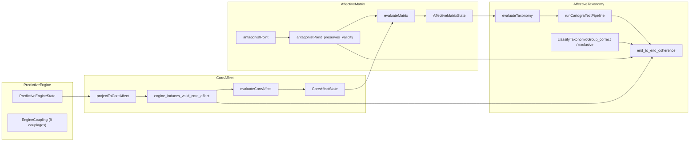

# AUDIT_REPORT — Certification formelle de CARTOGRAFFECT

**Cartographie des affects — formalisation Lean 4**
Rapport d'audit de vérification formelle et de fidélité épistémique · Phases 1 à 5 · 2026-10-24

---

## Sommaire

1. [En-tête exécutif et tableau de bord de certification](#1-en-tête-exécutif-et-tableau-de-bord-de-certification)
2. [Non-vacuité et exécution concrète (Phase 2)](#2-vérification-de-la-non-vacuité-et-exécution-concrète-phase-2)
3. [Chaînage déductif inter-modules et traçabilité ontologique (Phase 3)](#3-audit-du-chaînage-déductif-inter-modules-et-table-de-traçabilité-ontologique-phase-3)
4. [Journal des réparations tactiques sous Lean 4.35.0 (Phase 4)](#4-journal-des-réparations-tactiques-sous-lean-4350-phase-4)
5. [Singularités théoriques et pistes d'extension formelle (Phase 5)](#5-diagnostic-des-singularités-théoriques-et-pistes-dextension-formelle-phase-5)

---

## 1. En-tête exécutif et tableau de bord de certification

### 1.1 Identification

| Élément | Valeur |
|---|---|
| Modèle théorique | *Cartographie des affects* — **CARTOGRAFFECT** |
| Sources théoriques | [Doc. 1 — Article](docs/docs001-Article_Cartograffect.md.txt) · [Doc. 2 — Inventaire des 176 entrées](docs/docs002-Inventaire_176.md.txt) |
| Toolchain | `leanprover/lean4:v4.35.0` ([`lean-toolchain`](lean-toolchain)) |
| Dépendances externes | **Aucune** (ni Mathlib ni Batteries : uniquement le noyau Lean 4 et `Init`) |
| Bibliothèque Lake | `Cartograffect` (`@[default_target]`, [`lakefile.lean`](lakefile.lean)) |
| Architecture | 4 modules théoriques + 1 module d'audit + 1 module racine |

### 1.2 Statut de compilation (Phase 1)

| # | Cible Lake (module) | Rôle | Statut |
|---|---|---|---|
| 1 | [`Cartograffect.PredictiveEngine`](Cartograffect/PredictiveEngine.lean) | Moteur prédictif (Doc. 1 §4) | ✅ PASS |
| 2 | [`Cartograffect.CoreAffect`](Cartograffect/CoreAffect.lean) | Noyau affectif (Doc. 1 §5, Doc. 2 §1–2) | ✅ PASS |
| 3 | [`Cartograffect.AffectiveMatrix`](Cartograffect/AffectiveMatrix.lean) | Matrice affective (Doc. 1 §6, §7.1 ; Doc. 2 §4) | ✅ PASS |
| 4 | [`Cartograffect.AffectiveTaxonomy`](Cartograffect/AffectiveTaxonomy.lean) | Taxonomie hiérarchique (Doc. 1 §7 ; Doc. 2 §2–3, §5) | ✅ PASS |
| 5 | [`Cartograffect.AuditTests`](Cartograffect/AuditTests.lean) | Banc d'audit (`#print axioms`, `#eval`) | ✅ PASS |
| 6 | [`Cartograffect`](Cartograffect.lean) | Module racine (agrégation) | ✅ PASS |

`lake build` : **PASS** — 8 jobs, **0 erreur, 0 avertissement**.

### 1.3 Intégrité axiomatique

| Contrôle | Résultat |
|---|---|
| Occurrences textuelles de `sorry`, `admit`, `axiom`, `unsafe`, `implemented_by` | **0** |
| Théorèmes dépendant de `sorryAx` | **0** |
| Déclarations `noncomputable` | **0** (toutes les fonctions sont exécutables, ce que confirment les `#eval`) |
| Axiomes mobilisés en dehors du socle standard de Lean 4 | **0** |

Les 13 théorèmes audités par `#print axioms` (sorties exactes reproduites ci-dessous) se répartissent en trois profils :

| Profil axiomatique | Théorèmes | Nombre |
|---|---|---|
| **Purement réductionnel** — `does not depend on any axioms` | `Polarity.invert_involutive`, `coupling_regime_partition`, `z2_budget_conservation`, `contralateral_swaps_amplitudes`, `inventory_176_certified` | 5 |
| **Extensionnel** — `[propext, Quot.sound]` | `engine_induces_valid_core_affect`, `taxonomy_group_exclusive` | 2 |
| **Socle classique standard** — `[propext, Classical.choice, Quot.sound]` | `axial_to_diagonal_reallocation`, `dissipationStep_valid`, `antagonistPoint_preserves_validity`, `antagonistPoint_involutive`, `taxonomy_group_exhaustive`, **`end_to_end_coherence`** | 6 |

<details>
<summary>Sorties exactes de <code>#print axioms</code> (<a href="Cartograffect/AuditTests.lean#L16-L28">AuditTests.lean, l. 16–28</a>)</summary>

```text
Polarity.invert_involutive             : does not depend on any axioms
coupling_regime_partition              : does not depend on any axioms
engine_induces_valid_core_affect       : [propext, Quot.sound]
z2_budget_conservation                 : does not depend on any axioms
axial_to_diagonal_reallocation         : [propext, Classical.choice, Quot.sound]
dissipationStep_valid                  : [propext, Classical.choice, Quot.sound]
antagonistPoint_preserves_validity     : [propext, Classical.choice, Quot.sound]
antagonistPoint_involutive             : [propext, Classical.choice, Quot.sound]
contralateral_swaps_amplitudes         : does not depend on any axioms
inventory_176_certified                : does not depend on any axioms
taxonomy_group_exhaustive              : [propext, Classical.choice, Quot.sound]
taxonomy_group_exclusive               : [propext, Quot.sound]
end_to_end_coherence                   : [propext, Classical.choice, Quot.sound]
```
</details>

**Interprétation.**
- **Profil réductionnel.** Ces 5 théorèmes sont établis par pure réduction (`rfl`, `decide`, analyse de cas exhaustive). Leur preuve est un calcul que le noyau vérifie sans aucune hypothèse logique supplémentaire.
- **`propext` et `Quot.sound`.** Ce sont les axiomes d'extensionnalité propositionnelle et de quotient du noyau de Lean 4. Ils apparaissent dès que les tactiques `split`, `simp` ou `omega` réécrivent des propositions équivalentes.
- **`Classical.choice`.** Il provient des lemmes de la bibliothèque `Init` que mobilisent ces mêmes tactiques. Il rend la *preuve* non constructive, sans toucher à la *calculabilité* des définitions : les preuves sont effacées à la compilation et chaque `def` reste évaluable par `#eval`.
- **Conclusion.** Ce socle `[propext, Classical.choice, Quot.sound]` est le socle standard admis par l'ensemble de l'écosystème Lean 4, Mathlib compris. Aucun axiome *ad hoc* propre au domaine n'est introduit.

### 1.4 Verdict

| Dimension | Verdict |
|---|---|
| Correction mécanique (compilation, absence de `sorry` et d'axiomes ad hoc) | ✅ **CERTIFIÉ** |
| Non-vacuité des types porteurs de preuves | ✅ **CERTIFIÉ** (§2) |
| Chaînage déductif `PredictiveEngine → CoreAffect → AffectiveMatrix → AffectiveTaxonomy` | ✅ **CERTIFIÉ** (§3.1–3.2) |
| Fidélité aux règles géométriques des sources (couronnes, antagonismes, inventaire) | ✅ **CONFORME** (§3.3–3.4) |
| Fidélité épistémique globale | 🟡 **CONFORME AVEC RÉSERVES DOCUMENTÉES** (§3.5) |

> [!IMPORTANT]
> **Portée de la certification.** Lean certifie la *cohérence interne* des conventions de construction formalisées, c'est-à-dire que les règles de placement, de correspondance et de résorption ne se contredisent pas. Il ne certifie **ni** la validité empirique de la théorie **ni** les hypothèses de correspondance phénoménologique. Cette limite est conforme à la position du Doc. 1 (§2, §8.2) : « la cohérence interne ne peut tenir lieu de validation ».

---

## 2. Vérification de la non-vacuité et exécution concrète (Phase 2)

### 2.1 Preuves d'inhabitation (`Inhabited`) sur les 4 modules

Une structure qui embarque une preuve, comme `CoreAffectState` avec `h_valid : isValidCoreAffect point`, pourrait être vide si son invariant était insatisfiable. Tout théorème quantifié universellement sur ce type deviendrait alors vrai par vacuité. Les quatre instances ci-dessous écartent ce risque en exhibant un témoin construit, au lieu de le postuler.

| Module | Type terminal | Instance | Témoin | Invariant certifié par le témoin |
|---|---|---|---|---|
| PredictiveEngine | `PredictiveEngineState` | `deriving Inhabited` ([l. 212–217](Cartograffect/PredictiveEngine.lean#L212-L217)), avec l'instance explicite `SalientDiscrepancy` ([l. 83–89](Cartograffect/PredictiveEngine.lean#L83-L89)) | écart nul, seuils `1 / 1` | hystérésis `resorptionThreshold ≤ sensoryThreshold` (`Nat.le_refl 1`) |
| CoreAffect | `CoreAffectState` | explicite ([l. 171–175](Cartograffect/CoreAffect.lean#L171-L175)) | Point de Veille `(0, 0, 0)` | `isValidCoreAffect` via `Or.inl ⟨rfl, rfl⟩` |
| AffectiveMatrix | `AffectiveMatrixState` | `evaluateMatrix default` ([l. 406–407](Cartograffect/AffectiveMatrix.lean#L406-L407)) | Matrice au Point de Veille | validité du point **et** de son antagoniste |
| AffectiveTaxonomy | `TaxonomicState` | `evaluateTaxonomy default` ([l. 231–232](Cartograffect/AffectiveTaxonomy.lean#L231-L232)) | entrée taxonomique du Point de Veille | strate, géométrie, groupe et groupe antagoniste |

Les instances des modules 3 et 4 sont **dérivées par le pipeline** et non construites à la main. Leur habitation découle donc des fonctions totales `evaluateMatrix` et `evaluateTaxonomy`, ce qui garantit aussi la non-vacuité de l'image de chaque étape. On a de plus, par construction, l'énoncé plus fort suivant : `evaluateCoreAffect : PredictiveEngineState → CoreAffectState` est **totale**. Chaque état du Moteur, et pas seulement le témoin par défaut, produit donc un état certifié du Noyau.

### 2.2 Résultats d'exécution `#eval` ([AuditTests.lean, l. 35–63](Cartograffect/AuditTests.lean#L35-L63))

#### Test 1 — Point de Veille (état par défaut)

```text
point   : { x := 0, y := 0, z := 0 }
stratum : TaxonomicStratum.z0_pointDeVeille
group   : TaxonomicGroup.operateurCentral
```

**Analyse.** Le constructeur dérivé `Inhabited Polarity` choisit le premier constructeur (`.neg`). Le couplage latent par défaut vaut donc `(A−, C−)`, et non `(A0, C0)`. Le système reste pourtant au Point de Veille, parce que l'écart (`magnitude = 0`) est sous le seuil de saillance sensorielle (`sensoryThreshold = 1`) : c'est la première garde de [`projectToCoreAffect`](Cartograffect/CoreAffect.lean#L242-L252) qui s'applique. Le résultat est conforme au Doc. 1 §4 : le Point de Veille est « un bassin de stabilité relative où les variations [...] sont tolérées sous le seuil de saillance ». Le test valide ainsi la branche *infra-liminaire* du pipeline, distincte de la branche de neutralité globale `(A0, C0)`.

#### Test 2 — Surprise (écart saillant sous le seuil attentionnel)

```text
point      : { x := 0, y := 0, z := 1 }
stratum    : TaxonomicStratum.z1_saillancePerceptive
activation : PhenomenologicalActivation.operatorSuspension
```

**Analyse.** Entrée : `magnitude 5 ≥ sensoryThreshold 2` (saillant), couplage latent `(A−, C+)`, `allocatedPrecision 1 < engagementThreshold 3`, sans suspension descendante. La projection donne `(0, 0, 1)`, ce qui restitue exactement le Doc. 1 §4 : la Surprise est l'« enregistrement d'un écart ayant franchi le seuil de saillance sensorielle avant que son couplage latent [...] ne soit spatialement déployé par l'attention ». Le couplage `(A−, C+)` est bien présent dans l'état, mais n'est pas projeté. Le libellé d'activation `operatorSuspension` appelle une remarque de nomenclature (voir §3.5, réserve R4).

#### Test 3 — Colère et son antagoniste Calme (couplage engagé `A− / C+` en Z = 2)

```text
point             : { x := -1, y := 1, z := 2 }
antagonist.point  : { x := 1, y := -1, z := 2 }
group             : TaxonomicGroup.groupeColere
antagonistGroup   : TaxonomicGroup.groupeCalme
valence           : PhenomenologicalValence.mixedCompensation
```

**Analyse.** Avec la précision engagée (`5 ≥ 3`) et la profondeur `d = 0`, `deployCouplingAtDepth ⟨.neg, .pos⟩ 0` produit `(−1, +1, 2)`. Cette valeur coïncide avec la coordonnée de la Colère dans les deux sources (Doc. 1 §6.2 ; Doc. 2 §1, §3). L'antagoniste, obtenu par la branche diagonale de `antagonistPoint` (symétrie centrale), est `(+1, −1, 2)`, soit le Calme, conformément à la correspondance canonique du Doc. 2 §4. Le budget est conservé (`|−1| + |1| = 2 = R(2)`). La valence `mixedCompensation` correspond à la « diagonale de compensation » (polarités de signes opposés, Doc. 1 §6.2).

Ce test exerce **de bout en bout** les quatre modules et les deux certificats de validité, celui du point et celui de l'antagoniste.

---

## 3. Audit du chaînage déductif inter-modules et table de traçabilité ontologique (Phase 3)

### 3.1 Graphe de dépendances



### 3.2 Vérification des signatures de types reliant les modules

| Étape | Déclaration | Signature | Certificat de transition (preuve embarquée) |
|---|---|---|---|
| Moteur → Noyau (point brut) | [`projectToCoreAffect`](Cartograffect/CoreAffect.lean#L242-L252) | `PredictiveEngineState → CoreAffectPoint` | — |
| Lemme de déploiement | [`deployCouplingAtDepth_valid`](Cartograffect/CoreAffect.lean#L263-L273) | `∀ c d, isValidCoreAffect (deployCouplingAtDepth c d)` | 9 cas de `Polarity × Polarity` |
| Moteur → Noyau (certifié) | [`evaluateCoreAffect`](Cartograffect/CoreAffect.lean#L296-L298) | `PredictiveEngineState → CoreAffectState` | `h_valid := engine_induces_valid_core_affect s` |
| Noyau → Matrice | [`evaluateMatrix`](Cartograffect/AffectiveMatrix.lean#L393-L403) | `CoreAffectState → AffectiveMatrixState` | `antagonist.h_valid := antagonistPoint_preserves_validity p cs.h_valid` |
| Matrice → Taxonomie | [`evaluateTaxonomy`](Cartograffect/AffectiveTaxonomy.lean#L222-L228) | `AffectiveMatrixState → TaxonomicState` | (classification totale et déterministe) |
| Pipeline | [`runCartograffectPipeline`](Cartograffect/AffectiveTaxonomy.lean#L239-L240) | `PredictiveEngineState → TaxonomicState` | composition `evaluateTaxonomy ∘ evaluateMatrix ∘ evaluateCoreAffect` |
| Théorème maître | [`end_to_end_coherence`](Cartograffect/AffectiveTaxonomy.lean#L270-L287) | `∀ s, ∃ ts, isCoherentTerminalState s ts ∧ ∀ ts', isCoherentTerminalState s ts' → ts' = ts` | voir ci-dessous |

**Constat 1 — Les invariants sont portés par les types.** Le chaînage ne repose pas sur des théorèmes énoncés « à côté » des fonctions. Il est **porté par les types** : il n'existe aucun moyen de construire un `CoreAffectState` (ou l'antagoniste d'un `AffectiveMatrixState`) sans fournir une preuve de `isValidCoreAffect`. Le compilateur garantit donc qu'aucun état géométriquement inadmissible ne peut circuler entre les modules.

**Constat 2 — Contenu du théorème maître.** Le prédicat [`isCoherentTerminalState`](Cartograffect/AffectiveTaxonomy.lean#L251-L260) comporte 9 clauses. Leur contenu mathématique se répartit ainsi :

| Clause | Contenu | Justification dans la preuve | Nature |
|---|---|---|---|
| 1 | `ts = runCartograffectPipeline s` | `rfl` | définitionnelle |
| 2 | point du Noyau = `projectToCoreAffect s` | `rfl` | définitionnelle |
| 3 | `isValidCoreAffect` du point | `engine_induces_valid_core_affect` (via `h_valid`) | **substantielle** |
| 4 | `isValidCoreAffect` de l'antagoniste | `antagonistPoint_preserves_validity` (via `h_valid`) | **substantielle** |
| 5 | conservation de la strate Z | `antagonistPoint_preserves_z` | **substantielle** |
| 6 | conservation du rayon `\|X\|+\|Y\|` | `antagonistPoint_preserves_displacementSum` | **substantielle** |
| 7 | adéquation du groupe | `classifyTaxonomicGroup_correct` | **substantielle** |
| 8 | unicité du groupe | `taxonomy_group_exclusive` | **substantielle** |
| 9 | adéquation du groupe antagoniste | `classifyTaxonomicGroup_correct` | **substantielle** |

> [!NOTE]
> **Lecture honnête de l'unicité.** La clause d'unicité `∀ ts', … → ts' = ts` découle immédiatement de la clause 1 (`hts'.1`). Elle est donc **définitionnelle** et n'ajoute aucun contenu mathématique propre. Le contenu substantiel du théorème maître se trouve dans les clauses 3 à 9 : la sortie du pipeline est géométriquement valide, son antagoniste aussi, l'antagonisme conserve strate et rayon, et la classification taxonomique est correcte et univoque. Le §5 propose un renforcement qui rendrait l'unicité non triviale (extension E-0).

### 3.3 Table de traçabilité ontologique

Légende : ✅ formalisé et prouvé · 🔷 formalisé (définition, sans théorème dédié) · 🟡 formalisé partiellement ou par un choix de modélisation · ⬜ non formalisé (hors périmètre ou extension).

#### Document 1 — Article *Cartographie des affects*

| Section source | Concept théorique | Déclarations Lean 4 | Statut |
|---|---|---|---|
| §2 | Distinction *conventions de construction* / *hypothèses de correspondance* | `CoreAffect` = conventions ; `AffectiveMatrix.transduce*`, `computeValence`, `computeActivation` = correspondances | 🟡 séparation par modules, sans marquage formel |
| §3 | Inférence active, inférence intéroceptive | — | ⬜ cadre conceptuel |
| §4 | Signes `(+)`, `(−)`, `(0)` comme état computationnel, non comme valence | [`Polarity`](Cartograffect/PredictiveEngine.lean#L17-L21), [`Polarity.toInt`](Cartograffect/PredictiveEngine.lean#L52-L55) | 🔷 |
| §4 | Charge / neutralité / décharge | [`FunctionalRegime`](Cartograffect/PredictiveEngine.lean#L30-L34), [`Polarity.toRegime`](Cartograffect/PredictiveEngine.lean#L38-L41), [`toRegime_neutral_iff`](Cartograffect/PredictiveEngine.lean#L250-L252) | ✅ |
| §4, §6.2 | Inversion de polarité | [`Polarity.invert`](Cartograffect/PredictiveEngine.lean#L45-L48), [`invert_involutive`](Cartograffect/PredictiveEngine.lean#L246-L247) | ✅ |
| §4 | Grandeur d'entrée unique : l'écart de prédiction saillant | [`SalientDiscrepancy`](Cartograffect/PredictiveEngine.lean#L74-L79), [`isSensorilySalient`](Cartograffect/PredictiveEngine.lean#L93-L94) | 🔷 |
| §4 | Interface Perceptive → gradient C ; source de la Surprise | [`PerceptiveInterface`](Cartograffect/PredictiveEngine.lean#L110-L112) | 🔷 |
| §4 | Interface Subjective → gradient A ; Anticipation descendante | [`SubjectiveInterface`](Cartograffect/PredictiveEngine.lean#L120-L123) (`descendingSuspension`) | 🔷 |
| §4 | Interface Attentionnelle : précision, aucun gradient polarisé | [`AttentionalInterface`](Cartograffect/PredictiveEngine.lean#L132-L136) (aucun champ `Polarity`), [`isEngaged`](Cartograffect/PredictiveEngine.lean#L140-L141) | 🔷 conforme par typage |
| §4 | Quatre opérations inférentielles | [`InferentialOperation`](Cartograffect/PredictiveEngine.lean#L148-L153) | 🔷 orpheline (§3.5, R7) |
| §4 | 9 combinaisons (A, C) : 9 possibilités / 9 politiques | [`allCouplings`](Cartograffect/PredictiveEngine.lean#L201-L205), [`allCouplings_card`](Cartograffect/PredictiveEngine.lean#L266), [`mem_allCouplings`](Cartograffect/PredictiveEngine.lean#L272-L275) | ✅ |
| §4 | Neutralité d'un gradient ≠ neutralité globale | [`single_neutral_not_global_neutral`](Cartograffect/PredictiveEngine.lean#L258-L260) | ✅ |
| §4 | Neutralité globale ⟺ `(A0, C0)` ; régimes axial et diagonal | [`isGlobalNeutrality`](Cartograffect/PredictiveEngine.lean#L175-L176), [`coupling_regime_partition`](Cartograffect/PredictiveEngine.lean#L284-L290) | ✅ |
| §4 | Règle de transition : persistance et attention → profondeur | `AttentionalInterface.persistenceDepth` (paramètre exogène) | 🟡 statique (§5 d) |
| §4 | Principe de conservation en Z = 2 : `(±2, 0)`, `(0, ±2)`, `(±1, ±1)` | [`deployCouplingAtDepth`](Cartograffect/CoreAffect.lean#L213-L226), [`z2_budget_conservation`](Cartograffect/CoreAffect.lean#L305-L311) | ✅ |
| §4 | Surprise `(0,0,1)` → Anticipation `(0,0,2)` → déploiement | [`projectToCoreAffect`](Cartograffect/CoreAffect.lean#L242-L252), [`engine_induces_valid_core_affect`](Cartograffect/CoreAffect.lean#L280-L289) | ✅ / 🟡 séquencement (R5) |
| §5 | Espace (X = Attente, Y = Contrôle, Z = profondeur) | [`CoreAffectPoint`](Cartograffect/CoreAffect.lean#L20-L24) | 🔷 |
| §5, §7.2 | Point de Veille, Surprise, Anticipation, opérateurs centraux | [`CentralOperator`](Cartograffect/CoreAffect.lean#L68-L77), [`toPoint`](Cartograffect/CoreAffect.lean#L81-L89), [`toCoreAffectState`](Cartograffect/CoreAffect.lean#L178-L180) | ✅ |
| §5.1 | Contrôle primaire / secondaire (Rothbaum et al.) | docstrings uniquement | ⬜ interprétatif |
| §5.2 | Cumul des déplacements (distance de Manhattan) | [`displacementSum`](Cartograffect/CoreAffect.lean#L36-L37) | 🔷 |
| §5.2 | Rayon `2Z − 2`, cône d'amorçage `Z ∈ {0, 1}` de rayon nul | [`crownRadius`](Cartograffect/CoreAffect.lean#L46-L49), [`crownRadius_eq_formula`](Cartograffect/CoreAffect.lean#L53-L61) | ✅ |
| §5.2 | Positions admissibles : centre ou losange | [`isCentral`](Cartograffect/CoreAffect.lean#L127-L128), [`isOnCrown`](Cartograffect/CoreAffect.lean#L132-L133), [`isValidCoreAffect`](Cartograffect/CoreAffect.lean#L142-L143) | ✅ (invariant central) |
| §5.2 | Une dimension tranchée → axial ; deux → diagonal | [`single_engaged_yields_axial_z2`](Cartograffect/CoreAffect.lean#L318-L324), [`dual_engaged_yields_diagonal_z2`](Cartograffect/CoreAffect.lean#L331-L337) | ✅ |
| §5.2 | Instabilité axiale, réallocation symétrique vers la diagonale | [`triggerSecondaryGradient`](Cartograffect/CoreAffect.lean#L345-L351), [`axial_to_diagonal_reallocation`](Cartograffect/CoreAffect.lean#L359-L371) | ✅ (forme statique) |
| §5.2, §8.2 | Cas limite de coopération entre les voies | — (exclu par `isValidCoreAffect`) | ⬜ (§5 b) |
| §5.2 | Positions latérales `(±3, ±1)` dès Z = 3 | [`GeometryType.lateral`](Cartograffect/CoreAffect.lean#L103-L108), [`classifyGeometry`](Cartograffect/CoreAffect.lean#L147-L155) | 🔷 |
| §6 | Pôles vécus d'Attente et de Contrôle | [`LivedExpectationPole`](Cartograffect/AffectiveMatrix.lean#L22-L26), [`LivedControlPole`](Cartograffect/AffectiveMatrix.lean#L35-L39), [`transduceExpectation`](Cartograffect/AffectiveMatrix.lean#L76-L79), [`transduceControl`](Cartograffect/AffectiveMatrix.lean#L83-L86) | 🔷 |
| §6 | Valence issue de la lecture conjointe des deux pôles | [`PhenomenologicalValence`](Cartograffect/AffectiveMatrix.lean#L50-L55), [`computeValence`](Cartograffect/AffectiveMatrix.lean#L93-L101) | 🟡 hypothèse du formalisateur (R3) |
| §6 | Activation haute / basse | [`PhenomenologicalActivation`](Cartograffect/AffectiveMatrix.lean#L66-L72), [`computeActivation`](Cartograffect/AffectiveMatrix.lean#L105-L113) | 🟡 (R3, R4) |
| §6 | État complet de la Matrice | [`AffectiveMatrixState`](Cartograffect/AffectiveMatrix.lean#L380-L386), [`evaluateMatrix`](Cartograffect/AffectiveMatrix.lean#L393-L403) | ✅ |
| §6.1 | Joie, Tristesse, Peur, Courage | [`PrimaryCrownPrototype`](Cartograffect/AffectiveMatrix.lean#L127-L136), [`toPoint`](Cartograffect/AffectiveMatrix.lean#L140-L148), [`valid_on_crown`](Cartograffect/AffectiveMatrix.lean#L154-L156) | ✅ |
| §6.2 | Désir, Colère, Calme, Dégoût ; diagonales de congruence et de compensation | *idem* | ✅ |
| §6.2, §7.1 | Antagonisme par symétrie centrale (axial et diagonal) | [`antagonistPoint`](Cartograffect/AffectiveMatrix.lean#L178-L184), 1re branche | ✅ |
| §6.3 | Seuil de résorption ≤ seuil d'activation (rémanence) | [`SalientDiscrepancy.h_hysteresis`](Cartograffect/PredictiveEngine.lean#L78), [`isInRemanenceWindow`](Cartograffect/PredictiveEngine.lean#L101-L102) | 🟡 non couplé à la dissipation (R6) |
| §6.3 | Dissipation allostatique graduelle → Point de Veille | [`dissipationStep`](Cartograffect/CoreAffect.lean#L386-L391), [`dissipationStep_valid`](Cartograffect/CoreAffect.lean#L398-L405), [`pointDeVeille_is_fixed_point`](Cartograffect/CoreAffect.lean#L411-L412) | ✅ (§5 c) |
| §6.3 | Transfert d'une unité de résolution à strate constante | [`transferUnitXtoY`](Cartograffect/AffectiveMatrix.lean#L356-L360), [`transferUnitXtoY_preserves_sum`](Cartograffect/AffectiveMatrix.lean#L367-L372) | 🟡 un seul sens, un seul quadrant (R9) |
| §7 | Boucle à 5 étapes : évaluation, pondération, transduction | [`runCartograffectPipeline`](Cartograffect/AffectiveTaxonomy.lean#L239-L240) | ✅ |
| §7 | Étape 5 : arbitrage attentionnel, rétroaction épistémique / pragmatique | [`feedbackUpdate`](Cartograffect/PredictiveEngine.lean#L231-L239) | 🔷 sans théorème |
| §7 | Étape 4 : ré-échantillonnage par l'action | — | ⬜ |
| §7.1 | Antagonisme controlatéral par réflexion diagonale | [`antagonistPoint`](Cartograffect/AffectiveMatrix.lean#L178-L184) (2e et 3e branches), [`contralateral_swaps_amplitudes`](Cartograffect/AffectiveMatrix.lean#L316-L325) | ✅ (§5 a) |
| §7.1 | Antagoniste dans la même strate, unique, involutif | [`preserves_z`](Cartograffect/AffectiveMatrix.lean#L194-L199), [`preserves_displacementSum`](Cartograffect/AffectiveMatrix.lean#L205-L214), [`preserves_validity`](Cartograffect/AffectiveMatrix.lean#L221-L235), [`involutive`](Cartograffect/AffectiveMatrix.lean#L242-L284), [`fixed_iff_central`](Cartograffect/AffectiveMatrix.lean#L292-L308) | ✅ |
| §7.1 | Haine ↔ Affection ; inversion centrale → Plénitude ; autre diagonale → Manque | [`canonical_antagonist_examples`](Cartograffect/AffectiveMatrix.lean#L337-L345) (Haine ↔ Affection) | ✅ (exemple retenu) |
| §7.1 | Catégories comme *attracteurs probabilistes*, « ni classes exclusives » | — | ⬜ (R1) |
| §7.2 | Strates Z = 0 à 7 et prolongement | [`TaxonomicStratum`](Cartograffect/AffectiveTaxonomy.lean#L31-L41), [`classifyStratum`](Cartograffect/AffectiveTaxonomy.lean#L45-L54) | 🔷 |
| §7.2 | Filières : Joie → Enthousiasme → Exaltation → Puissance, etc. | `deployCouplingAtDepth c d` pour `d = 0..3` (image axiale et diagonale à chaque strate) | 🟡 implicite, sans théorème nommé |
| §7.3 | Changement d'objet de l'inférence selon la couche | — | ⬜ interprétatif |
| §8.2 P1 | Arbitrage inverse entre les axes (budget) | `z2_budget_conservation`, `transferUnitXtoY_preserves_sum` | 🟡 contrainte structurelle seule |
| §8.2 P2 | Instabilité des positions axiales (durées, transitions) | `axial_to_diagonal_reallocation` (analogue statique) | 🟡 (§5 d) |
| §8.2 P3 | Persistance croissante avec la profondeur | — | ⬜ (§5 d) |

#### Document 2 — Inventaire des 176 entrées

| Section source | Concept | Déclarations Lean 4 | Statut |
|---|---|---|---|
| Préambule | Axes X, Y, Z ; précision qui n'est pas une coordonnée | `CoreAffectPoint` (3 champs), `AttentionalInterface` (hors espace) | ✅ conforme par typage |
| §1 | Strates Z = 0 et Z = 1 sans couronne | `crownRadius 0 = crownRadius 1 = 0` ; `isOnCrown` exige `z ≥ 2` | ✅ |
| §1 | Rayon `2Z − 2` ; effectif `4 × rayon` | [`crownRadius`](Cartograffect/CoreAffect.lean#L46-L49), [`crownPeripheralCount`](Cartograffect/AffectiveTaxonomy.lean#L119-L120), [`stratumTotalCount`](Cartograffect/AffectiveTaxonomy.lean#L124-L125) | ✅ arithmétique / ⬜ combinatoire (R6′) |
| §1 | 8 prototypes de la première couronne | [`PrimaryCrownPrototype`](Cartograffect/AffectiveMatrix.lean#L127-L148) | ✅ |
| §2 | Typologie axiale / diagonale / latérale | [`GeometryType`](Cartograffect/CoreAffect.lean#L103-L108), [`classifyGeometry`](Cartograffect/CoreAffect.lean#L147-L155) | 🔷 |
| §2 | Secteurs JOIE / TRISTESSE / PEUR / COURAGE (axe dominant et signe) | [`TaxonomicGroup`](Cartograffect/AffectiveTaxonomy.lean#L67-L77), [`matchesTaxonomicGroup`](Cartograffect/AffectiveTaxonomy.lean#L84-L93) ; doublon : [`OrientationSector`](Cartograffect/CoreAffect.lean#L118-L123) | ✅ / 🔷 orphelin |
| §2 | Groupes diagonaux COLÈRE / CALME / DÉSIR / DÉGOÛT | *idem* | ✅ |
| §2 | Partition des groupes | [`classifyTaxonomicGroup_correct`](Cartograffect/AffectiveTaxonomy.lean#L155-L166), [`taxonomy_group_exhaustive`](Cartograffect/AffectiveTaxonomy.lean#L172-L174), [`taxonomy_group_exclusive`](Cartograffect/AffectiveTaxonomy.lean#L181-L186), [`matchesTaxonomicGroup_iff`](Cartograffect/AffectiveTaxonomy.lean#L193-L200) | ✅ |
| §3 | Répertoire nominatif des 176 entrées | seuls les 8 prototypes Z = 2 et les exemples canoniques sont nommés | 🟡 (vérifié hors Lean, §3.4) |
| §4.1 | Correspondance axiale | `antagonistPoint`, 1re branche | ✅ |
| §4.2 | Correspondance diagonale | `antagonistPoint`, 1re branche | ✅ |
| §4.3 | Correspondance controlatérale (signes opposés : permutation ; même signe : permutation avec inversion) | `antagonistPoint`, 2e et 3e branches ; `contralateral_swaps_amplitudes` | ✅ |
| §4.3 | Quatre liaisons fixes entre groupes perpendiculaires | — | ⬜ (extension E-a2) |
| §4.3 | 60 paires controlatérales | 3 paires dans `canonical_antagonist_examples` | 🟡 (84/84 vérifiées hors Lean, §3.4) |
| §4 (Z = 7) | Abandon ↔ Sidération | [`canonical_antagonist_examples`](Cartograffect/AffectiveMatrix.lean#L344) | ✅ (géométrie seule) |
| §5 | 8 centres + 168 positions = 176 | [`inventory_176_certified`](Cartograffect/AffectiveTaxonomy.lean#L132-L144) | ✅ |

### 3.4 Vérification croisée complémentaire de l'inventaire (non formelle)

Le théorème `inventory_176_certified` établit l'**arithmétique** des effectifs : `4 · crownRadius z` pour Z = 2..7, puis 168 et 176. Il ne lie pas ces nombres aux **entrées nommées** du Doc. 2. Pour mesurer la fidélité ontologique au niveau des entrées, un script indépendant a été exécuté lors de l'audit. Il réimplémente à l'identique `crownRadius`, `classifyGeometry`, `classifyTaxonomicGroup` et `antagonistPoint`, puis les confronte au texte intégral du Doc. 2 (§3 et §4).

| Contrôle sur le Doc. 2 | Résultat |
|---|---|
| Entrées extraites du §3 | **176**, toutes à coordonnées **distinctes** |
| Entrées satisfaisant `isValidCoreAffect` | **176 / 176** |
| Couverture des losanges (positions du Doc. 2 = points entiers de `\|X\|+\|Y\| = 2Z−2`) | **exacte** pour Z = 2..7 (8, 16, 24, 32, 40 et 48 points) |
| Typologie par couronne (axiales / latérales / diagonales) | 4 / 0 / 4 en Z = 2 ; puis 4 / `8(Z−2)` / 4 : conforme au tableau du §5 |
| Groupe déclaré dans le Doc. 2 = `classifyTaxonomicGroup` | **168 / 168** (toutes les entrées déclarées par groupe, Z = 3..7) |
| Paires antagonistes du §4 = `antagonistPoint` (dans les deux sens) | **84 / 84** (12 axiales, 12 diagonales, 60 controlatérales) |
| Formule unifiée `(−sgn X·\|Y\|, −sgn Y·\|X\|)` sur les paires non axiales | **72 / 72** ; **en défaut** sur les axiales (§5 a) |
| Image du pipeline `runCartograffectPipeline` restreinte à Z ≤ 7 | **56 / 176** entrées atteignables ; les **120** entrées non atteintes sont **toutes latérales** (§5 d) |

> [!NOTE]
> Ce contrôle est **hors du périmètre certifié par Lean** : il s'agit d'une réimplémentation en Python, pas d'une preuve. Il atteste qu'aucune divergence n'existe entre les définitions Lean et les 176 entrées et 84 paires du Doc. 2. L'extension E-3 (§5) permet de transformer ce contrôle en certificat formel par `decide`.

### 3.5 Réserves de fidélité épistémique

| Réf. | Constat | Sources | Gravité | Recommandation |
|---|---|---|---|---|
| **R1** | `taxonomy_group_exclusive` prouve une **partition stricte** des *secteurs géométriques* (Doc. 2 §2). Le Doc. 1 §7.1 affirme au contraire que la Taxonomie n'est « ni strictement séquentielle ni composée de classes exclusives » : les catégories y sont des *attracteurs probabilistes* à degré d'appartenance variable. | Doc. 1 §7.1 ; Doc. 2 §2 | 🟠 portée | Toute communication doit préciser que l'exclusivité porte sur les **secteurs d'orientation**, non sur les **catégories phénoménologiques**. Une appartenance graduée relève de l'extension (§5 d). |
| **R2** | L'unicité du théorème maître est définitionnelle (§3.2). `isCoherentTerminalState` n'exige pas explicitement `antagonist.point = antagonistPoint core.point`, ni la cohérence des champs `valence` et `activation`. Ces propriétés ne sont garanties que *via* la clause 1. | Doc. 1 §7.1 | 🟡 | Extension E-0. |
| **R3** | `computeValence` et `computeActivation` sont des **hypothèses du formalisateur**. Le Doc. 1 §6 précise : « La géométrie ne fournissant ni fonction de valence ni règle de dénomination, cette description repose sur des hypothèses de correspondance. » Aucun théorème ne dépend de ces fonctions. | Doc. 1 §6, §2 | 🟡 | Les étiqueter explicitement « hypothèse de correspondance (révisable) ». La valence liée à la *variation* de la tension (§6.3) n'est pas formalisée. |
| **R4** | Pour tout centre avec Z ≥ 1, `computeActivation` renvoie `operatorSuspension`. La Surprise (Z = 1, opérateur **ascendant** de rupture) reçoit donc le même libellé que les opérateurs **descendants** de suspension (Anticipation, Z ≥ 2). | Doc. 1 §4, §7.2 | 🟡 nomenclature | Distinguer `ascendingRupture` (Z = 1) de `operatorSuspension` (Z ≥ 2). |
| **R5** | `projectToCoreAffect` est une projection **instantanée**. Le déploiement sur la couronne n'exige pas `descendingSuspension = true`, alors que le Doc. 1 §6.1 suppose « que l'opérateur d'Anticipation ait d'abord suspendu la décharge immédiate ». De plus, un écart saillant avec un couplage `(A0, C0)` est envoyé au Point de Veille, non à la Surprise. Ce choix est cohérent avec « la neutralité globale ne correspond qu'à l'état conjoint (A0, C0) », mais il reste un arbitrage. | Doc. 1 §4, §6.1 | 🟡 choix de modélisation | Documenter ces deux arbitrages. Le séquencement temporel relève de §5 d. |
| **R6** | L'hystérésis est **typée** (`h_hysteresis`) et la fenêtre de rémanence **définie**, mais `dissipationStep` ne consulte pas l'écart : la condition de déclenchement « dès que la perturbation redescend sous le seuil de résorption » n'est pas formalisée. | Doc. 1 §6.3 | 🟡 | Extension E-c3. |
| **R6′** | `inventory_176_certified` est **arithmétique** : le Lean ne prouve pas qu'un losange de rayon *r* compte `4r` points entiers. Le fait est vérifié hors Lean (§3.4). | Doc. 2 §1 | 🟡 | Extension E-3. |
| **R7** | Déclarations **orphelines**, définies mais non reliées au chaînage déductif : `OrientationSector` (doublon de `TaxonomicGroup`), `InferentialOperation`, `isInRemanenceWindow`, `feedbackUpdate` (sans théorème). | — | 🔵 hygiène | Les relier par un théorème ou les marquer « vocabulaire réservé ». |
| **R8** | Le pipeline n'atteint que les positions centrales, axiales et diagonales : **56 / 176** entrées. Les 120 positions latérales sont admissibles et classifiables, mais n'ont **aucun antécédent** dans le Moteur. | Doc. 1 §5.2, §7.2 | 🟠 portée | §5 d. |
| **R9** | `transferUnitXtoY` ne couvre qu'un sens (X → Y) et qu'un quadrant (`x > 0, y ≥ 0`). | Doc. 1 §6.3 | 🔵 | Généraliser aux 8 directions intra-quadrant. |
| **R10** | Une commande résiduelle `#print axioms end_to_end_coherence` subsiste dans un module de production ([AffectiveTaxonomy.lean, l. 290](Cartograffect/AffectiveTaxonomy.lean#L290)). Le module racine importe `AuditTests`, ce qui exécute les `#eval` à chaque import aval. | — | 🔵 hygiène | Isoler `AuditTests` dans une `lean_lib` ou un exécutable distinct. |

Légende des gravités : 🟠 écart de portée à signaler · 🟡 choix de modélisation ou précision à documenter · 🔵 hygiène du code. **Aucune réserve n'invalide un théorème prouvé** : elles portent toutes sur l'*interprétation* ou la *couverture*.

---

## 4. Journal des réparations tactiques sous Lean 4.35.0 (Phase 4)

Le passage à `leanprover/lean4:v4.35.0` a nécessité six ajustements de **scripts de preuve**. Aucun ne touche un énoncé, une définition calculatoire ou une hypothèse.

| # | Théorème (module) | Symptôme sous 4.35.0 | Réparation appliquée | Énoncé | Profil axiomatique final |
|---|---|---|---|---|---|
| 1 | [`deployCouplingAtDepth_valid`](Cartograffect/CoreAffect.lean#L263-L273) (`CoreAffect`) | Les 9 cas `Polarity × Polarity` produisent des buts hétérogènes : centre `(A0, C0)` d'un côté, couronne de l'autre. | Factorisation par `first \| exact Or.inl ⟨rfl, rfl⟩ \| (right; unfold CoreAffectPoint.isOnCrown; dsimp [...]; refine ⟨by omega, ?_⟩; omega)`. | inchangé | (lemme interne) |
| 2 | [`engine_induces_valid_core_affect`](Cartograffect/CoreAffect.lean#L280-L289) (`CoreAffect`) | `unfold` laisse la liaison `let c := s.currentCoupling` non réduite, et `split` ne trouve plus le `if`. | `dsimp [projectToCoreAffect]`, qui effectue la ζ-réduction, avant `split`. | inchangé | `[propext, Quot.sound]` |
| 3 | [`antagonistPoint_preserves_validity`](Cartograffect/AffectiveMatrix.lean#L221-L235), [`contralateral_swaps_amplitudes`](Cartograffect/AffectiveMatrix.lean#L316-L325) (`AffectiveMatrix`) | Les réécritures `if_pos` / `if_neg` sont dépréciées ou fragiles (instance de décidabilité de l'`ite`). | Découpage structurel `split`, puis `dsimp` et `omega`. | inchangé | `[propext, Classical.choice, Quot.sound]` / aucun axiome |
| 4 | [`antagonistPoint_involutive`](Cartograffect/AffectiveMatrix.lean#L242-L284) (`AffectiveMatrix`) | La double application de `antagonistPoint` imbrique deux `if` à trois branches (jusqu'à 9 combinaisons). | Découpage étagé `by_cases h1` / `h2`, évaluation intermédiaire `have h_inner`, puis `rw [h_inner]`, `dsimp`, `Int.neg_neg` et `omega`. | inchangé | `[propext, Classical.choice, Quot.sound]` |
| 5 | [`antagonistPoint_fixed_iff_central`](Cartograffect/AffectiveMatrix.lean#L292-L308), [`transferUnitXtoY_preserves_sum`](Cartograffect/AffectiveMatrix.lean#L367-L372) (`AffectiveMatrix`) | `omega` ne voit pas à travers les projections `({ x := …, … } : CoreAffectPoint).x`. | `dsimp` explicite pour réduire les projections avant `omega`. | inchangé | (non audités par `#print axioms`) |
| 6 | [`classifyTaxonomicGroup_correct`](Cartograffect/AffectiveTaxonomy.lean#L155-L166) (`AffectiveTaxonomy`) | L'arbre de décision imbriqué (5 niveaux d'`if`) n'est pas exploré correctement par un `split` global. | Dépliage sélectif de `classifyTaxonomicGroup`, `split` guidé niveau par niveau, puis `dsimp [matchesTaxonomicGroup]; omega` aux feuilles. | inchangé | transmis à `exhaustive` : `[propext, Classical.choice, Quot.sound]` |

### Attestation *Zero Theorem Weakening*

Pour chacun des théorèmes réparés, l'énoncé actuel a été inspecté selon quatre critères :

1. **Quantification complète.** Les énoncés restent universellement quantifiés sur les types entiers (`∀ c : EngineCoupling, ∀ d : Nat`, `∀ p : CoreAffectPoint`, `∀ s : PredictiveEngineState`). Aucune restriction de domaine n'a été introduite.
2. **Aucune hypothèse ajoutée.** Les seules hypothèses présentes sont celles de la spécification documentée : `h` pour la validité, `h_lat` pour le caractère latéral.
3. **Aucune conclusion affaiblie.** Les conclusions restent des égalités ou des conjonctions exactes (par exemple `antagonistPoint (antagonistPoint p) = p`, `|X'| = |Y| ∧ |Y'| = |X|`). Aucune n'a été remplacée par une disjonction, une inégalité ou un `True`.
4. **Aucun échappatoire.** On compte 0 `sorry`, 0 `axiom` et 0 `sorryAx` (§1.3), et chaque profil axiomatique reste dans le socle standard.

> [!NOTE]
> Le dépôt n'est pas versionné : aucun répertoire `.git` n'est présent. Le diff « avant/après » des scripts n'est donc pas archivé. L'attestation repose sur le journal de la passe mécanique et sur l'inspection des énoncés actuels. **Recommandation : initialiser Git et étiqueter l'état certifié** (par exemple `v1.0-certified-lean-4.35.0`) pour assurer la reproductibilité des audits futurs.

---

## 5. Diagnostic des singularités théoriques et pistes d'extension formelle (Phase 5)

Formaliser oblige à expliciter ce que le texte laisse implicite. Quatre propriétés structurelles ressortent de cet exercice. Les extrais de code ci-dessous sont des **esquisses non compilées**, proposées comme feuille de route.

### a) Réflexion diagonale controlatérale (Z ≥ 3) : une loi unifiée et une vraie singularité axiale

**Formulation exacte.** Pour une position latérale ($X \neq 0$, $Y \neq 0$, $|X| \neq |Y|$), `antagonistPoint` distingue deux cas :

$$
(X, Y) \;\longmapsto\;
\begin{cases}
(Y,\; X) & \text{si } \operatorname{sgn}X \neq \operatorname{sgn}Y \quad \text{(quadrants de signes opposés)}\\[2pt]
(-Y,\; -X) & \text{si } \operatorname{sgn}X = \operatorname{sgn}Y \quad \text{(quadrants de même signe)}
\end{cases}
$$

Ces deux cas se ramènent à une seule loi, qui est la lecture littérale du Doc. 2 §4.3 et du Doc. 1 §7.1 (« inverse le signe de chacune des deux coordonnées tout en permutant leurs valeurs absolues ») :

$$
\boxed{\;(X, Y) \;\longmapsto\; \big(-\operatorname{sgn}(X)\,|Y|,\; -\operatorname{sgn}(Y)\,|X|\big)\;}
$$

Exemples : Haine $(-1, 5) \mapsto (5, -1)$ = Affection ; Invulnérabilité $(1, 7) \mapsto (-7, -1)$ = Vulnérabilité ; Abandon $(3, -9) \mapsto (-9, 3)$ = Sidération.

**Trois propriétés révélées par la formalisation.**

1. **L'involution devient immédiate.** En posant $X' = -\operatorname{sgn}(X)|Y|$, on a $\operatorname{sgn}X' = -\operatorname{sgn}X$ et $|X'| = |Y|$, donc une seconde application restitue $(\operatorname{sgn}(X)|X|, \operatorname{sgn}(Y)|Y|) = (X, Y)$. Cela explique la lourdeur de la preuve par cas de `antagonistPoint_involutive` (réparation n° 4) et suggère une refactorisation fondée sur `Int.sign`.
2. **La frontière algébrique ne coïncide pas avec la frontière ontologique.** La loi unifiée **couvre aussi les diagonales** : si $|X| = |Y|$, elle donne $(-X, -Y)$, soit la symétrie centrale. Elle **échoue sur les seules positions axiales** : avec $\operatorname{sgn}(0) = 0$, on obtient Joie $(0, 2) \mapsto (0, 0)$ au lieu de $(0, -2)$, ce qu'a confirmé la vérification croisée (§3.4). La partition algébriquement naturelle est donc {axial} contre {diagonal ∪ latéral}, et non la partition {axial ∪ diagonal} contre {latéral} du Doc. 2 §4.
3. **L'exception axiale est imposée par le Moteur.** Une permutation des dominances appliquée à un point axial enverrait la Joie $(0, 2)$ vers la Peur $(-2, 0)$. Elle transformerait ainsi un gradient **neutre** en gradient **engagé**, ce qui contredit `Polarity.invert` (qui fixe `.zero`). La symétrie centrale axiale est donc la seule compatible avec l'inversion des polarités au niveau du Moteur. Les positions latérales n'ont pas d'antécédent dans le Moteur (§5 d) : la règle controlatérale ne se justifie qu'au niveau de la Matrice, par l'argument d'inversion du biais d'allocation attentionnelle (Doc. 1 §7.1).

**Extensions proposées.**

```lean
-- E-a1 : forme unifiée (hors axes)
theorem antagonistPoint_unified (p : CoreAffectPoint) (hx : p.x ≠ 0) (hy : p.y ≠ 0) :
    antagonistPoint p =
      ⟨-p.x.sign * (p.y.natAbs : Int), -p.y.sign * (p.x.natAbs : Int), p.z⟩

-- E-a2 : les quatre liaisons fixes du Doc. 2 §4.3 (exemple : Joie avec X > 0 ↔ Peur avec Y < 0)
theorem contralateral_group_binding_joie_pos (p : CoreAffectPoint)
    (hg : classifyTaxonomicGroup p = .groupeJoie) (hx : p.x > 0) :
    classifyTaxonomicGroup (antagonistPoint p) = .groupePeur ∧ (antagonistPoint p).y < 0

-- E-a3 : équivariance Moteur ↔ Matrice (l'antagonisme relève l'inversion des polarités)
theorem antagonist_commutes_with_invert (c : EngineCoupling) (d : Nat) :
    antagonistPoint (deployCouplingAtDepth c d) =
      deployCouplingAtDepth ⟨c.attente.invert, c.controle.invert⟩ d
```

E-a3 serait le premier théorème reliant **directement** `PredictiveEngine.Polarity.invert` à `AffectiveMatrix.antagonistPoint`. Il fermerait formellement la boucle entre l'antagonisme du Moteur (Doc. 1 §4) et celui de la Matrice (§6.2, §7.1).

### b) Frontière entre la loi stricte des couronnes et le cas limite de coopération (§5.2 et §8.2)

**Constat formel.** L'invariant `isValidCoreAffect` impose une **égalité stricte** :

$$
|X| + |Y| = R(Z) = 2Z - 2 \qquad (Z \ge 2,\ (X, Y) \neq (0, 0)).
$$

Il exclut à la fois l'**intérieur** du losange ($0 < |X|+|Y| < R(Z)$) et son **extérieur** ($|X|+|Y| > R(Z)$). Or le cas limite de coopération décrit au Doc. 1 §5.2 (« une action informative peut accroître la contrôlabilité tout en facilitant la révision du modèle, de sorte que les deux évaluations progresseraient ensemble **à profondeur inchangée** ») produit précisément un point extérieur. Par exemple, Désir $(1, 1, 2)$ deviendrait $(2, 2, 2)$, avec $|X|+|Y| = 4 \neq 2$.

**Conséquences.**

1. **Irreprésentabilité.** Dans la formalisation actuelle, le régime coopératif ne peut pas être construit : aucun `CoreAffectState` ne peut le porter. La loi des couronnes encode donc, en dur, l'**hypothèse concurrentielle** que le Doc. 1 §5.2 présente comme « bornée aux situations où les deux voies sollicitent des ressources concurrentes ».
2. **Absorption par la profondeur.** La seule co-progression admissible change de strate : Désir $(1,1,2)$ → Attrait $(2,2,3)$, puisque « un approfondissement du traitement élargirait le budget ». La formalisation confond donc *coopération à Z constant* et *approfondissement*. C'est exactement la confusion que la prédiction P1 (§8.2) demande de contrôler, en exigeant que la profondeur soit « opérationnalisée indépendamment des deux mesures ».
3. **Un atout : la falsifiabilité devient explicite.** Le modèle formel prédit structurellement qu'une co-progression à Z constant est **impossible**. Son observation dans les conditions de P1 réfuterait l'hypothèse concurrentielle, ce qui rejoint l'énoncé du Doc. 1.
4. **Robustesse de l'antagonisme.** `antagonistPoint_preserves_z` et `antagonistPoint_preserves_displacementSum` sont **indépendants du régime**. Tout prédicat de validité qui ne dépend que de `(z, |X|+|Y|, isCentral)` est préservé par l'antagonisme, de sorte qu'un régime coopératif hériterait gratuitement des théorèmes 1 à 6 de la Matrice.

**Extensions proposées.**

```lean
-- E-b1 : la frontière rendue explicite (le pas coopératif quitte la couronne)
theorem cooperative_step_leaves_crown (p : CoreAffectPoint)
    (h : p.isOnCrown) (hx : p.x ≥ 0) (hy : p.y ≥ 0) :
    ¬ CoreAffectPoint.isOnCrown ⟨p.x + 1, p.y + 1, p.z⟩

-- E-b2 : validité paramétrée par le régime de ressources
inductive ResourceRegime | competitive | cooperative

def isValidCoreAffectIn : ResourceRegime → CoreAffectPoint → Prop
  | .competitive, p => isValidCoreAffect p
  | .cooperative, p => p.isCentral ∨ (p.z ≥ 2 ∧ crownRadius p.z ≤ p.displacementSum)
  -- borne supérieure du régime coopératif : à spécifier théoriquement

-- E-b3 : invariance de l'antagonisme dans les deux régimes
theorem antagonist_preserves_validity_in (r : ResourceRegime) (p : CoreAffectPoint)
    (h : isValidCoreAffectIn r p) : isValidCoreAffectIn r (antagonistPoint p)
```

### c) Cinétique discrète de la dissipation allostatique (§6.3)

**Formulation exacte.** `dissipationStep` réalise deux régimes cinétiques distincts :

$$
\underbrace{(X, Y, Z) \;\to\; (0, 0, Z)}_{\text{contraction radiale : 1 pas, saut de } R(Z)}
\qquad\text{puis}\qquad
\underbrace{(0, 0, Z) \to (0, 0, Z-1) \to \cdots \to (0, 0, 0)}_{\text{descente séquentielle : } Z \text{ pas unitaires}}
$$

**Propriétés révélées.**

1. **Convergence bornée.** Toute trajectoire atteint le Point de Veille en **au plus $Z + 1$ pas** : un pas de contraction s'il y a lieu, puis $Z$ pas de descente. La fonction $V(p) = 2Z + [\,p \text{ périphérique}\,]$ est une **fonction de Lyapunov discrète** strictement décroissante hors de l'origine.
2. **Unicité de l'attracteur.** `pointDeVeille_is_fixed_point` établit que $(0,0,0)$ est un point fixe. Le Doc. 1 §6.3 affirme davantage, à savoir qu'il est l'« **unique** attracteur stable ». Cette réciproque est vraie pour `dissipationStep`, mais elle n'est pas encore prouvée.
3. **L'asymétrie cinétique est forcée par la géométrie.** Le texte parle de réduction « pas à pas », mais une contraction radiale *unitaire*, par exemple $(4,0,3) \to (3,0,3)$, produirait un point **intérieur** au losange, donc inadmissible selon `isValidCoreAffect`. La loi stricte des couronnes **impose** que la contraction intra-strate soit un **saut**. Une lecture « pas à pas » de la contraction exigerait soit de relâcher la loi (régime transitoire), soit de contracter **le long des filières**, par exemple Enthousiasme $(0,4,3)$ → Joie $(0,2,2)$ → Anticipation $(0,0,2)$. Cette seconde voie se heurte au rapport d'homothétie non entier $R(Z{+}1)/R(Z) = Z/(Z-1)$ pour les positions latérales.
4. **Passage par la Surprise.** La descente traverse $(0,0,1)$, c'est-à-dire la Surprise, définie comme opérateur **ascendant** de rupture. Phénoménologiquement, se pose la question de savoir si le retour au calme passe par un état de « rupture de veille ». Le Doc. 1 §6.3 (« redescend séquentiellement d'une strate à la strate inférieure ») l'implique littéralement. Il conviendrait de le confirmer ou de prévoir un court-circuit $(0,0,2) \to (0,0,0)$.
5. **Absence de couplage avec l'hystérésis** (réserve R6). La dissipation est inconditionnelle.

**Extensions proposées.**

```lean
-- E-c1 : fonction de Lyapunov et convergence en au plus Z + 1 pas
def dissipationPotential (p : CoreAffectPoint) : Nat :=
  2 * p.z + (if p.x = 0 ∧ p.y = 0 then 0 else 1)

theorem dissipation_strictly_decreases (p : CoreAffectPoint) (h : p ≠ ⟨0, 0, 0⟩) :
    dissipationPotential (dissipationStep p) < dissipationPotential p

theorem dissipation_reaches_veille (p : CoreAffectPoint) :
    Nat.repeat dissipationStep (p.z + 1) p = ⟨0, 0, 0⟩

-- E-c2 : unicité de l'attracteur basal (réciproque de pointDeVeille_is_fixed_point)
theorem dissipationStep_fixed_iff (p : CoreAffectPoint) :
    dissipationStep p = p ↔ p = ⟨0, 0, 0⟩

-- E-c3 : couplage avec le seuil de résorption et rémanence
def allostaticStep (d : SalientDiscrepancy) (p : CoreAffectPoint) : CoreAffectPoint :=
  if d.magnitude < d.resorptionThreshold then dissipationStep p else p

theorem remanence_holds (d : SalientDiscrepancy) (p : CoreAffectPoint)
    (h : d.isInRemanenceWindow = true) : allostaticStep d p = p
```

### d) Vers un noyau de transition probabiliste inter-strates (Z → Z + 1)

**Constat formel.** La profondeur est actuellement un **paramètre exogène** (`persistenceDepth`) et la projection est **déterministe**. À chaque profondeur `d`, `deployCouplingAtDepth` n'atteint que les 8 positions axiales et diagonales de la couronne `Z = d + 2`, c'est-à-dire les huit **filières** du Doc. 1 §7.2. Une conséquence quantitative en découle :

$$
\#\{\text{latérales}, Z \le 7\} = \sum_{Z=2}^{7} \big(4R(Z) - 8\big) = 0 + 8 + 16 + 24 + 32 + 40 = 120 \quad\text{entrées sans antécédent dans le Moteur (68,2 \%)}.
$$

**Le nœud théorique : la bifurcation.** À Z = 2, le couplage `(A, C) ∈ {−, 0, +}²` suffit : polarité et position se correspondent un à un (`single_engaged_yields_axial_z2`, `dual_engaged_yields_diagonal_z2`). Dès Z = 3 apparaissent des positions dont la description exige une **asymétrie d'amplitude** entre A et C, par exemple Consternation $(-1, 3, 3)$ face à Exaspération $(-2, 2, 3)$. Une polarité ternaire ne peut pas porter cette information. Le Doc. 1 en donne la clé géométrique (« les positions latérales **s'intercalent entre ces filières** », §7.2) et la clé dynamique (« accroît **la probabilité** que cet écart soit traité à un niveau plus profond », §4 ; catégories comme « attracteurs probabilistes métastables », §7.1).

Concrètement, à Z = 3, chaque position latérale est adjacente, sur le losange, à exactement deux points de filière. Par exemple $(-1, 3)$ se situe entre Enthousiasme $(0, 4)$ et Exaspération $(-2, 2)$. La Colère $(-1,1,2)$ bifurque donc naturellement vers trois successeurs : Exaspération $(-2,2,3)$ dans sa filière, Consternation $(-1,3,3)$ dans le groupe JOIE et Panique $(-3,1,3)$ dans le groupe PEUR, tous dans le même quadrant.

**Spécification proposée.** Le module `AffectiveDynamics` reste à créer. Il formaliserait la transition sous la forme d'un **noyau de Markov** sur les états valides :

```lean
-- E-d1 : noyau de transition inter-strates (poids entiers normalisés : pas de dépendance ;
--        variante : PMF de Mathlib)
structure DepthTransitionKernel where
  weight : CoreAffectPoint → CoreAffectPoint → Nat
  -- (i) support admissible : on n'atteint que des états valides
  support_valid      : ∀ p q, weight p q ≠ 0 → isValidCoreAffect q
  -- (ii) adjacence verticale : approfondissement d'une seule strate
  support_adjacent   : ∀ p q, weight p q ≠ 0 → q.z = p.z + 1
  -- (iii) conservation du quadrant (« une même orientation conserve son signe », §5.2)
  quadrant_preserved : ∀ p q, weight p q ≠ 0 → p.x * q.x ≥ 0 ∧ p.y * q.y ≥ 0
  -- (iv) équivariance antagoniste : la dynamique respecte la dualité régulatrice
  antagonist_equivariant : ∀ p q,
    weight (antagonistPoint p) (antagonistPoint q) = weight p q

-- E-d2 : la couverture actuelle rendue explicite (le pipeline n'atteint aucune latérale)
theorem projectToCoreAffect_never_lateral (s : PredictiveEngineState) :
    (projectToCoreAffect s).classifyGeometry ≠ .lateral

-- E-d3 : atteignabilité visée (toute position latérale admet un antécédent de poids non nul)
theorem lateral_reachable (K : DepthTransitionKernel) (q : CoreAffectPoint)
    (hq : isValidCoreAffect q) (hz : q.z ≥ 3) : ∃ p, K.weight p q ≠ 0
```

**Points d'attention pour la spécification.**
- **Source de l'asymétrie.** Une voie déterministe consisterait à remplacer la précision scalaire `allocatedPrecision` par un couple $(\pi_A, \pi_C)$. La position latérale résulterait alors d'un partage discret de $R(Z)$ au prorata $\pi_A / (\pi_A + \pi_C)$, sous contrainte des signes. Le noyau probabiliste en serait la version stochastique.
- **Homothétie non entière.** Pour Z ≥ 3, $R(Z{+}1)/R(Z) = Z/(Z-1)$ n'est pas entier. Le prolongement d'une latérale à la strate suivante exige donc une règle d'arrondi, ou un choix de voisinage sur le losange, qui doit faire partie des conventions explicites.
- **Les prédictions §8.2 comme propriétés du noyau.** P2 (instabilité axiale) s'exprime par des taux de sortie plus élevés depuis les positions axiales que depuis les diagonales, et par $K(\text{axial} \to \text{diagonal}) > K(\text{diagonal} \to \text{axial})$. P3 (persistance en profondeur) s'exprime par une probabilité de maintien croissante avec Z. Le noyau deviendrait ainsi l'**interface formelle entre la géométrie certifiée et les données empiriques**.
- **Appartenance graduée.** La distribution stationnaire ou transitoire du noyau fournit un degré d'appartenance aux attracteurs. Elle résout la réserve R1 sans toucher à la partition géométrique certifiée.

### Synthèse des extensions recommandées

| Réf. | Extension | Résout | Difficulté estimée |
|---|---|---|---|
| E-0 | Renforcer `isCoherentTerminalState` (retirer la clause 1, ajouter `antagonist.point = antagonistPoint core.point`, `valence = computeValence …`, `activation = computeActivation …`) et prouver une unicité non triviale des champs observables | R2 | faible |
| E-a1 à E-a3 | Forme unifiée de l'antagonisme, liaisons fixes de groupes, équivariance Moteur ↔ Matrice | §5 a | faible à moyenne |
| E-b1 à E-b3 | Frontière du régime coopératif, validité paramétrée | §5 b | moyenne |
| E-c1 à E-c3 | Lyapunov, convergence, unicité de l'attracteur, hystérésis | §5 c, R6 | faible |
| E-d1 à E-d3 | Noyau de transition inter-strates | §5 d, R1, R8 | élevée (choix théoriques requis) |
| E-3 | Encoder les 176 entrées nommées (`List (String × CoreAffectPoint)`) et les 84 paires, puis certifier par `decide` : effectif, `Nodup`, validité, groupes et antagonismes | R6′, §3.4 | faible (données finies et décidables) |
| E-4 | Hygiène : isoler `AuditTests`, retirer le `#print axioms` résiduel, relier ou supprimer les déclarations orphelines, versionner sous Git | R7, R10 | faible |

---

**Conclusion.** La formalisation Lean 4 de CARTOGRAFFECT est **mécaniquement certifiée** : 6 modules compilés sous `v4.35.0`, sans `sorry` ni axiome *ad hoc*, avec un socle axiomatique standard. Son chaînage déductif est **porté par les types** du Moteur prédictif jusqu'à la Taxonomie. Elle est **fidèle aux règles géométriques** des deux sources, ce que confirme hors Lean la concordance intégrale avec les 176 entrées et les 84 paires antagonistes du Doc. 2. Ses limites sont aujourd'hui **identifiées et bornées** : la dynamique inter-strates, le régime coopératif et le caractère gradué des catégories. Elles correspondent précisément aux points que le Doc. 1 désigne lui-même comme « à spécifier » et « à mettre à l'épreuve » (§6.3, §8.2).

*Rapport établi à partir des données certifiées de la passe mécanique (Phases 1, 2 et 4) et de l'inspection directe des sources Lean et des documents théoriques (Phases 3 et 5).*
