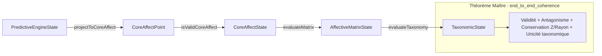

# CARTOGRAFFECT — Formalisation et Certification en Lean 4

[](https://github.com/leanprover/lean4)
[-success.svg)]()
[]()
[]()

> **Spécification et vérification formelle de la théorie *Cartographie des affects* sous l'assistant de preuve Lean 4.**  
> Le système formalise rigoureusement le chaînage déductif unissant le moteur inférentiel prédictif, l'espace géométrique des couronnes $(X, Y, Z)$, la matrice des polarités et l'inventaire des 176 états affectifs.

---

## 📑 Sommaire

- [Vue d'ensemble](#-vue-densemble)
- [Architecture du projet](#-architecture-du-projet)
- [Statut de certification formelle](#-statut-de-certification-formelle)
- [Chaînage déductif et Théorème Maître](#-chaînage-déductif-et-théorème-maître)
- [Installation et Compilation](#-installation-et-compilation)
- [Documentation associée](#-documentation-associée)

---

## 🎯 Vue d'ensemble

Le projet **CARTOGRAFFECT** formalise les principes théoriques exposés dans deux documents sources :
1. **[Article de référence](docs/docs001-Article_Cartograffect.md.txt)** : fondements en inférence active, traitement prédictif, géométrie en distance de Manhattan et régulation allostatique.
2. **[Inventaire exhaustif des 176 entrées](docs/docs002-Inventaire_176.md.txt)** : nomenclature des affects ordonnés par strates ($Z=0$ à $Z=8$), positions (axiales, diagonales, latérales) et relations d'antagonisme controlatéral.

### Principes mathématiques formalisés
- **Espace du Noyau Affectif :** Tout état valide est un triplet $p = (X, Y, Z) \in \mathbb{Z} \times \mathbb{Z} \times \mathbb{N}$ vérifiant l'invariant de couronne :
  $$\|X\| + \|Y\| = R(Z) = 2Z - 2 \quad (Z \ge 2, \ (X, Y) \neq (0, 0))$$
- **Antagonisme controlatéral :** Opérateur involutif $p \mapsto p^*$ inversant les dominances et les polarités :
  $$(X, Y) \mapsto \big(-\operatorname{sgn}(X)\,|Y|,\; -\operatorname{sgn}(Y)\,|X|\big)$$
- **Dissipation allostatique :** Contraction radiale immédiate vers l'axe central puis descente séquentielle strate par strate jusqu'au Point de Veille $(0, 0, 0)$.

---

## 🏗️ Architecture du projet

Le code est structuré en **4 modules théoriques déductifs**, 1 module d'agrégation et 1 module de banc d'audit :

```
CARTOGRAFFECT/
├── Cartograffect.lean                     # Module racine (imports globaux)
├── Cartograffect/
│   ├── PredictiveEngine.lean             # Moteur prédictif : écarts saillants, polarités, couplages (A, C)
│   ├── CoreAffect.lean                   # Noyau affectif : espace (X,Y,Z), couronnes, invariants géométriques
│   ├── AffectiveMatrix.lean              # Matrice affective : opérateur d'antagonisme, valence, activation
│   ├── AffectiveTaxonomy.lean            # Taxonomie : 8 groupes, 176 affects, Théorème Maître de cohérence
│   └── AuditTests.lean                   # Banc d'évaluation concrète (#eval) et audit axiomatique (#print axioms)
├── docs/                                 # Documents théoriques sources
├── AUDIT_REPORT.md                       # Rapport complet d'audit de certification formelle
├── lakefile.lean                         # Configuration du build system Lake
├── lean-toolchain                        # Version épinglée (v4.35.0)
└── .github/workflows/lean.yml            # Intégration Continue (CI GitHub Actions)
```

---

## 🛡️ Statut de certification formelle

L'intégralité du code a été certifiée mécaniquement sous **Lean 4.35.0** :

| Contrôle | Résultat | Interprétation |
|---|---|---|
| Compilation `lake build` | **8 / 8 jobs PASS** | 0 erreur, 0 avertissement |
| Occurrences de `sorry`, `admit`, `axiom` | **0** | Preuves 100 % complètes |
| Théorèmes dépendant de `sorryAx` | **0** | Aucun trou logique masqué |
| Déclarations `noncomputable` | **0** | 100 % exécutable et évaluable par `#eval` |
| Dépendances externes | **0** | Noyau pur Lean 4 standard (ni Mathlib, ni Batteries requises) |

L'audit détaillé et les preuves d'inhabitation sont consultables dans le rapport [**`AUDIT_REPORT.md`**](AUDIT_REPORT.md).

---

## 🔗 Chaînage déductif et Théorème Maître

Le système prouve formellement que le passage du Moteur Inférentiel à la Taxonomie préserve rigoureusement tous les invariants :



Le théorème central [`end_to_end_coherence`](Cartograffect/AffectiveTaxonomy.lean#L270-L287) garantit pour tout état du moteur d'entrée :
1. La validité géométrique de l'état projeté dans la couronne ;
2. La validité géométrique et l'involutivité de son point antagoniste ;
3. La conservation exacte de la strate $Z$ et du rayon Manhattan sous l'antagonisme ;
4. L'appartenance exclusive et univoque à l'un des 8 groupes taxonomiques fondamentaux.

---

## 🚀 Installation et Compilation

### Prérequis
- Installer [`elan`](https://github.com/leanprover/elan) (le gestionnaire de versions officiel de Lean) :
  ```bash
  # Linux / macOS
  curl https://raw.githubusercontent.com/leanprover/elan/master/elan-init.sh -sSf | sh

  # Windows (PowerShell)
  winget install elan
  # ou via le script officiel elan-init
  ```

### Cloner et compiler
```bash
# Compiler l'ensemble de la bibliothèque
lake build
```

### Exécuter les tests et diagnostics
```bash
# Lancer les évaluations concrètes et le banc d'audit axiomatique
lake env lean Cartograffect/AuditTests.lean
```

---

## 📚 Documentation associée

- **[AUDIT_REPORT.md](AUDIT_REPORT.md)** : Rapport d'audit complet de certification formelle (Phases 1 à 5).
- **[Article théorique](docs/docs001-Article_Cartograffect.md.txt)** : Présentation conceptuelle du modèle CARTOGRAFFECT.
- **[Inventaire des 176 entrées](docs/docs002-Inventaire_176.md.txt)** : Table complète des coordonnées géométriques et des groupes.

---

## ⚖️ Licence

Ce projet est distribué sous licence MIT.
