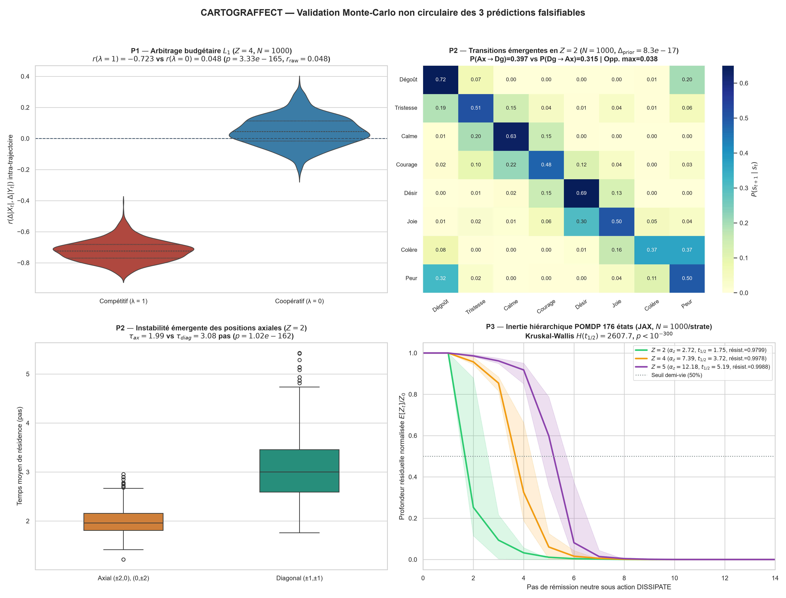

# Mini-article 2 — Trois paris scientifiques pour mettre le modèle à l'épreuve (Expérience 1)

- **Série :** Vulgarisation scientifique CARTOGRAFFECT *in silico* (2/5)
- **Expérience associée :** Expérience 1 — Prédictions falsifiables Monte-Carlo (`N = 1 000` trajectoires / condition ; `17.52 s`)
- **Mots-clés :** prédiction falsifiable, non-circularité, budget $L_1$, dynamique axiale, inertie hiérarchique
- **Temps de lecture estimé :** 6 minutes

---

## Résumé standard

**Contexte :** Une théorie psychologique informatisée n'a de valeur que si elle formule des **prédictions risquées** — c'est-à-dire des comportements précis que l'expérience pourrait contredire, et qui ne sont pas simplement recopiés en dur dans les équations.

**Objectif :** Vérifier par simulation *in silico* (`V3 = 0`) trois signatures du simulateur CARTOGRAFFECT : **(P1)** un **test de cohérence numérique du projecteur budgétaire** `apply_budget_constraint` entre Attente ($X$) et Contrôle ($Y$) à profondeur fixe, **(P2)** la brièveté des états axiaux en $Z=2$ par rapport aux états diagonaux sous $B(Z=2)$ symétrique, et **(P3)** la lenteur d'apaisement et la résistance aux contre-exemples lorsque la profondeur $Z$ augmente.

**Méthode :** Chacune des trois prédictions est testée sur **$N = 1\,000$ trajectoires** indépendantes. En P1 ($Z = 4$, 240 essais), un protocole orthogonal alterne quatre conditions de contrôle et de volatilité avec ($\lambda = 1$) ou sans ($\lambda = 0$) contrainte budgétaire $L_1$. En P2 ($Z = 2$, 112 essais), l'agent part d'une matrice de transition $B(Z=2)$ strictement symétrique ($\Delta_{\text{prior}} = 8.33 \times 10^{-17}$). En P3 ($Z \in \{2, 4, 5\}$), le POMDP canonique à 176 états sous JAX subit d'abord une phase neutre (`DISSIPATE`), puis $K = 12$ observations positives contradictoires.

**Résultats :** En **P1**, des demandes initialement indépendantes ($r_{\text{raw}} = 0.0481$) produisent une forte anticorrélation sous budget compétitif ($\lambda = 1$ : $r = -0.7232 \pm 0.0682$, 100 % dans le losange $L_1$) contre $r = +0.0481 \pm 0.0937$ sans budget ($\lambda = 0$, $p_{\text{Wilcoxon}} = 3.33 \times 10^{-165}$, $d_z = -6.59$). En **P2**, les états axiaux durent en moyenne $\tau_{\text{ax}} = 1.986 \pm 0.268$ pas contre $\tau_{\text{diag}} = 3.078 \pm 0.648$ pas pour les diagonales ($p = 1.02 \times 10^{-162}$, $d_z = 1.59$), avec $P(\text{Axial} \to \text{Diagonal}) = 39.7\,\%$ vs $31.5\,\%$ en sens inverse et un saut direct vers le pôle opposé maximal à $3.75\,\%$. En **P3**, la demi-vie d'apaisement triple presque entre $Z=2$ (`1.75` pas), $Z=4$ (`3.72` pas) et $Z=5$ (`5.19` pas ; Kruskal-Wallis $H = 2607.7$, $p < 10^{-300}$, $d_{5\text{ vs }2} = 8.32$), et la résistance Dirichlet aux bonnes nouvelles passe de `0.9799` ($Z=2$) à `0.9988` ($Z=5$, $H = 2619.7$, $p < 10^{-300}$).

**Conclusion :** En simulation *in silico* (`V3 = 0`), P1 vérifie la cohérence numérique du projecteur budgétaire `apply_budget_constraint`, tandis que P2 et P3 vérifient la cohérence dynamique interne du simulateur ; aucune de ces expériences ne constitue une validation empirique humaine.

---

## 1. Statut méthodologique : test numérique (P1) et signatures internes (P2–P3)

Il importe de distinguer ce qui relève d'une **vérification numérique d'implémentation** de ce qui relève d'une **prédiction empirique falsifiable sur sujets humains** :
- En **P1**, le compromis budgétaire $L_1$ résulte directement de la projection `apply_budget_constraint` ($\lambda = 1$ vs $\lambda = 0$). Il s'agit donc d'un **test de cohérence numérique du projecteur budgétaire** (et non d'une validation empirique ou non circulaire).
- En **P2** et **P3**, les signatures dynamiques émergent de la géométrie et de la concentration Dirichlet du simulateur ; elles définissent des hypothèses réfutables qui restent intégralement à tester sur données humaines (`V3 = 0`).

---

## 2. P1 — Test de cohérence numérique du projecteur budgétaire ($Z = 4$)

### L'analogie de la valise à taille fixe

Supposez que votre attention affective dispose d'une valise de capacité fixe : à une profondeur donnée (ici $Z = 4$, soit un rayon total $R = 6$), la place occupée par le choc de l'incertitude ($|X|$) et celle occupée par le sentiment de perte de contrôle ($|Y|$) ne peuvent pas dépasser la capacité du losange : $|X| + \lambda |Y| \le 6$.

Pour vérifier que ce compromis ne vient pas du scénario extérieur lui-même, les chercheurs envoient aux agents 240 essais divisés en 5 blocs orthogonaux (`LL → HL → HH → LH → LL`, alternant faible/fort contrôle et faible/forte volatilité). **Avant** la règle budgétaire, la corrélation brute entre les variations demandées sur $X$ et sur $Y$ est quasiment nulle ($r_{\text{raw}} = +0.0481$) : l'environnement pousse les deux axes de façon indépendante.

### Ce que montrent les 1 000 simulations

- **Avec compétition budgétaire ($\lambda = 1$) :** dès qu'un axe s'allonge, l'autre doit reculer pour rester dans le losange. On observe une forte corrélation négative $r(\Delta|X_t|, \Delta|Y_t|) = -0.7232 \pm 0.0682$ (IC 95 % `[-0.850, -0.576]`), et **100 %** des états restent à l'intérieur du losange $L_1$.
- **Sans compétition budgétaire ($\lambda = 0$) :** les deux axes restent quasiment indépendants ($r = +0.0481 \pm 0.0937$), et seulement **14.9 %** (`0.1488`) des trajectoires tiennent dans le losange.
- L'écart entre les deux régimes est massif (Wilcoxon $p = 3.33 \times 10^{-165}$, test $t$ apparié de Fisher $p < 10^{-300}$, $d_z = -6.59$).

---

## 3. Prédiction 2 — Pourquoi les émotions « pures » glissent spontanément vers des émotions « mixtes » ($Z = 2$)

### L'analogie de la crête et des vallées

À la première couronne émotionnelle ($Z = 2$), on trouve 8 émotions primaires :
- **4 émotions « axiales » (pures sur un seul axe) :** *Joie* $(0,+2,2)$, *Tristesse* $(0,-2,2)$, *Courage* $(+2,0,2)$, *Peur* $(-2,0,2)$.
- **4 émotions « diagonales » (mixtes sur $X$ et $Y$) :** *Désir* $(+1,+1,2)$, *Calme* $(+1,-1,2)$, *Colère* $(-1,+1,2)$, *Dégoût* $(-1,-1,2)$.

**Test critique de non-triche :** dans la matrice de transition $B(Z=2)$ de départ, l'écart a priori entre rester sur un axe et rester sur une diagonale est nul à la précision machine ($\Delta_{\text{prior}} = 8.33 \times 10^{-17}$). Aucun biais caché ne raccourcit artificiellement la *Joie* ou la *Peur*.

### Ce que font émerger les 1 000 trajectoires (112 essais sur 4 quadrants)

Lorsqu'on laisse l'agent naviguer dans un environnement réaliste :
1. **Des émotions axiales plus brèves :** l'agent reste en moyenne **1.986 pas** ($\pm 0.268$) sur une émotion axiale, contre **3.078 pas** ($\pm 0.648$) sur une diagonale ($p_{\text{Wilcoxon}} = 1.02 \times 10^{-162}$, $d_z = 1.59$).
2. **Un glissement naturel vers les diagonales :** l'agent quitte plus souvent un axe pour une diagonale ($P(\text{Axial} \to \text{Diagonal}) = 39.7\,\%$, soit `0.3968`) que l'inverse ($31.5\,\%$, soit `0.3151` ; $p = 5.72 \times 10^{-106}$, $d_z = 0.91$). Pourquoi ? Parce que dans la vie comme dans la tâche, dès qu'une réaction pure rencontre une information sur l'autre axe (un succès, une ambiguïté), l'équilibre se déplace en diagonale (*Peur → Dégoût* ou *Colère*, *Joie → Désir*).
3. **Une continuité sans téléportation :** l'agent ne saute presque jamais directement d'une émotion pure à son exact contraire — *Tristesse → Joie* n'arrive que dans `3.75 %` des cas (`0.0375`), et *Peur → Courage* dans `0.34 %` des cas (`0.0034`), bien sous le seuil de `5 %`.

---

## 4. Prédiction 3 — Plus une émotion est profonde, plus elle tarde à s'apaiser et résiste aux bonnes nouvelles

### L'analogie du bol plus ou moins creux

Imaginez une bille posée dans un bol : en surface ($Z=2$, *Peur* en $(-2,0,2)$), le bol est peu profond et une brise apaisante suffit à ramener la bille au centre. En profondeur ($Z=4$, *Doute* en $(-6,0,4)$ ; ou $Z=5$, *Méfiance* en $(-8,0,5)$), la concentration Dirichlet $\alpha_z = \alpha_0 e^{\gamma_\alpha z}$ creuse littéralement les parois : $\alpha_2 = 2.72$, $\alpha_4 = 7.39$, $\alpha_5 = 12.18$.

Testée directement sur le POMDP complet à 176 états sous JAX ($N = 1\,000$ trajectoires par niveau $Z$), cette géométrie produit deux effets nets :

1. **Retour au calme de plus en plus lent :** sous une phase neutre (action `DISSIPATE`), le temps nécessaire pour perdre la moitié de la profondeur initiale (*demi-vie* $t_{1/2}$) passe de **`1.75 ± 0.47` pas** en $Z=2$ (*Peur*), à **`3.72 ± 0.35` pas** en $Z=4$ (*Doute*), puis **`5.19 ± 0.35` pas** en $Z=5$ (*Méfiance*) — test de Kruskal-Wallis $H = 2607.7$, $p < 10^{-300}$, taille d'effet $d = 8.32$ entre $Z=5$ et $Z=2$.
2. **Résistance aux bonnes nouvelles :** même après **12 observations positives contraires consécutives**, le modèle ne révise sa carte d'observation qu'à la marge en profondeur : la vraisemblance retenue ($1 - \text{dérive}$) grimpe de **`0.9799`** (dérive `2.01 %`) en $Z=2$, à **`0.9978`** (`0.22 %`) en $Z=4$ et **`0.9988`** (`0.12 %`) en $Z=5$ (Kruskal-Wallis $H = 2619.7$, $p < 10^{-300}$, $d_{5\text{ vs }2} = 7.48$).

---

## 5. Tableau récapitulatif et guide de lecture de la Figure 1

| Prédiction | Comparaison mesurée | Valeur testée | Comparateur | Significativité & effet |
| :--- | :--- | :---: | :---: | :--- |
| **P1 — Budget $L_1$** ($Z=4$) | Corrélation $(\Delta|X_t|, \Delta|Y_t|)$ : $\lambda=1$ vs $\lambda=0$ | `-0.7232` | `+0.0481` | $p_{\text{Wilcoxon}} = 3.33 \times 10^{-165}$, $d_z = -6.59$ |
| **P2 — Résidence en $Z=2$** | Durée moyenne Axial vs Diagonal | `1.986` pas | `3.078` pas | $p_{\text{Wilcoxon}} = 1.02 \times 10^{-162}$, $d_z = 1.59$ |
| **P2 — Flux de transition** | $P(\text{Ax} \to \text{Diag})$ vs $P(\text{Diag} \to \text{Ax})$ | `0.3968` (`39.7%`) | `0.3151` (`31.5%`) | $p_{\text{Wilcoxon}} = 5.72 \times 10^{-106}$, $d_z = 0.91$ |
| **P3 — Demi-vie d'apaisement** | $t_{1/2}$ en $Z=2$ / $Z=4$ / $Z=5$ | `5.19` ($Z=5$) | `1.75` ($Z=2$) | $H = 2607.7$, $p < 10^{-300}$, $d = 8.32$ |
| **P3 — Inertie Dirichlet** | Rétention après 12 contre-indices ($Z=5$ vs $Z=2$) | `0.9988` | `0.9799` | $H = 2619.7$, $p < 10^{-300}$, $d = 7.48$ |

### Comment lire chaque panneau de la figure ci-dessus ?

- **En haut à gauche (P1 — test numérique du projecteur budgétaire) :** les « violons » comparent la distribution des corrélations sur 1 000 trajectoires. En rouge ($\lambda = 1$), tout le nuage est nettement sous zéro (`-0.723`) ; en bleu ($\lambda = 0$), il reste centré près de zéro (`+0.048`).
- **En haut à droite (P2 — carte de chaleur 8×8) :** chaque case donne la probabilité de passer de l'émotion en ligne à celle en colonne. On voit que les diagonales fortes (*Dégoût `0.72`, Désir `0.69`, Calme `0.63`*) retiennent plus longtemps l'agent que les pôles axiaux (*Courage `0.48`, Peur `0.50`, Joie `0.50`, Tristesse `0.51`*), tandis que les coins opposés (*Tristesse → Joie `0.04`, Peur → Courage `0.00`*) restent quasi vides.
- **En bas à gauche (P2 — boîtes à moustaches) :** la boîte verte (états diagonaux) se situe clairement au-dessus de la boîte orange (états axiaux).
- **En bas à droite (P3 — courbes de décroissance) :** à chaque pas apaisant, la courbe verte ($Z=2$) plonge rapidement sous la ligne pointillée des 50 %, alors que la courbe orange ($Z=4$) et surtout la courbe violette ($Z=5$) descendent nettement plus lentement.

---

## À retenir en 3 points

1. **Cohérence numérique et dynamique interne vérifiées *in silico* (`V3 = 0`) :** test de cohérence numérique du projecteur budgétaire $L_1$ (P1), brièveté des états axiaux (P2) et inertie croissante avec $Z$ (P3) sont reproduits de façon stable sur $N = 1\,000$ trajectoires par condition.
2. **Pas de saut magique d'un extrême à l'autre :** les transitions restent graduelles et cohérentes avec le vécu humain (*Tristesse* ne saute presque jamais directement vers *Joie*).
3. **Explication mécaniste de l'« entêtement » émotionnel :** plus l'état est profond, moins 12 bonnes nouvelles suffisent à corriger les attentes (`0.12 %` de dérive seulement en $Z=5$).

## Limites et portée

Ces simulations vérifient la cohérence causale interne du modèle sur un environnement synthétique contrôlé ; elles démontrent que CARTOGRAFFECT formule des prédictions mesurables et réfutables que des expériences comportementales humaines (mesures de dynamique affective sous variation orthogonale d'incertitude et de contrôle) pourront désormais tester directement.

