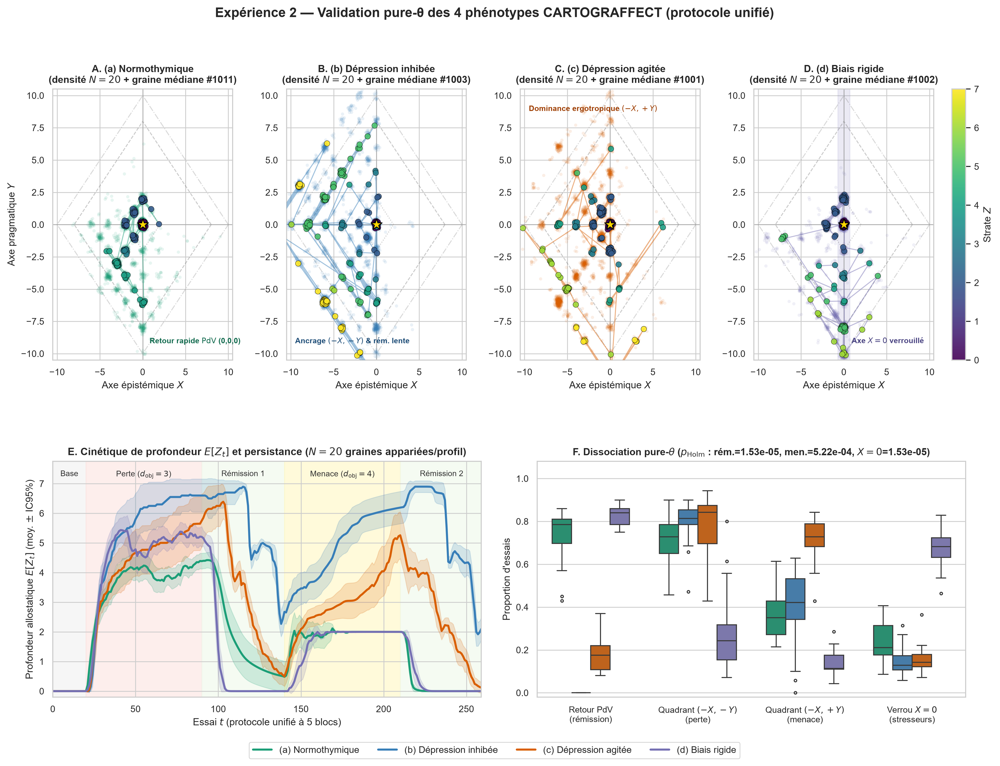

# Mini-article 3 — Quatre façons de traverser le stress : comment 8 paramètres différencient résilience, inhibition, agitation et rigidité (Expérience 2)

- **Série :** Vulgarisation scientifique CARTOGRAFFECT® *in silico* (3/5)
- **Expérience associée :** Expérience 2 — Phénotypes cliniques comparés pure-$\theta$ (`N = 20` graines appariées × 4 profils ; 260 essais ; `341.02 s`)
- **Mots-clés :** phénotypes cliniques, dépression inhibée, dépression agitée, biais rigide, rémission, Holm-Bonferroni
- **Temps de lecture estimé :** 6 minutes

---

## Résumé standard

**Contexte :** En clinique, deux patients traversant des épreuves comparables peuvent évoluer vers des tableaux très différents — rétablissement rapide, effondrement durable avec retrait, tension anxieuse agitée, ou au contraire verrouillage rationnel face à la surprise — qu'un modèle unidimensionnel peine à différencier mécanistiquement.

**Objectif :** Évaluer si le POMDP complet CARTOGRAFFECT® à 176 états peut reproduire quatre phénotypes cliniques contrastés uniquement en ajustant les **8 paramètres individuels $\theta$**, sans modifier aucun autre hyperparamètre du moteur (`pure_theta_only = True`).

**Méthode :** Quatre profils (`a_normothymic`, `b_inhibited`, `c_agitated`, `d_rigid_bias`) ont été exposés par paires de graines aléatoires identiques ($N = 20$ par profil) au même scénario unifié de **260 essais** en 5 blocs : calme initial (20 essais), perte incontrôlable ($p_{\text{ctrl}} = 0.12$, 70 essais), rémission post-perte (50 essais), menace volatile contrôlable ($p_{\text{ctrl}} = 0.88$, $v_{\text{rule}} = 0.35$, 70 essais) et rémission finale (50 essais). Huit hypothèses comparatives ont été testées par test des rangs signés de Wilcoxon apparié bilatéral avec correction de Holm-Bonferroni.

**Résultats :** Toutes les dissociations attendues sont fortement significatives ($p_{\text{Holm}} \in [1.53 \times 10^{-5},\, 9.99 \times 10^{-3}]$, taille d'effet rang-bisériale $r_{rb} \in [0.657,\, 1.000]$). Contrairement au profil normothymique qui récupère rapidement en rémission ($Z_{\text{rém}} = 1.05 \pm 0.54$, retour au *Point de Veille* `73.1 %`), la **dépression inhibée** s'enfonce dans $(-X, -Y)$ sous perte (`79.7 %`, `12/20` graines visitent *Désespoir*) et reste **piégée en rémission** ($Z_{\text{rém}} = 5.54 \pm 0.36$, retour `PdV = 0.0 %`, $Z_{\text{fin}} = 2.14$). La **dépression agitée** bascule massivement dans le quadrant ergotropique $(-X, +Y)$ sous menace volatile (`71.6 %` vs `36.3 %` normothymique ; `5/20` graines visitent *Tourment*) avec récupération partielle ($Z_{\text{rém}} = 3.00 \pm 0.37$, `PdV = 17.9 %`). Enfin, le **biais rigide** ($\tau_A = 0.95 \gg \tau_C = 0.12$) verrouille l'axe $X=0$ pendant les stresseurs (`66.5 %` vs `24.0 %`) sans jamais dériver vers l'apex maniaque *Infini* $(0, +12, 7)$ (`0` visite).

**Conclusion :** Huit paramètres interprétables suffisent à générer, sur un moteur identique, quatre dynamiques affectives cliniquement distinctes et statistiquement robustes.

---

## 1. Le même parcours d'épreuves pour tout le monde (protocole unifié)

Pour que la comparaison soit loyale, les 4 profils simulés vivent **exactement les mêmes 260 épreuves**, graine aléatoire contre graine aléatoire ($N = 20$ « jumeaux de tirage » par profil) :

| Bloc | Phase vécue | Essais | Ce qui se passe concrètement |
| :---: | :--- | :---: | :--- |
| **0** | Calme initial | 1–20 | Règles stables (`0.05`), contrôle élevé (`0.88`), indices clairs (`0.92`), rémission. |
| **1** | **Perte incontrôlable** | 21–90 | Quoi que fasse l'agent, il n'a presque aucun contrôle (`p_ctrl = 0.12`, abstraction `d_obj = 3`). |
| **2** | **Rémission post-perte** | 91–140 | La situation redevient calme et prévisible : qui arrive à récupérer ? |
| **3** | **Menace volatile** | 141–210 | Le contrôle existe (`0.88`), mais les règles basculent souvent (`0.35`, indices flous `0.55`, `d_obj = 4`). |
| **4** | **Rémission finale** | 211–260 | Retour au calme prolongé pour observer la descente finale vers le *Point de Veille*. |

### Deux garanties contre les illusions statistiques

1. **Règle `pure_theta_only = True` :** le programme vérifie automatiquement qu'absolument aucune constante cachée du code ne diffère d'un profil à l'autre. **Seuls les 8 curseurs $\theta$ varient.**
2. **Zéro sélection complaisante :** sur la figure, les bandes colorées montrent l'enveloppe réelle (de 25 % à 75 %) de toutes les 20 trajectoires, et le trait épais trace la trajectoire de la **graine médiane représentative** — jamais un cas extrême choisi pour faire joli.

---

## 2. Les quatre portraits cliniques vulgarisés

### (a) Le profil Normothymique flexible (le « ressort sain »)
- **Réglage clé :** inertie modérée ($\alpha_0 = 0.80, \gamma_\alpha = 0.35$), bonne dissipation ($\eta_{\text{diss}} = 0.45$), seuils équilibrés ($\tau_A = \tau_C = 0.24$), graine médiane `#1011`.
- **Ce qu'il vit :** il ressent clairement la perte et l'incertitude pendant les crises ($Z_{\text{stress}} = 2.72 \pm 0.28$), avec des réactions proportionnées (*Colère*, *Peur*, *Rejet*, *Joie*), puis **rebondit vite dès l'accalmie** : en rémission, sa profondeur moyenne retombe à $Z_{\text{rém}} = 1.05 \pm 0.54$, il passe **73.1 %** du temps de rémission revenu au *Point de Veille* $(0,0,0)$ et termine à $Z_{\text{fin}} \approx 0.00$.

### (b) La Dépression inhibée (le « piège en eau profonde »)
- **Réglage clé :** très forte inertie de base ($\alpha_0 = 3.50$), emballement rapide avec la profondeur ($\gamma_\alpha = 0.75$), frein quasi bloqué sur la dissipation ($\eta_{\text{diss}} = 0.03$), graine médiane `#1003`.
- **Ce qu'il vit :** dès le bloc de perte incontrôlable, il passe **79.7 %** de son temps dans le quadrant $(-X, -Y)$ (incertitude + impuissance). Sur les 20 graines, **20/20** plongent jusqu'à $Z \ge 5$ dans ce quadrant, et **12/20** atteignent même *Désespoir* $(-1, -7, 5)$. Surtout, quand la rémission arrive, **il ne remonte pas** : profondeur moyenne $Z_{\text{rém}} = 5.54 \pm 0.36$, **0.0 %** de retour au *Point de Veille*, et il termine encore coincé à $Z_{\text{fin}} = 2.14$ dans des états lourds (*Dissolution*, *Déréliction*, *Méfiance*, *Sidération*, *Néant*).

### (c) La Dépression agitée / anxieuse (le « moteur en surrégime »)
- **Réglage clé :** seuils très abaissés ($\tau_A = 0.14, \tau_C = 0.09$), forte priorité épistémique ($\beta_X = 2.9$ vs $\beta_Y = 1.0$), inertie élevée ($\alpha_0 = 2.50, \gamma_\alpha = 0.58$) et dissipation lente ($\eta_{\text{diss}} = 0.08$), graine médiane `#1001`.
- **Ce qu'il vit :** face au bloc de menace volatile où il garde pourtant du contrôle ($p_{\text{ctrl}} = 0.88$), son hyper-réactivité à l'imprévu le pousse **71.6 %** du temps dans le quadrant ergotropique $(-X, +Y)$ (contre **36.3 %** pour le normothymique et **39.5 %** pour l'inhibé) : il se bat activement dans la tension (*Colère*, *Dégoût*, *Dissolution*, *Tristesse*, *Peur*). **17/20** graines atteignent $Z \ge 5$ en $(-X, +Y)$, **5/20** visitent *Tourment* $(-5, 5, 6)$, le taux d'oscillation en $(-X, +Y)$ augmente (`10.6 %` vs `7.7 %` en médiane), et l'apaisement reste partiel ($Z_{\text{rém}} = 3.00 \pm 0.37$, `PdV = 17.9 %`).

### (d) Le Biais attentionnel rigide (le « verrou sur l'axe $X = 0$ »)
- **Réglage clé :** asymétrie extrême des filtres — seuil d'attente très élevé ($\tau_A = 0.95$) mais seuil de contrôle bas ($\tau_C = 0.12$), graine médiane `#1002`.
- **Ce qu'il vit :** parce qu'il bloque presque tous les écarts d'attente sur $X = 0$, il reste **verrouillé sur l'axe central $X = 0$** pendant **66.5 %** des phases de stress (contre **24.0 %** chez le normothymique) et **78.8 %** de toute la session ! Il ne réagit pratiquement qu'à la perte ou au gain de contrôle $Y$ (*Joie*, *Impuissance*, *Peur*, *Inertie*), retrouve vite le calme en rémission ($Z_{\text{rém}} = 0.62 \pm 0.15$, `PdV = 82.5 %`) et — vérification de réalisme cruciale — ne dérive **jamais** vers l'extrême positif *Infini* $(0, +12, 7)$ (`0` visite sur 20 graines).

---

## 3. Résultats chiffrés et preuves statistiques

### Comparaison des 4 profils (moyennes ± écart-type sur $N = 20$ graines)

| Profil (`pure_theta_only = True`) | $Z$ en rémission | Retour `PdV` en rémission | Temps en $(-X,-Y)$ sous perte | Temps en $(-X,+Y)$ sous menace | Verrouillage $X=0$ sous stress |
| :--- | :---: | :---: | :---: | :---: | :---: |
| **`a_normothymic`** | `1.05 ± 0.54` | `73.1 %` (`0.731`) | `70.4 %` (`0.704`) | `36.3 %` (`0.363`) | `24.0 %` (`0.240`) |
| **`b_inhibited`** | **`5.54 ± 0.36`** | **`0.0 %`** (`0.000`) | **`79.7 %`** (`0.797`) | `39.5 %` (`0.395`) | `14.6 %` (`0.146`) |
| **`c_agitated`** | `3.00 ± 0.37` | `17.9 %` (`0.179`) | `77.1 %` (`0.771`) | **`71.6 %`** (`0.716`) | `15.4 %` (`0.154`) |
| **`d_rigid_bias`** | `0.62 ± 0.15` | `82.5 %` (`0.825`) | `28.0 %` (`0.280`) | `14.0 %` (`0.140`) | **`66.5 %`** (`0.665`) |

### Les 8 comparaisons appariées (Wilcoxon bilatéral + correction Holm-Bonferroni)

| Hypothèse testée | Médiane A vs B | $p_{\text{brut}}$ | $p_{\text{Holm}}$ | Rang-bisérial $r_{rb}$ |
| :--- | :---: | :---: | :---: | :---: |
| `inhibited_vs_normo_z_remission` | `5.625` vs `0.790` | `1.91e-06` | `1.53e-05` | `1.000` |
| `inhibited_vs_normo_pdv_remission` | `0.785` vs `0.000` | `8.71e-05` | `5.22e-04` | `1.000` |
| `inhibited_vs_normo_neg_neg_loss` | `0.814` vs `0.729` | `2.88e-03` | `5.76e-03` | `0.779` |
| `agitated_vs_normo_neg_pos_threat` | `0.729` vs `0.350` | `8.83e-05` | `5.22e-04` | `1.000` |
| `agitated_vs_inhibited_neg_pos_threat` | `0.729` vs `0.421` | `1.20e-04` | `5.22e-04` | `0.981` |
| `agitated_vs_normo_oscillation` | `0.106` vs `0.077` | `9.99e-03` | `9.99e-03` | `0.657` |
| `rigid_vs_normo_x_zero_lock` | `0.796` vs `0.556` | `8.83e-05` | `5.22e-04` | `1.000` |
| `rigid_vs_normo_x_zero_stress` | `0.682` vs `0.211` | `1.91e-06` | `1.53e-05` | `1.000` |

### Comment lire la Figure 2 ?

Sur les panneaux temporels, repérez les zones grisées correspondant aux deux phases de stresseurs (perte puis menace volatile) et les zones blanches de rémission :
- La courbe verte (**normothymique**) monte pendant les chocs puis retombe rapidement à zéro dans les zones blanches.
- La courbe bleue (**dépression inhibée**) reste perchée tout en haut ($Z \approx 5$ à $6$) même pendant les phases blanches de calme : c'est la trace visuelle du **piégeage allostatique**.
- La courbe orange (**dépression agitée**) bondit spécifiquement dans le quadrant $(-X, +Y)$ durant le second choc (menace volatile) et redescend beaucoup plus lentement que le normothymique.
- La courbe violette (**biais rigide**) reste majoritairement collée sur $X = 0$ tout au long des stresseurs, tout en conservant une excellente capacité de retour au repos.

---

## À retenir en 3 points

1. **Un même cerveau virtuel, quatre vulnérabilités distinctes :** sans tricher sur les réglages techniques, les 8 paramètres $\theta$ produisent des profils qualitativement différents face aux mêmes stress.
2. **Distinction fine entre dépression inhibée et agitée :** la première reste piégée en profondeur après la crise (`0.0 %` de retour au calme en rémission), tandis que la seconde s'enflamme surtout sur le quadrant de lutte/colère $(-X, +Y)$ sous incertitude volatile (`71.6 %`).
3. **Cohérence clinique du filtre $\tau_A$ :** un seuil d'attente très haut verrouille l'expérience émotionnelle sur le seul axe du contrôle ($X = 0$) sans dégénérer vers des états maniaques artificiels.

## Limites et portée

Ces quatre profils constituent des **prototypes mécanistiques *in silico*** démontrant la capacité générative de CARTOGRAFFECT®. Ils ne sont ni un outil diagnostique autonome ni une preuve sur patients réels : la prochaine étape scientifique consiste à vérifier si les paramètres $\theta$ estimés chez de vrais participants humains corrèlent effectivement avec ces tableaux cliniques — ce qui suppose d'abord de prouver que $\theta$ est correctement mesurable ([Mini-article 4](04_fiabilite_mesure_et_comparaison_modeles.md)).

Une fois cette mesurabilité validée, cette approche à 4 prototypes est directement généralisée à **8 cohortes cliniques inspirées du DSM-5** ($N = 1\,600$ agents, Expérience 4) puis à un **panorama pan-chapitres de 26 régimes transdiagnostiques et 7 spectres HiTOP** ($N = 2\,600$ agents, Expérience 5), incluant la simulation de trois leviers d'intervention thérapeutique ([Mini-article 5](05_psychiatrie_computationnelle_dsm5_et_interventions.md)).

