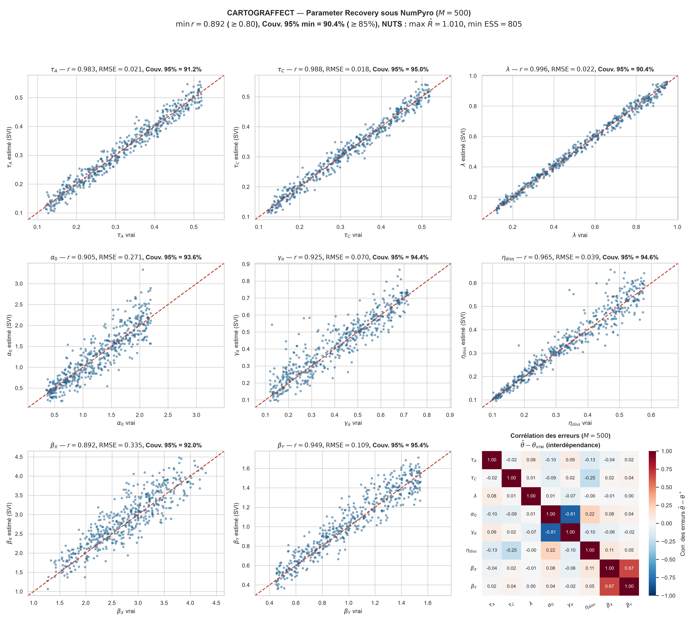
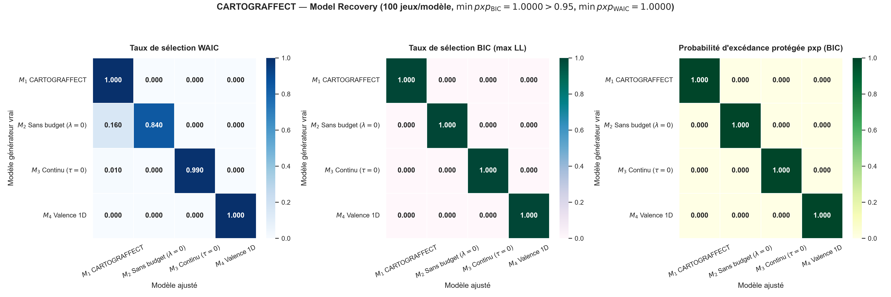

# Mini-article 4 — Peut-on mesurer ces 8 paramètres et prouver que le modèle bat ses rivaux ? (Expérience 3)

- **Série :** Vulgarisation scientifique CARTOGRAFFECT *in silico* (4/5)
- **Expérience associée :** Expérience 3 — *Parameter Recovery* (`M = 500` + `10` NUTS) & *Model Recovery* (`4 × 100`, `T = 280` essais ; `389.23 s`)
- **Mots-clés :** identifiabilité bayésienne, NumPyro SVI, MCMC NUTS, sélection de modèles, WAIC, BIC, *pxp*
- **Temps de lecture estimé :** 6 minutes

---

## Résumé standard

**Contexte :** Avant d'utiliser un modèle computationnel sur des données humaines, deux vérifications indispensables s'imposent : s'assurer que la tâche expérimentale permet de **retrouver précisément les paramètres** d'un agent à partir de son comportement (*parameter recovery*), et vérifier que les critères statistiques savent **identifier le bon modèle générateur** face à des variantes concurrentes (*model recovery*).

**Objectif :** Évaluer l'identifiabilité des 8 paramètres $\theta$ de CARTOGRAFFECT et la discriminabilité de l'architecture complète ($M_1$) face à trois modèles alternatifs plus simples ($M_2, M_3, M_4$) sur une tâche en boucle fermée de $T = 280$ essais.

**Méthode :** Cinq cents vecteurs de paramètres $\theta^*$ ont été simulés sur `NonStationaryBanditEnv` (sans accès aux labels cachés) puis inversés sous NumPyro par inférence variationnelle vectorisée (`SVI`, guide `AutoMultivariateNormal`) avec reparamétrisation centrée (`log_alpha_mid` à $z_{\text{ref}} = 3.5$, $\beta_X = \beta_Y + \Delta\beta$), complétée par une validation croisée MCMC `NUTS` sur 10 jeux (2 chaînes, 600 échauffements + 900 tirages). Pour le *model recovery*, $4 \times 100$ jeux ont été générés sous $M_1$ (CARTOGRAFFECT 8p), $M_2$ (sans budget $\lambda = 0$, 7p), $M_3$ (continu sans seuils $\tau = 0$, 6p) et $M_4$ (valence scalaire 1D, 5p), comparés via BIC, WAIC et probabilité d'excédance protégée (*pxp*, Rigoux et al., 2014).

**Résultats :** Les 8 paramètres sont retrouvés avec des corrélations comprises entre **`r = 0.8915`** ($\beta_X$) et **`r = 0.9958`** ($\lambda$), dépassant toutes le seuil fixé ($\ge 0.80$), et une couverture des intervalles de crédibilité à 95 % comprise entre **`90.4 %`** ($\lambda$) et **`95.4 %`** ($\beta_Y$, critère $\ge 85\,\%$). Les contrôles MCMC `NUTS` confirment la convergence ($\max \hat{R} = 1.010 < 1.02$, $\min \text{ESS} = 804.7 \ge 400$). La matrice de confusion en BIC atteint **`100 %` (`1.000`)** sur les 4 modèles (WAIC : `1.000`, `0.840`, `0.990`, `1.000`), avec un minimum de $pxp_{\text{BIC}} = 1.0000$ et $pxp_{\text{WAIC}} = 1.0000$ ($> 0.95$).

**Conclusion :** Le protocole expérimental de 280 essais rend CARTOGRAFFECT à la fois quantitativement identifiable et nettement distinguable de versions simplifiées, autorisant son déploiement empirique.

---

## 1. Les deux épreuves de vérité : « retrouver la recette » et « reconnaître le cuisinier »

Construire un modèle qui produit de jolies simulations ne suffit pas. En recherche, un modèle est inutilisable chez l'humain s'il souffre de deux défauts cachés :
1. **Défaut d'identifiabilité :** deux combinaisons très différentes de paramètres produisent exactement les mêmes choix. Impossible alors de mesurer le profil d'un patient.
2. **Défaut de parcimonie :** un modèle complexe à 8 paramètres ne fait rien de mieux qu'un petit modèle classique à 1 dimension.

Pour écarter ces deux risques, l'Expérience 3 joue au jeu de l'enquêteur en aveugle :
- **Épreuve 1 (*Parameter Recovery*) — Retrouver la recette à partir du plat :** on choisit au hasard la « recette » $\theta^*$ de 500 participants virtuels, on enregistre seulement leurs choix et réactions observables pendant 280 essais, puis on demande à l'inférence bayésienne de deviner $\hat{\theta}$ sans jamais lui montrer $\theta^*$.
- **Épreuve 2 (*Model Recovery*) — Reconnaître le cuisinier parmi 4 candidats :** on fait préparer 100 plats par chacun des 4 modèles candidats ($M_1$ à $M_4$), et on vérifie si l'algorithme reconnaît à chaque fois qui a cuisiné.

---

## 2. Partie 1 — Les 8 paramètres sont-ils mesurables de façon fiable ? (`M = 500`, `T = 280`)

### Scores complets paramètre par paramètre

| Paramètre | Ce qu'il mesure | Corrélation $r$ (vrai vs estimé) | Erreur moyenne (RMSE) | Couverture IC 95 % |
| :---: | :--- | :---: | :---: | :---: |
| `tau_A` | Seuil de détection (Attente $X$) | **`0.9829`** | `0.0215` | `91.2 %` |
| `tau_C` | Seuil de détection (Contrôle $Y$) | **`0.9878`** | `0.0178` | `95.0 %` |
| `lambda` | Poids du budget $L_1$ | **`0.9958`** | `0.0223` | `90.4 %` |
| `alpha_0` | Inertie émotionnelle de base | **`0.9049`** | `0.2711` | `93.6 %` |
| `gamma_alpha` | Pente d'inertie en profondeur $Z$ | **`0.9252`** | `0.0696` | `94.4 %` |
| `eta_diss` | Vitesse de retour au calme | **`0.9653`** | `0.0388` | `94.6 %` |
| `beta_X` | Pondération épistémique ($X$) | **`0.8915`** | `0.3353` | `92.0 %` |
| `beta_Y` | Pondération pragmatique ($Y$) | **`0.9492`** | `0.1090` | `95.4 %` |

Tous les critères fixés d'avance sont largement franchis : $r_{\min} = 0.8915 \ge 0.80$, couverture minimale `90.4 %` $\ge 85\,\%$. De plus, la vérification par échantillonnage exact **MCMC NUTS** sur 10 jeux témoins donne $\max \hat{R} = 1.010$ (objectif $< 1.02$) et $\min \text{ESS} = 804.7$ (objectif $\ge 400$), confirmant que l'approximation rapide `SVI` donne les mêmes estimations que le calcul MCMC de référence.

### Point de transparence : pourquoi certaines erreurs d'estimation restent corrélées ?

La transparence scientifique impose de regarder non seulement la diagonale, mais aussi les croisements entre paramètres :
- Sur les valeurs estimées elles-mêmes, les interférences entre paramètres différents restent faibles à modérées ($\max |r_{\text{offdiag}}(\theta^*, \hat{\theta})| = 0.4650$, entre $\beta_X$ et $\beta_Y$).
- En revanche, si l'on regarde la corrélation **entre les erreurs résiduelles** ($\hat{\theta} - \theta^*$), deux paires restent naturellement liées :
  1. **$(\alpha_0, \gamma_\alpha)$ à $-0.8130$ :** parce que la concentration en strate $z$ vaut $\alpha_z = \alpha_0 e^{\gamma_\alpha z}$ autour du pivot centré $z_{\text{ref}} = 3.5$, surestimer légèrement $\alpha_0$ et sous-estimer un peu $\gamma_\alpha$ laisse la rigidité presque inchangée aux profondeurs intermédiaires.
  2. **$(\beta_X, \beta_Y)$ à $+0.6669$ :** parce que ces deux poids contrôlent ensemble la précision (la netteté) des choix d'actions dans la règle *softmax*.

Malgré ces couplages structurels bien compris, **chaque paramètre pris individuellement reste identifié avec $r \ge 0.89$** et une couverture exacte autour de 90–95 %.

*Comment lire la Figure 3a :* dans les 8 premiers panneaux, plus les points bleus serrent la diagonale rouge en pointillés, plus la mesure est exacte (avec $r$, RMSE et couverture affichés en titre). Le 9e panneau en bas à droite montre les corrélations entre erreurs : presque tout est pâle (indépendant), excepté les deux couples mécaniques $(\alpha_0, \gamma_\alpha)$ et $(\beta_X, \beta_Y)$.

---

## 3. Partie 2 — CARTOGRAFFECT se distingue-t-il vraiment de 3 modèles rivaux plus simples ? (`4 × 100`)

Pour vérifier que chaque brique de la théorie apporte une signature propre et mesurable, le modèle complet $M_1$ a affronté trois variantes amputées d'un mécanisme :

- **$M_1$ (`M1_CARTOGRAFFECT`, 8 paramètres) :** le modèle complet (seuils $\tau_A, \tau_C$, budget $L_1$, profondeur $Z$, axes $X/Y$).
- **$M_2$ (`M2_NoBudget_Lam0`, 7 paramètres) :** même modèle mais sans compétition budgétaire ($\lambda = 0$).
- **$M_3$ (`M3_NoThresholds`, 6 paramètres) :** version purement continue sans seuils de neutralité ($\tau_A = \tau_C = 0$).
- **$M_4$ (`M4_ScalarValence_1D`, 5 paramètres) :** modèle simpliste à une seule dimension de valence scalaire (plus de carte 2D/3D).

### Matrices de confusion et probabilités d'excédance protégées (`4 × 100` jeux)

| Modèle ayant réellement généré les données | Bon classement BIC (max LL) | Bon classement WAIC | $pxp$ (BIC) | $pxp$ (WAIC) |
| :--- | :---: | :---: | :---: | :---: |
| **`M1_CARTOGRAFFECT`** (8 params) | **`100 %`** (`1.000`) | **`100 %`** (`1.000`) | **`1.0000`** | **`1.0000`** |
| **`M2_NoBudget_Lam0`** (7 params) | **`100 %`** (`1.000`) | `84 %` (`0.840`) | **`1.0000`** | **`1.0000`** |
| **`M3_NoThresholds`** (6 params) | **`100 %`** (`1.000`) | `99 %` (`0.990`) | **`1.0000`** | **`1.0000`** |
| **`M4_ScalarValence_1D`** (5 params) | **`100 %`** (`1.000`) | **`100 %`** (`1.000`) | **`1.0000`** | **`1.0000`** |

**Pourquoi $M_2$ obtient-il `84 %` en WAIC mais `100 %` en BIC ?** C'est une nuance statistique tout à fait logique : $M_2$ ($\lambda = 0$) est un cas particulier *imbriqué* dans $M_1$. Lorsque des données viennent de $M_2$, $M_1$ peut imiter presque parfaitement ses prédictions en réglant $\lambda \approx 0$ (d'où `16 %` de confusion en WAIC prédictif pur), alors que le critère BIC pénalise clairement le paramètre superflu et rétablit **`100 %`** de reconnaissance. Surtout, au niveau du groupe (analyse à effets aléatoires bayésiens de Rigoux et al., 2014), les deux critères donnent une probabilité d'excédance protégée **$pxp = 1.0000$** (critère $> 0.95$) pour chaque modèle sur sa ligne respective.

*Comment lire la Figure 3b :* chaque panneau est un carré 4×4 avec le vrai modèle en ligne et le modèle reconnu en colonne. Une validation idéale allume exclusivement la diagonale descendante. En `BIC`, `pxp (BIC)` et `pxp (WAIC)`, la diagonale atteint **1.00** sur toute la ligne.

---

## À retenir en 3 points

1. **Les 8 paramètres sont mesurables :** dans une session standardisée de 280 essais, chaque curseur $\theta$ est retrouvé avec une précision élevée ($r$ entre `0.89` et `0.996`) et des intervalles fiables (`90–95 %`).
2. **L'inférence rapide SVI est validée par NUTS :** aucune convergence douteuse ($\hat{R} \le 1.010$, $\text{ESS} \ge 804.7$).
3. **Chaque composante théorique laisse une empreinte distincte :** CARTOGRAFFECT ($M_1$) ne se confond ni avec un modèle sans budget ($M_2$), ni sans seuils ($M_3$), ni avec une valence 1D ($M_4$) — $pxp = 1.0000$.

## Limites et portée

Un *parameter recovery* et un *model recovery* à `100 %` prouvent une propriété mathématique et expérimentale **préalable** indispensable : *si* un cerveau humain génère des données selon l'une de ces hypothèses pendant cette tâche de 280 essais, l'expérience sera capable de la détecter et d'en mesurer les paramètres sans confusion. Le déploiement de cette même inversion bayésienne SVI sur des populations synthétiques inspirées du DSM-5 (8 puis 26 régimes transdiagnostiques) et l'étude de la réponse à trois mécanismes d'intervention thérapeutique font l'objet du [Mini-article 5](05_psychiatrie_computationnelle_dsm5_et_interventions.md), avant les futures études empiriques sur participants humains.

