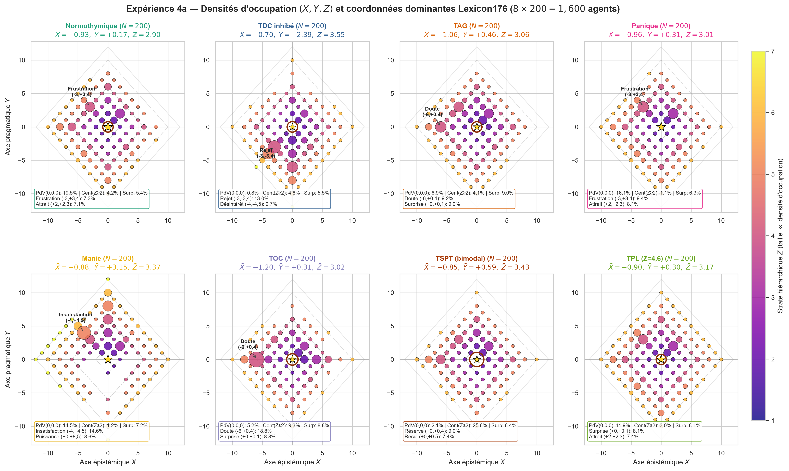
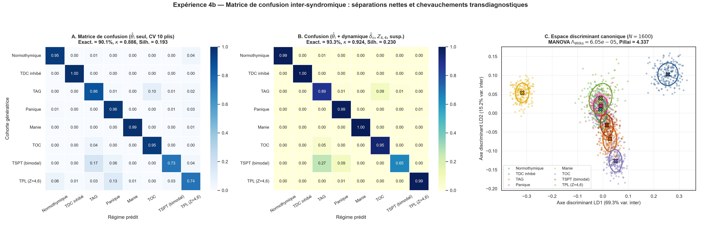
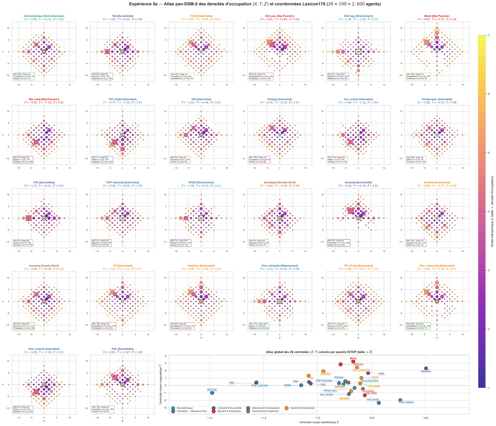
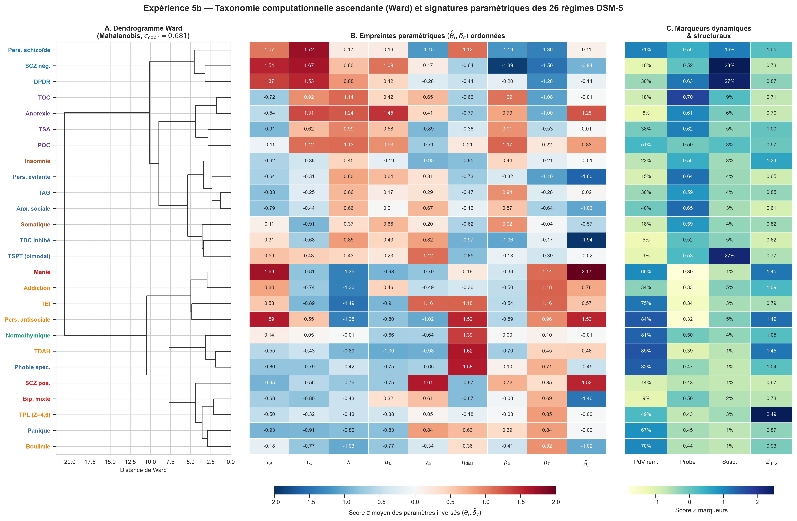
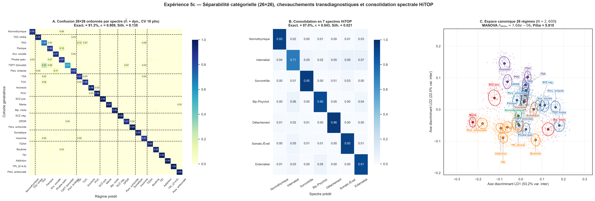
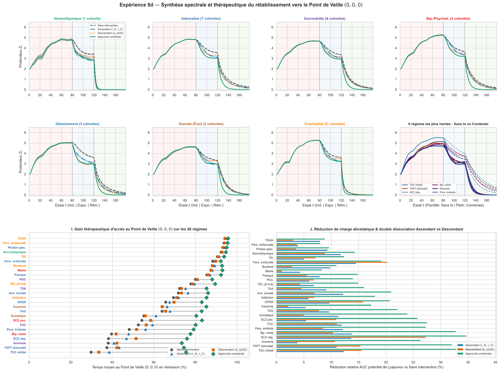
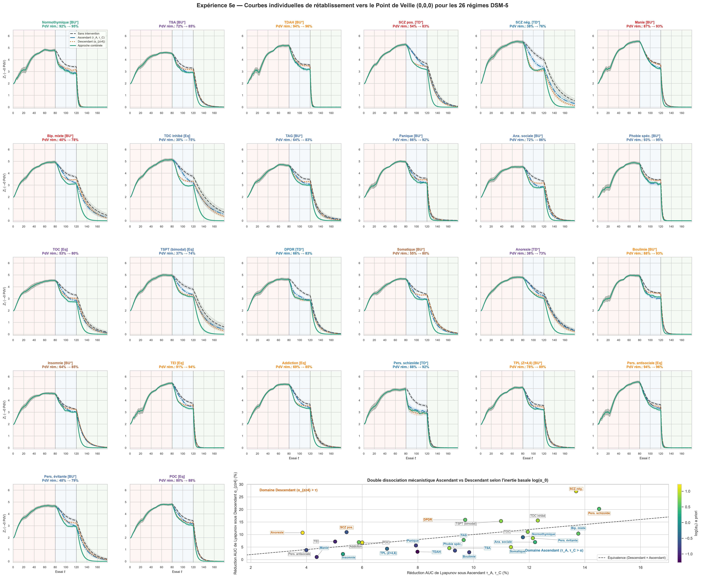

# Mini-article 5 — Des profils cliniques aux 26 régimes transdiagnostiques du DSM-5 et aux interventions thérapeutiques (Expériences 4 & 5)

- **Série :** Vulgarisation scientifique CARTOGRAFFECT® *in silico* (5/5)
- **Expériences associées :**
  - **Expérience 4 :** Phénotypage computationnel sur 8 cohortes DSM-5 ($8 \times 200 = 1\,600$ agents ; `280` essais ; `503.8 s`)
  - **Expérience 5 :** Panorama pan-chapitres DSM-5 sur 26 régimes ($26 \times 100 = 2\,600$ agents ; `15` chapitres DSM-5, `7` spectres HiTOP ; `903.6 s`)
- **Mots-clés :** psychiatrie computationnelle transdiagnostique, DSM-5, spectres HiTOP, dendrogramme de Ward, double dissociation thérapeutique, *Point de Veille*
- **Temps de lecture estimé :** 9 minutes

---

## Résumé standard

**Contexte :** Après avoir vérifié que les 8 paramètres $\theta$ de CARTOGRAFFECT® produisent 4 prototypes contrastés (Expérience 2) et sont mesurables en aveugle avec $r \ge 0.89$ (Expérience 3), une question clinique se pose : dans quelle mesure ce même espace paramétrique continu permet-il de cartographier l'ensemble du spectre psychopathologique décrit par le DSM-5 — en préservant à la fois les distinctions nettes, les chevauchements transdiagnostiques réels et les leviers thérapeutiques différenciés ? Conformément à la contrainte épistémologique fondamentale de CARTOGRAFFECT®, les profils simulés formalisent des **trajectoires fonctionnelles réversibles**, et jamais des étiquettes diagnostiques statiques ou essentialistes.

**Objectif :** Évaluer, sur la tâche orthogonale standardisée de $280$ essais sans fuite d'information cachée (`sensory_payload()` uniquement), la géométrie dans $(X, Y, Z)$, le lexique `Lexicon176`, la séparabilité inter-syndromique et la réponse différentielle à trois mécanismes d'intervention thérapeutique (`Ascendant`, `Descendant`, `Combiné`) à travers **8 cohortes cliniques clés** (Expérience 4, $N = 1\,600$) puis un **panorama pan-nosologique de 26 régimes** couvrant 15 chapitres du DSM-5 et 7 spectres HiTOP (Expérience 5, $N = 2\,600$).

**Méthode :** Deux banques de lois *a priori* multivariées non diagonales ont été définies sur $\theta = \{\tau_A, \tau_C, \lambda, \alpha_0, \gamma_\alpha, \eta_{\text{diss}}, \beta_X, \beta_Y\}$ (avec biais de contrôlabilité $\delta_c$ marginalisé à l'inversion) : `DSM5PriorBank` (8 cohortes : normothymique, TDC inhibé, TAG, trouble panique, épisode maniaque, TOC, TSPT bimodal hypervigilance/dissociation, trouble de la personnalité limite avec instabilité en strates $Z \in \{4, 6\}$) et `DSM5FullNosologyPriorBank` (26 régimes étendant aux troubles neurodéveloppementaux, spectre schizophrénique positif/négatif, bipolarité mixte, anxiété sociale, phobie spécifique, dépersonnalisation, symptomatologie somatique, anorexie, boulimie, insomnie chronique, trouble explosif intermittent, addictions et personnalités schizoïde, antisociale, évitante et obsessionnelle-compulsive). Les trajectoires simulées ont été inversées en aveugle par SVI NumPyro, classées par analyse quadratique régularisée en validation croisée stratifiée à 10 plis (`QDA`), consolidées sur les 7 spectres HiTOP et hiérarchisées par liaison de Ward sur distances de Mahalanobis. Enfin, chaque cohorte a subi de façon strictement appariée un protocole thérapeutique en 3 phases (`180` essais : induction, exposition corrective, rémission) sous 4 conditions (`none`, `bottom_up_interoceptive`, `top_down_prior_relaxation`, `combined`).

**Résultats :** L'inversion SVI retrouve fidèlement les paramètres individuels sur les $1\,600$ agents ($r \in [0.8591,\, 0.9982]$) comme sur les $2\,600$ agents ($r \in [0.8784,\, 0.9988]$). Sur 8 cohortes, la discrimination atteint `90.1 %` ($\kappa = 0.886$) sur $\hat{\theta}_i$ seul et `93.3 %` ($\kappa = 0.924$) avec les marqueurs dynamiques. Sur 26 régimes, la séparabilité atteint `77.4 %` ($\kappa = 0.765$) sur $\hat{\theta}_i$ seul et **`91.3 %`** ($\kappa = 0.909$, $\Lambda_{\text{Wilks}} = 7.68 \times 10^{-6}$, Pillai $= 5.915$) avec la dynamique ; elle consolide les frontières floues en **7 spectres HiTOP à `87.0 %`** ($\kappa = 0.843$) tout en révélant des ponts transdiagnostiques réalistes (`TAG ↔ TSPT` `11.5 %`, `Panique ↔ Phobie spéc.` `9.5 %`, `TSA ↔ TAG` `8.5 %`, `Anx. sociale ↔ Pers. évitante` `7.5 %`). Sous traitement, l'approche combinée réduit significativement la charge allostatique sur les 26 cohortes ($\max p_{\text{Holm}} = 9.30 \times 10^{-14}$) et révèle une **double dissociation mécanistique** : `5` régimes à forte inertie ou détachement (`SCZ nég.`, `DPDR`, `Anorexie`, `Pers. schizoïde`, `SCZ pos.`) répondent mieux au relâchement descendant ($\alpha_{z \ge 4}$), tandis que `14` régimes à hyper-saillance ou dysrégulation intéroceptive répondent davantage au recalibrage ascendant ($\tau_A, \tau_C$).

**Conclusion :** Sans recourir à des catégories figées, CARTOGRAFFECT® organise l'ensemble du paysage nosologique en un continuum paramétrique mesurable qui rend compte à la fois de la séparation des spectres, des comorbidités cliniques et de la spécialisation des leviers thérapeutiques.

---

## 1. Des étiquettes figées aux trajectoires dynamiques

Dans le [Mini-article 3](03_quatre_profils_cliniques.md), quatre profils idéaux suffisaient pour illustrer la polyvalence du moteur. En clinique réelle, toutefois, deux obstacles majeurs apparaissent :
1. **Des variations continues et corrélées :** tous les patients dépressifs n'ont pas exactement les mêmes réglages ; chaque trouble correspond plutôt à un *nuage de probabilités* multivarié autour d'un régime d'attraction préférentiel.
2. **Des frontières perméables (comorbidités transdiagnostiques) :** l'anxiété généralisée, le TSPT et les traits obsessionnels partagent des mécanismes communs de sensibilité à l'incertitude, tout comme les profils impulsifs ou dissociatifs se recouvrent partiellement.

Les **Expériences 4 et 5** modélisent donc chaque tableau inspiré du DSM-5 (APA, 2013 ; Friston et al., 2014 ; Schwartenbeck & Friston, 2016) comme une **loi *a priori* multivariée dans l'espace continu $\theta$**, accompagnée le cas échéant de trois mécanismes dynamiques spécifiques :
- **Biais de transition de contrôlabilité ($\delta_c$) :** capture la polarisation optimiste (`mania`, `scz_positive`, `aspd`) vs pessimiste (`mdd_inhibited`, `avpd`, `bipolar_dep_mixed`) de l'anticipation d'agentivité sur l'axe $Y$, tout en restant **strictement marginalisé en aveugle** à l'inversion.
- **Modulation bimodale (TSPT) :** un mélange entre un sous-régime d'*hypervigilance* ($\tau_A$ très bas) et un sous-régime de *dissociation centrale* ($\tau_A, \tau_C$ élevés déclenchés sous surcharge profonde $Z \ge Z_{\text{diss}}$).
- **Instabilité de précision localisée aux strates $Z = 4, 6$ (TPL) :** une agitation stochastique des filtres intéroceptifs ($\sigma_{Z_{4,6}} = 0.42$) lorsque la trajectoire traverse la strate réflexive ($Z = 4$) ou identitaire ($Z = 6$), expliquant les bascules affectives rapides entre quadrants.

---

## 2. Expérience 4 — Huit cohortes DSM-5 en aveugle ($N = 1\,600$ agents)

Avant d'étendre à toute la nosologie, l'**Expérience 4** ([04_dsm5_phenotyping.py](../experiments/04_dsm5_phenotyping.py)) soumet **$8 \times 200 = 1\,600$ agents synthétiques** aux $280$ essais de la tâche orthogonale `GenerativeProcess`, puis inverse $\hat{\theta}_i$ en aveugle.

L'inversion bayésienne reste remarquablement précise à grande échelle : Pearson $r$ compris entre `0.8591` ($\gamma_\alpha$) et `0.9982` ($\delta_c$), avec `0.9857` pour $\tau_A$, `0.9837` pour $\tau_C$, `0.9851` pour $\lambda$, `0.8877` pour $\alpha_0$, `0.9621` pour $\eta_{\text{diss}}$, `0.9156` pour $\beta_X$ et `0.9614` pour $\beta_Y$.

| Cohorte ($N = 200$) | Centroïde $(\bar{X}, \bar{Y}, \bar{Z})$ | PdV session / rém. | États `Lexicon176` dominants (hors PdV) | Signature mécanistique observée |
| :--- | :---: | :---: | :--- | :--- |
| **Normothymique** | `(-0.93, +0.17, 2.90)` | `19.5 %` / `80.4 %` | *Frustration* `(-3,+3,4)` (`7.3 %`), *Attrait* `(+2,+2,3)` (`7.1 %`) | Récupération la plus rapide ($\bar{Z}_{\text{rém}} = 0.46$) |
| **TDC inhibé** | `(-0.70, -2.39, 3.55)` | `0.8 %` / `4.0 %` | *Rejet* `(-3,-3,4)` (`13.0 %`), *Désintérêt* `(-4,-4,5)` (`9.7 %`), *Langueur* `(0,-6,4)` (`9.4 %`) | Ancrage dans le quadrant $(-X, -Y)$ (`33.4 %`) |
| **TAG** | `(-1.06, +0.46, 3.06)` | `6.9 %` / `27.8 %` | *Doute* `(-6,0,4)` (`9.2 %`), *Surprise* `(0,0,1)` (`9.0 %`) | Vérification soutenue (`probe = 59.5 %`), pic en $Z=4$ |
| **Trouble panique** | `(-0.96, +0.31, 3.01)` | `16.1 %` / `67.7 %` | *Frustration* `(-3,+3,4)` (`9.4 %`), *Attrait* `(+2,+2,3)` (`8.1 %`) | Réactivité $+Y$ aiguë, suspension centrale minimale (`1.15 %`) |
| **Épisode maniaque** | `(-0.88, +3.15, 3.37)` | `14.5 %` / `63.5 %` | *Insatisfaction* `(-4,+4,5)` (`14.6 %`), *Puissance* `(0,+8,5)` (`8.6 %`), *Exaltation* `(0,+6,4)` (`7.5 %`) | Demi-plan $+Y$ à `74.8 %`, `probe` minimal (`29.9 %`) |
| **TOC** | `(-1.20, +0.31, 3.02)` | `5.2 %` / `19.6 %` | *Doute* `(-6,0,4)` (`18.8 %`), *Surprise* `(0,0,1)` (`8.8 %`) | Taux de sondage épistémique maximal (`probe = 69.5 %`) |
| **TSPT (bimodal)** | `(-0.85, +0.59, 3.43)` | `2.1 %` / `9.0 %` | *Réserve* `(0,0,4)` (`9.0 %`), *Recul* `(0,0,5)` (`7.4 %`) | `108` hypervig. / `92` dissoc., $BC(\hat{\tau}_A) = 0.846 > 0.556$, susp. `25.6 %` |
| **TPL ($Z = 4, 6$)** | `(-0.90, +0.30, 3.17)` | `11.9 %` / `50.9 %` | *Surprise* `(0,0,1)` (`8.1 %`), *Attrait* `(+2,+2,3)` (`7.4 %`) | Instabilité maximale : `switch = 47.5 %`, ratio $Z_{4,6} = 2.473$ ($\max p_{\text{Holm}} = 2.15 \times 10^{-46}$) |

*Comment lire les Figures 4a, 4b et 4c :* chaque losange de la Figure 4a montre le nuage exact d'occupation sur les 176 états : on voit à l'œil nu le glissement polaire vers le bas (`TDC inhibé`, *Rejet* / *Désintérêt*) vs le haut (`Manie`, *Insatisfaction* / *Puissance*), le pôle épistémique gauche (`TOC` en *Doute* à `18.8 %`) et l'anneau central épais de suspension (`TSPT`). Les profils paramétriques complets ($\hat{\theta}_i$, bimodalité TSPT et instabilité $Z_{4,6}$ du TPL) sont détaillés dans [fig4b_theta_profiles_and_strata.png](../results/dsm5_phenotyping/fig4b_theta_profiles_and_strata.png).

En classification croisée à 10 plis (QDA), les 8 régimes se séparent à **`90.1 %`** ($\kappa = 0.886$, $\Lambda_{\text{Wilks}} = 4.47 \times 10^{-3}$) sur les seuls $\hat{\theta}_i$, et à **`93.3 %`** ($\kappa = 0.924$, $\Lambda_{\text{Wilks}} = 6.05 \times 10^{-5}$) en ajoutant les marqueurs dynamiques ($\hat{\delta}_c$, ratio $Z_{4,6}$, suspension) — ce qui fait bondir le rappel du **TPL** de `74.0 %` à `99.5 %`. Surtout, la matrice révèle exactement ce que prévoit la clinique : des séparations absolues (`Manie ↔ TOC`, `TDC inhibé ↔ Manie`, `0 %` de confusion) coexistent avec des zones de recouvrement transdiagnostique (`TSPT → TAG` `17.5 %` sur $\hat{\theta}_i$ ; `TPL → Panique` `13.0 %` avant ajout de la signature $Z_{4,6}$ ; `TAG ↔ TOC` `4.5–9.5 %`).

---

## 3. Expérience 5 — Panorama pan-DSM-5 de 26 régimes et 7 spectres HiTOP ($N = 2\,600$ agents)

L'**Expérience 5** ([05_dsm5_full_nosology.py](../experiments/05_dsm5_full_nosology.py)) étend ce cadre à **26 régimes paramétriques** ($N = 100$ par cohorte, soit **$2\,600$ agents**) couvrant **15 grands chapitres du DSM-5** et regroupés selon **7 spectres dimensionnels HiTOP**.

Malgré un triplement du nombre de profils, l'inversion SVI aveugle maintient une identifiabilité très élevée sur l'ensemble de la population :
- $\tau_A$ : $r = 0.9905$ (couverture `89.3 %`) ; $\tau_C$ : $r = 0.9895$ (`89.2 %`) ; $\lambda$ : $r = 0.9937$ (`90.2 %`) ;
- $\alpha_0$ : $r = 0.8784$ (`88.5 %`) ; $\gamma_\alpha$ : $r = 0.9181$ (`88.3 %`) ; $\eta_{\text{diss}}$ : $r = 0.9758$ (`88.9 %`) ;
- $\beta_X$ : $r = 0.9205$ (`93.5 %`) ; $\beta_Y$ : $r = 0.9680$ (`93.3 %`) ; $\delta_c$ : $r = 0.9988$ (`92.0 %`).

| Spectre HiTOP | Régimes DSM-5 rattachés | Signatures `Lexicon176` et dynamiques dominantes | Rappel HiTOP (`QDA`) |
| :--- | :--- | :--- | :---: |
| **Normothymique** (`1`) | Contrôle normothymique | PdV rémission `80.8 %`, *Frustration* (`7.5 %`), *Attrait* (`7.2 %`) | **`93.0 %`** |
| **Internalisé — Détresse & Peur** (`7`) | TDC inhibé, TAG, Panique, Anxiété sociale, Phobie spécifique, TSPT, Pers. évitante | Spectre le plus hétérogène : pôle $-Y$ profond (`TDC` $\bar{Y}=-2.35$, `Pers. évit.` $\bar{Y}=-2.00$), inquiétude $-X$ (`TAG`), alarme phasique (`Panique`, `Phobie spéc.`) et bimodalité (`TSPT`, $BC(\hat{\tau}_A)=0.824$) | `71.4 %` |
| **Compulsif & Surcontrôle** (`4`) | TSA, TOC, Anorexie restrictive, POC | Budget $L_1$ serré ($\lambda \in [0.84, 0.92]$), sondage élevé (`TOC` `70.2 %`, *Doute* `19.4 %` ; `TSA` `62.4 %`, *Doute* `13.2 %`), rigidité en `Frustration` (`Anorexie` `19.0 %`, `POC` `15.3 %`) | **`95.2 %`** |
| **Bipolaire & Psychotique** (`3`) | Épisode maniaque, Schizophrénie pos., Dépression bipolaire mixte | Expansion `+Y` (`Manie` $\bar{Y}=+3.22$, `SCZ pos.` $\bar{Y}=+2.84$ à `84.4 %` en $+Y$) opposée à la dysphorie mixte (`Bip. mixte` $\bar{Y}=-1.33$) | **`90.0 %`** |
| **Détachement & Dissociation** (`3`) | Schizophrénie nég., DPDR, Pers. schizoïde | Suspension centrale massive sans valence périphérique : `SCZ nég.` `32.7 %` (*Réserve* `9.8 %`, $\bar{Z}=3.70$), `DPDR` `27.5 %` (*Réserve* `11.1 %`), `Pers. schizoïde` `16.4 %` | **`96.0 %`** |
| **Somatoforme & Hyperéveil** (`2`) | Trouble somatique, Insomnie chronique | Hyper-réactivité intéroceptive $\tau_C$ ou éveil tonique $\tau_A$ avec récupération ralentie (`PdV rém.` `18.0 %` et `23.4 %`) | **`93.0 %`** |
| **Désinhibé & Externalisé** (`6`) | TDAH, Boulimie, TEI, Addiction, TPL ($Z=4,6$), Pers. antisociale | Contrainte $L_1$ faible ($\lambda \le 0.38$), bascule $Z_{4,6}$ maximale chez le `TPL` (`ratio = 2.491`, $\max p_{\text{Holm}} = 8.70 \times 10^{-28}$), capture pragmatique (`Addiction` $\bar{Y}=+1.90$, `Pers. antisociale` $\bar{Y}=+2.40$) | **`90.7 %`** |

### Que révèle la taxonomie ascendante de Ward sur 26 diagnostics ?

Une question centrale en psychiatrie computationnelle est de savoir si une classification purement guidée par les paramètres génératifs retrouve — ou recompose utilement — les chapitres cliniques. Sur les $\binom{26}{2} = 325$ distances de Mahalanobis entre centroïdes, le **dendrogramme hiérarchique de Ward** (corrélation cophénétique $c_{\text{coph}} = 0.681$) fait émerger spontanément **quatre grandes familles mécanistiques** :
1. **Un pôle de détachement hypo-réactif** regroupant `Pers. schizoïde`, `SCZ nég.` et `DPDR` (tous caractérisés par $\tau_A, \tau_C$ élevés et suspension centrale).
2. **Un bloc surcontrôlé épistémique** unissant `TOC`, `Anorexie`, `TSA` et `POC` (à travers $\lambda$ élevé et forte pondération $\beta_X$).
3. **Un continuum internalisé-somatoforme** rapprochant `Insomnie`, `Pers. évitante`, `TAG`, `Anx. sociale`, `Somatique`, `TDC inhibé` et `TSPT`.
4. **Un macro-pôle désinhibé / paroxystique** réunissant d'une part l'axe ergotropique impulsif (`Manie`, `Addiction`, `TEI`, `Pers. antisociale`) et d'autre part les profils fluides ou labilité verticale (`Normothymique`, `TDAH`, `Phobie spéc.`, `SCZ pos.`, `Bip. mixte`, `TPL`, `Panique`, `Boulimie`).

Sur le plan classificatoire, l'ajout des marqueurs dynamiques ($\hat{\delta}_c, Z_{4,6}$, suspension centrale, taux de bascule) fait passer l'exactitude à **26 classes** de `77.4 %` ($\kappa = 0.765$) à **`91.3 %`** ($\kappa = 0.909$, $\Lambda_{\text{Wilks}} = 7.68 \times 10^{-6}$, trace de Pillai $= 5.915$). Surtout, les erreurs restantes ne sont pas aléatoires — ce sont les **chevauchements transdiagnostiques majeurs** attendus en clinique :
- **Séparations nettes (`0.0 %` de confusion)** : `Manie ↔ Anorexie` (Mahalanobis $D = 11.81$), `Manie ↔ TOC` ($D = 11.65$, JSD `0.554`), `Anorexie ↔ TEI` ($D = 11.57$), `TOC ↔ Pers. antisociale` ($D = 11.37$).
- **Ponts transdiagnostiques (confusion symétrique combinée)** : `TAG ↔ TSPT` (`11.5 %`), `Panique ↔ Phobie spéc.` (`9.5 %`), `TSA ↔ TAG` (`8.5 %`), `Anx. sociale ↔ Pers. évitante` (`7.5 %`), `TAG ↔ TOC` (`6.5 %`), `TAG ↔ Insomnie` (`5.5 %`), `TSPT ↔ DPDR` (`5.0 %`). Lorsque l'on regroupe ces diagnostics dans les **7 spectres HiTOP**, la matrice atteint **`87.0 %`** ($\kappa = 0.843$) avec une très forte compacité des spectres `Détachement` (`96.0 %`), `Surcontrôle` (`95.2 %`), `Normothymique` (`93.0 %`), `Somatoforme` (`93.0 %`), `Externalisé` (`90.7 %`) et `Bipolaire/Psychotique` (`90.0 %`).

---

## 4. Simuler trois mécanismes thérapeutiques et révéler une double dissociation

Au-delà de la cartographie, CARTOGRAFFECT® permet de tester *in silico* comment différentes stratégies thérapeutiques ramènent des trajectoires pathologiques vers le **Point de Veille $(0, 0, 0)$**. La classe `TherapeuticIntervention` met face à face, sur les **mêmes agents jumeaux** ($N = 100$ par cohorte dans l'Expérience 5, $N = 200$ dans l'Expérience 4), après 80 essais d'induction de crise puis 40 essais d'exposition sûre et 60 essais de rémission :
1. **Recalibrage ascendant (*Bottom-Up*) :** ramène progressivement les seuils de saillance intéroceptive $(\tau_A, \tau_C)$ vers l'équilibre normothymique ($0.28, 0.28$), ce qui apaise l'amplification des écarts sous-seuil sans toucher directement à la rigidité profonde.
2. **Relaxation descendante (*Top-Down*) :** assouplit sélectivement l'inertie des strates profondes $\alpha_{z \ge 4}$ (tout en laissant strictement invariantes les couches superficielles $\alpha_{z < 4}$, comme vérifié par test unitaire) et modère les *a priori* extrêmes de contrôle $\delta_c$.
3. **Approche combinée :** associe les deux mécanismes avec un léger gain synergique de dissipation $\eta_{\text{diss}}$.

### Synthèse des gains thérapeutiques et de la double dissociation

| Cohorte représentative | PdV rém. (`Sans tx` → `Combinée`) | Réduction AUC Lyapunov (`Asc.` vs `Desc.` vs `Comb.`) | Monothérapie dominante ($p_{\text{Holm}}$) |
| :--- | :---: | :---: | :--- |
| **SCZ profil négatif** (Exp. 5) | `38.2 %` → **`76.0 %`** | `13.7 %` vs **`27.3 %`** vs **`34.7 %`** | **Descendant** ($\alpha_{z \ge 4}$, $p_{\text{Holm}} = 8.54 \times 10^{-10}$) |
| **DPDR** (Exp. 5) | `65.7 %` → **`83.1 %`** | `9.7 %` vs **`15.8 %`** vs **`20.7 %`** | **Descendant** ($\alpha_{z \ge 4}$, $p_{\text{Holm}} = 2.11 \times 10^{-5}$) |
| **Anorexie restrictive** (Exp. 5) | `38.0 %` → **`73.4 %`** | `3.9 %` vs **`10.7 %`** vs **`26.4 %`** | **Descendant** ($\alpha_{z \ge 4}$, $p_{\text{Holm}} = 1.94 \times 10^{-5}$) |
| **Pers. schizoïde** (Exp. 5) | `88.3 %` → **`92.2 %`** | `14.5 %` vs **`20.2 %`** vs `19.1 %` | **Descendant** ($\alpha_{z \ge 4}$, $p_{\text{Holm}} = 9.26 \times 10^{-4}$) |
| **SCZ profil positif** (Exp. 5) | `54.2 %` → **`83.2 %`** | `5.4 %` vs **`10.9 %`** vs **`25.8 %`** | **Descendant** ($\alpha_{z \ge 4}$, $p_{\text{Holm}} = 3.05 \times 10^{-4}$) |
| **Dép. bipolaire mixte** (Exp. 5) | `39.7 %` → **`77.7 %`** | **`13.8 %`** vs `10.4 %` vs **`32.7 %`** | **Ascendant** ($\tau_A, \tau_C$, $p_{\text{Holm}} = 2.71 \times 10^{-4}$) |
| **Anxiété sociale** (Exp. 5) | `71.8 %` → **`86.1 %`** | **`12.2 %`** vs `7.0 %` vs **`21.0 %`** | **Ascendant** ($\tau_A, \tau_C$, $p_{\text{Holm}} = 3.75 \times 10^{-5}$) |
| **Pers. évitante** (Exp. 5) | `48.2 %` → **`79.1 %`** | **`12.1 %`** vs `8.6 %` vs **`27.3 %`** | **Ascendant** ($\tau_A, \tau_C$, $p_{\text{Holm}} = 4.77 \times 10^{-3}$) |
| **TPL ($Z = 4, 6$)** (Exp. 5) | `77.8 %` → **`89.5 %`** | **`6.9 %`** vs `4.3 %` vs **`14.9 %`** | **Ascendant** ($\tau_A, \tau_C$, $p_{\text{Holm}} = 2.89 \times 10^{-4}$) |
| **TDC inhibé** (Exp. 4 / Exp. 5) | `25.3 %` → `73.7 %` / `29.8 %` → **`75.5 %`** | `12.3 %` vs `15.6 %` vs **`38.3 %`** (Exp. 5) | Complémentaire (`Équivalent` $N=100$, combinée $-40.5\%$ Exp. 4) |
| **TSPT bimodal** (Exp. 4 / Exp. 5) | `33.8 %` → `74.1 %` / `37.4 %` → **`74.5 %`** | `11.0 %` vs `15.3 %` vs **`32.0 %`** (Exp. 5) | **Descendant** en Exp. 4 ($N=200$, $p_{\text{Holm}} = 0.0031$) |

L'enseignement majeur de ces deux figures réside dans la **double dissociation mécanistique** :
- Sur les 26 régimes, l'approche **combinée** bat significativement l'absence d'intervention sur absolument chaque cohorte ($\max p_{\text{Holm}} = 9.30 \times 10^{-14}$ sur Exp. 5 ; $\max p_{\text{Holm}} = 1.82 \times 10^{-32}$ sur Exp. 4).
- Lorsque les deux monothérapies sont opposées à correction globale de Holm-Bonferroni, **`5` régimes** (`SCZ nég.`, `DPDR`, `Anorexie`, `Pers. schizoïde`, `SCZ pos.`) tirent un bénéfice significativement supérieur du levier **descendant** ($\alpha_{z \ge 4}$), parce que leur piège principal vient d'une rigidité hiérarchique profonde ou d'un verrouillage perceptif filtré.
- À l'inverse, **`14` régimes** (`Normothymique`, `TSA`, `TDAH`, `Manie`, `Bip. mixte`, `TAG`, `Panique`, `Anx. sociale`, `Phobie spéc.`, `Somatique`, `Boulimie`, `Insomnie`, `TPL`, `Pers. évitante`) bénéficient significativement davantage du levier **ascendant** ($\tau_A, \tau_C$), qui empêche l'emballement des erreurs intéroceptives de déclencher l'escalade allostatique (`7` régimes restent statistiquement équivalents entre les deux monothérapies mais accélèrent fortement en traitement combiné).

*Pour consulter les courbes appariées sur les 8 cohortes à $N=200$, voir [fig4d_therapeutic_recovery_curves.png](../results/dsm5_phenotyping/fig4d_therapeutic_recovery_curves.png).*

---

## À retenir en 4 points

1. **Un cadre unifié, du prototype à toute la nosologie :** les 8 paramètres $\theta$ de CARTOGRAFFECT® suffisent pour déployer non seulement 8 profils pivots ($N = 1\,600$), mais un atlas complet de **26 régimes** couvrant **15 chapitres DSM-5** ($N = 2\,600$) avec une identifiabilité SVI aveugle maintenue à $r \in [0.878,\, 0.999]$.
2. **Séparation des spectres et réalisme des chevauchements :** le classifieur CV atteint `91.3 %` sur 26 régimes et consolide naturellement les zones frontières en **7 spectres HiTOP (`87.0 %`)** et en un **arbre de Ward ($c_{\text{coph}} = 0.681$)**, expliquant mécanistiquement les comorbidités cliniques (`TAG ↔ TSPT`, `Anx. sociale ↔ Pers. évitante`, `Panique ↔ Phobie spéc.`).
3. **Marqueurs dynamiques essentiels :** l'ajout des signatures temporelles (bimodalité $BC = 0.824\text{–}0.846$ du TSPT, instabilité $Z_{4,6} = 2.49$ du TPL, biais $\hat{\delta}_c$) fait progresser le diagnostic différentiel paramétrique de `77.4 %` à `91.3 %` à 26 classes.
4. **Cibles thérapeutiques dissociables :** aucun mécanisme isolé n'est optimal partout — la relaxation descendante $\alpha_{z \ge 4}$ domine les régimes à forte inertie ou détachement (`5` cohortes), le recalibrage ascendant $\tau_A, \tau_C$ domine les régimes d'hyper-saillance ou dysrégulation (`14` cohortes), et l'approche combinée l'emporte sur l'ensemble des cohortes pathologiques.

## Limites et portée

Ces simulations transdiagnostiques constituent des **modèles computationnels génératifs *in silico*** et **non un manuel nosologique ni un outil de diagnostic clinique autonome**. Bien que les distributions multivariées soient ancrées dans les mécanismes d'inférence active de la littérature (Friston et al., 2014 ; Schwartenbeck & Friston, 2016) et testées sans fuite d'information, la validation empirique finale exigera d'estimer $\hat{\theta}_i$ sur de véritables cohortes cliniques longitudinales effectuant la tâche de 280 essais afin de vérifier les positions exactes de chaque spectre dans l'espace paramétrique et la réponse différentielle aux psychothérapies ou pharmacothérapies ascendantes et descendantes.

