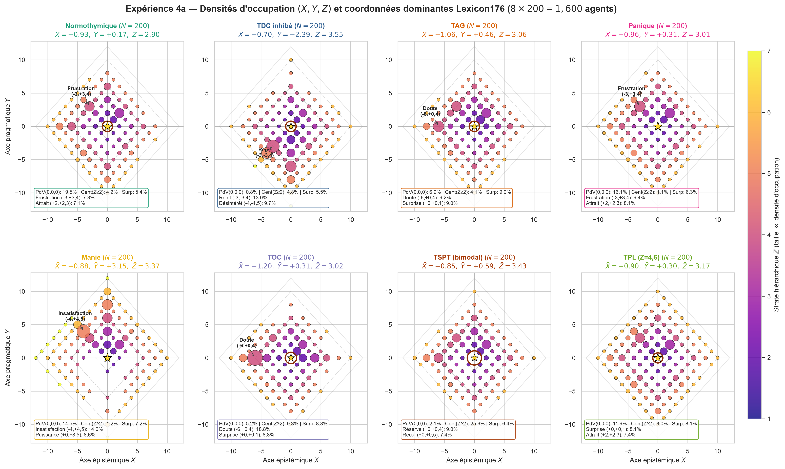
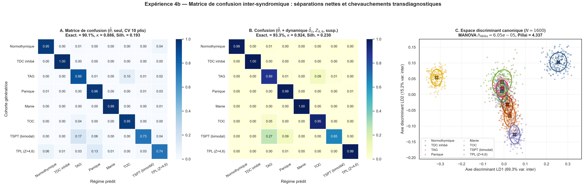
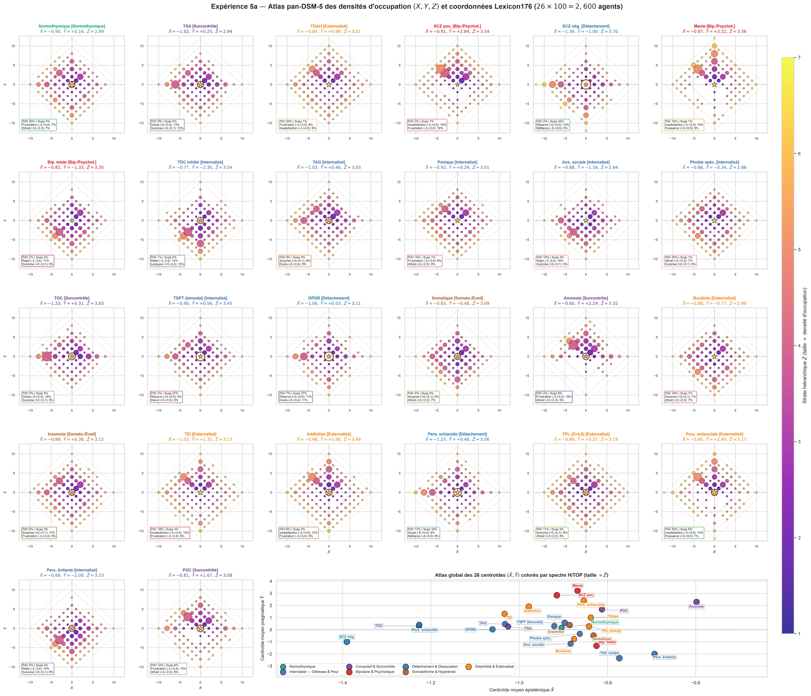
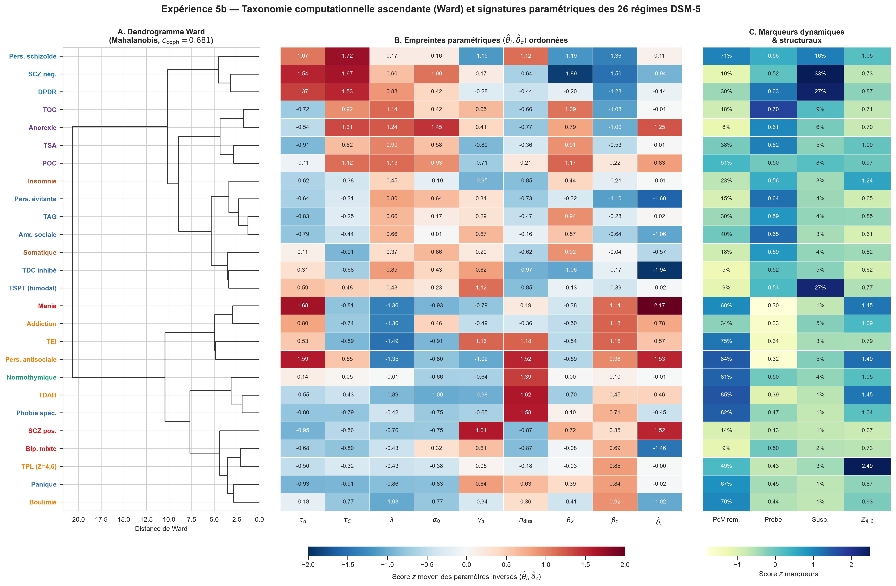
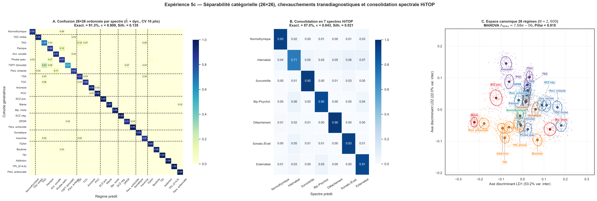
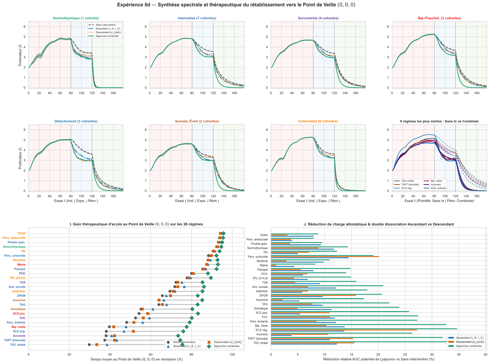
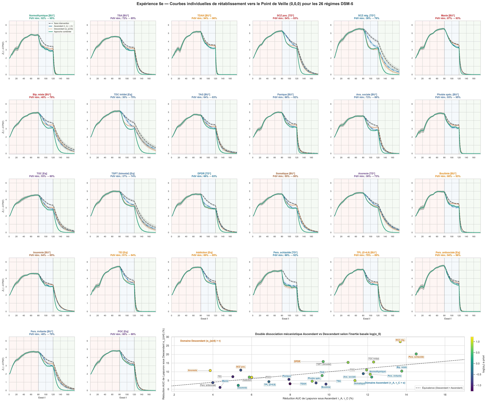

# Note exploratoire 5 — Simulations synthétiques sur 8 et 26 régimes paramétriques inspirés du DSM-5 (Expériences 4 & 5)

> **⚠️ AVERTISSEMENT ÉPISTÉMIQUE — `SYNTHETIC EXPLORATORY ONLY — V3 = 0`**
>
> Ce document ainsi que les scripts [`04_dsm5_phenotyping.py`](04_dsm5_phenotyping.py) et [`05_dsm5_full_nosology.py`](05_dsm5_full_nosology.py) sont isolés en **quarantaine exploratoire (`extensions/in_silico/exploratory_synthetic/`)**.
> - **Zéro donnée clinique humaine (`V3 = 0`) :** toutes les cohortes sont des agents synthétiques tirés de lois *a priori* multivariées construites à la main dans l'espace paramétrique $\theta$ du simulateur.
> - **Aucune portée diagnostique, nosologique ou thérapeutique réelle :** les séparabilités QDA, les chevauchements entre cohortes simulées et les réponses différentielles aux perturbations paramétriques ($\tau_{A,C}$ vs $\alpha_{z \ge 4}$) mesurent exclusivement la géométrie interne des *priors* choisis dans le simulateur. Ils ne doivent en aucun cas être présentés comme validation externe, ni comme démonstration de comorbidités cliniques ou d'efficacité thérapeutique chez l'humain.

- **Série :** Annexe exploratoire synthétique CARTOGRAFFECT® *in silico* (`SYNTHETIC EXPLORATORY ONLY — V3 = 0`)
- **Expériences associées (quarantaine) :**
  - **Expérience 4 :** Simulation exploratoire sur 8 cohortes paramétriques synthétiques ($8 \times 200 = 1\,600$ agents ; `280` essais)
  - **Expérience 5 :** Simulation exploratoire sur 26 régimes paramétriques synthétiques ($26 \times 100 = 2\,600$ agents ; `15` groupes d'étiquettes DSM-5, `7` regroupements HiTOP)
- **Mots-clés :** simulation exploratoire synthétique (`V3 = 0`), priors paramétriques, dendrogramme de Ward, sensibilité paramétrique simulée, *Point de Veille*

---

## Résumé méthodologique (`V3 = 0`)

**Contexte :** Dans le prolongement exploratoire des Expériences 2 et 3, ce banc synthétique examine comment un espace paramétrique continu $\theta$ à 8 dimensions permet de paramétrer des familles de trajectoires simulées étiquetées d'après des descripteurs cliniques du DSM-5, sans prétendre ni valider la nosologie psychiatrique ni établir des propriétés sur des patients réels.

**Objectif :** Mesurer, sur des agents synthétiques soumis à la tâche simulée de $280$ essais (`sensory_payload()` uniquement), la géométrie d'occupation dans $(X, Y, Z)$, la récupérabilité des paramètres générés, la séparabilité des lois *a priori* choisies (8 puis 26 régimes synthétiques) et la sensibilité des trajectoires simulées à trois perturbations paramétriques (`Ascendant`, `Descendant`, `Combiné`).

**Méthode :** Deux banques de lois *a priori* multivariées non diagonales ont été spécifiées sur $\theta = \{\tau_A, \tau_C, \lambda, \alpha_0, \gamma_\alpha, \eta_{\text{diss}}, \beta_X, \beta_Y\}$ (avec biais $\delta_c$ marginalisé à l'inversion) : `DSM5PriorBank` (8 cohortes synthétiques) et `DSM5FullNosologyPriorBank` (26 régimes synthétiques). Les trajectoires simulées ont été inversées par SVI NumPyro, classées par QDA régularisée en validation croisée stratifiée à 10 plis, regroupées sur 7 ensembles d'étiquettes HiTOP et hiérarchisées par liaison de Ward sur distances de Mahalanobis. Chaque cohorte synthétique a ensuite subi une simulation appariée en 3 phases (`180` essais) sous 4 conditions de perturbation paramétrique (`none`, `bottom_up_interoceptive`, `top_down_prior_relaxation`, `combined`).

**Résultats *in silico* (agents synthétiques uniquement, `V3 = 0`) :** L'inversion SVI retrouve les paramètres générés sur les $1\,600$ agents ($r \in [0.8591,\, 0.9982]$) comme sur les $2\,600$ agents ($r \in [0.8784,\, 0.9988]$). Sur 8 cohortes synthétiques, la discrimination QDA atteint `90.1 %` ($\kappa = 0.886$) sur $\hat{\theta}_i$ seul et `93.3 %` ($\kappa = 0.924$) avec les marqueurs dynamiques. Sur 26 régimes synthétiques, la séparabilité atteint `77.4 %` ($\kappa = 0.765$) sur $\hat{\theta}_i$ seul et `91.3 %` ($\kappa = 0.909$, $\Lambda_{\text{Wilks}} = 7.68 \times 10^{-6}$, Pillai $= 5.915$) avec la dynamique ; le regroupement en 7 ensembles HiTOP atteint `87.0 %` ($\kappa = 0.843$), avec des zones de recouvrement attendues entre distributions *a priori* voisines (`TAG ↔ TSPT` `11.5 %`, `Panique ↔ Phobie spéc.` `9.5 %`, `TSA ↔ TAG` `8.5 %`, `Anx. sociale ↔ Pers. évitante` `7.5 %`). Sous perturbation paramétrique simulée, la condition combinée réduit l'indicateur allostatique sur les 26 cohortes synthétiques ($\max p_{\text{Holm}} = 9.30 \times 10^{-14}$), avec une sensibilité différentielle entre les deux perturbations isolées (`5` régimes synthétiques à fort $\alpha_0$ ou détachement répondent davantage à l'abaissement de $\alpha_{z \ge 4}$, tandis que `14` régimes synthétiques à seuils $\tau_{A,C}$ déséquilibrés répondent davantage au recentrage de $\tau_A, \tau_C$).

**Conclusion (portée strictement limitée) :** Ces résultats décrivent uniquement la séparabilité interne et la sensibilité paramétrique de lois *a priori* synthétiques conçues par le modèle (`V3 = 0`). Ils ne constituent aucune validation clinique, diagnostique ou thérapeutique.

---

## 1. Spécification des lois *a priori* synthétiques

Les **Expériences 4 et 5** définissent chaque cohorte synthétique comme une **loi *a priori* multivariée dans l'espace continu $\theta$**, assortie le cas échéant de trois mécanismes programmés dans le simulateur :
- **Biais de transition de contrôlabilité ($\delta_c$)** (marginalisé à l'inversion) ;
- **Mélange bimodal** sur le profil étiqueté `TSPT` ;
- **Instabilité de précision localisée aux strates $Z = 4, 6$** ($\sigma_{Z_{4,6}} = 0.42$) sur le profil étiqueté `TPL`.

*(Pour le contexte général des 4 prototypes de l'Expérience 2, voir [Mini-article 3](../articles/03_quatre_profils_cliniques.md).)*

---

## 2. Expérience 4 — Huit cohortes paramétriques synthétiques ($N = 1\,600$ agents)

L'**Expérience 4** ([`04_dsm5_phenotyping.py`](04_dsm5_phenotyping.py)) simule **$8 \times 200 = 1\,600$ agents synthétiques** sur $280$ essais puis inverse $\hat{\theta}_i$ par SVI.

La récupération des paramètres simulés atteint $r \in [0.8591, 0.9982]$ ($\tau_A: 0.9857$, $\tau_C: 0.9837$, $\lambda: 0.9851$, $\alpha_0: 0.8877$, $\gamma_\alpha: 0.8591$, $\eta_{\text{diss}}: 0.9621$, $\beta_X: 0.9156$, $\beta_Y: 0.9614$, $\delta_c: 0.9982$).

| Cohorte synthétique ($N = 200$) | Centroïde $(\bar{X}, \bar{Y}, \bar{Z})$ | PdV session / rém. | États `Lexicon176` dominants (hors PdV) | Signature simulée observée |
| :--- | :---: | :---: | :--- | :--- |
| **Normothymique** | `(-0.93, +0.17, 2.90)` | `19.5 %` / `80.4 %` | *Frustration* `(-3,+3,4)` (`7.3 %`), *Attrait* `(+2,+2,3)` (`7.1 %`) | Retour simulé rapide ($\bar{Z}_{\text{rém}} = 0.46$) |
| **TDC inhibé** | `(-0.70, -2.39, 3.55)` | `0.8 %` / `4.0 %` | *Rejet* `(-3,-3,4)` (`13.0 %`), *Désintérêt* `(-4,-4,5)` (`9.7 %`), *Langueur* `(0,-6,4)` (`9.4 %`) | Occupation quadrant $(-X, -Y)$ (`33.4 %`) |
| **TAG** | `(-1.06, +0.46, 3.06)` | `6.9 %` / `27.8 %` | *Doute* `(-6,0,4)` (`9.2 %`), *Surprise* `(0,0,1)` (`9.0 %`) | Sondage élevé (`probe = 59.5 %`), pic en $Z=4$ |
| **Trouble panique** | `(-0.96, +0.31, 3.01)` | `16.1 %` / `67.7 %` | *Frustration* `(-3,+3,4)` (`9.4 %`), *Attrait* `(+2,+2,3)` (`8.1 %`) | Réactivité $+Y$, suspension centrale `1.15 %` |
| **Épisode maniaque** | `(-0.88, +3.15, 3.37)` | `14.5 %` / `63.5 %` | *Insatisfaction* `(-4,+4,5)` (`14.6 %`), *Puissance* `(0,+8,5)` (`8.6 %`), *Exaltation* `(0,+6,4)` (`7.5 %`) | Demi-plan $+Y$ à `74.8 %`, `probe = 29.9 %` |
| **TOC** | `(-1.20, +0.31, 3.02)` | `5.2 %` / `19.6 %` | *Doute* `(-6,0,4)` (`18.8 %`), *Surprise* `(0,0,1)` (`8.8 %`) | Sondage maximal (`probe = 69.5 %`) |
| **TSPT (bimodal)** | `(-0.85, +0.59, 3.43)` | `2.1 %` / `9.0 %` | *Réserve* `(0,0,4)` (`9.0 %`), *Recul* `(0,0,5)` (`7.4 %`) | `108` / `92` sous-régimes, $BC(\hat{\tau}_A) = 0.846$, susp. `25.6 %` |
| **TPL ($Z = 4, 6$)** | `(-0.90, +0.30, 3.17)` | `11.9 %` / `50.9 %` | *Surprise* `(0,0,1)` (`8.1 %`), *Attrait* `(+2,+2,3)` (`7.4 %`) | `switch = 47.5 %`, ratio $Z_{4,6} = 2.473$ ($\max p_{\text{Holm}} = 2.15 \times 10^{-46}$) |

Les profils paramétriques synthétiques sont illustrés dans [fig4b_theta_profiles_and_strata.png](../results/dsm5_phenotyping/fig4b_theta_profiles_and_strata.png). En classification QDA à 10 plis, la séparation entre les 8 lois *a priori* synthétiques atteint `90.1 %` ($\kappa = 0.886$) sur $\hat{\theta}_i$ seul et `93.3 %` ($\kappa = 0.924$) avec les marqueurs dynamiques ; les confusions résiduelles reflètent la proximité entre distributions *a priori* spécifiées dans `DSM5PriorBank` (`TSPT → TAG` `17.5 %` sur $\hat{\theta}_i$ ; `TPL → Panique` `13.0 %` avant ajout de la signature $Z_{4,6}$ ; `TAG ↔ TOC` `4.5–9.5 %`).

---

## 3. Expérience 5 — Simulation exploratoire de 26 régimes paramétriques synthétiques ($N = 2\,600$ agents)

L'**Expérience 5** ([`05_dsm5_full_nosology.py`](05_dsm5_full_nosology.py)) étend la banque de lois *a priori* synthétiques à **26 régimes paramétriques** ($N = 100$ agents synthétiques par cohorte, soit $2\,600$ agents) regroupés selon 7 ensembles d'étiquettes inspirés de HiTOP.

La récupération SVI des paramètres générés est : $\tau_A$ ($r = 0.9905$), $\tau_C$ ($r = 0.9895$), $\lambda$ ($r = 0.9937$), $\alpha_0$ ($r = 0.8784$), $\gamma_\alpha$ ($r = 0.9181$), $\eta_{\text{diss}}$ ($r = 0.9758$), $\beta_X$ ($r = 0.9205$), $\beta_Y$ ($r = 0.9680$), $\delta_c$ ($r = 0.9988$).

| Regroupement d'étiquettes | Régimes synthétiques rattachés | Signatures simulées dominantes | Rappel QDA (priors synthétiques) |
| :--- | :--- | :--- | :---: |
| **Normothymique** (`1`) | Contrôle normothymique | PdV rémission `80.8 %`, *Frustration* (`7.5 %`), *Attrait* (`7.2 %`) | `93.0 %` |
| **Internalisé — Détresse & Peur** (`7`) | TDC inhibé, TAG, Panique, Anxiété sociale, Phobie spécifique, TSPT, Pers. évitante | Pôle $-Y$ (`TDC`, `Pers. évit.`), $-X$ (`TAG`), alarme (`Panique`, `Phobie spéc.`), bimodalité (`TSPT`) | `71.4 %` |
| **Compulsif & Surcontrôle** (`4`) | TSA, TOC, Anorexie restrictive, POC | $\lambda \in [0.84, 0.92]$, sondage élevé (`TOC` `70.2 %`, `TSA` `62.4 %`) | `95.2 %` |
| **Bipolaire & Psychotique** (`3`) | Épisode maniaque, Schizophrénie pos., Dépression bipolaire mixte | Expansion `+Y` (`Manie`, `SCZ pos.`) vs `-Y` (`Bip. mixte`) | `90.0 %` |
| **Détachement & Dissociation** (`3`) | Schizophrénie nég., DPDR, Pers. schizoïde | Suspension centrale élevée (`SCZ nég.` `32.7 %`, `DPDR` `27.5 %`, `Pers. schizoïde` `16.4 %`) | `96.0 %` |
| **Somatoforme & Hyperéveil** (`2`) | Trouble somatique, Insomnie chronique | Seuils $\tau_C$ ou $\tau_A$ bas, récupération ralentie | `93.0 %` |
| **Désinhibé & Externalisé** (`6`) | TDAH, Boulimie, TEI, Addiction, TPL ($Z=4,6$), Pers. antisociale | $\lambda \le 0.38$, ratio $Z_{4,6} = 2.491$ (`TPL`), $+Y$ (`Addiction`, `Pers. antisociale`) | `90.7 %` |

### Regroupement hiérarchique de Ward des 26 centroïdes synthétiques

Sur les $\binom{26}{2} = 325$ distances de Mahalanobis entre les centroïdes synthétiques générés, le dendrogramme de Ward ($c_{\text{coph}} = 0.681$) reflète la structure des lois *a priori* codées dans `DSM5FullNosologyPriorBank` (4 branches principales : hypo-réactivité $\tau_{A,C}$ élevés, fort $\lambda/\beta_X$, continuum internalisé-somatoforme, et profils à faible $\lambda$ ou fort $\delta_c$).

L'exactitude QDA à 26 classes passe de `77.4 %` ($\kappa = 0.765$) à `91.3 %` ($\kappa = 0.909$) avec les marqueurs dynamiques ; les recouvrements entre paires de priors voisins sont : `TAG ↔ TSPT` (`11.5 %`), `Panique ↔ Phobie spéc.` (`9.5 %`), `TSA ↔ TAG` (`8.5 %`), `Anx. sociale ↔ Pers. évitante` (`7.5 %`), `TAG ↔ TOC` (`6.5 %`), `TAG ↔ Insomnie` (`5.5 %`), `TSPT ↔ DPDR` (`5.0 %`). Ces recouvrements sont une conséquence directe de la proximité des paramètres spécifiés dans la banque synthétique et ne constituent pas une validation empirique des comorbidités cliniques.

---

## 4. Sensibilité simulée à trois perturbations paramétriques (`V3 = 0`)

La classe `TherapeuticIntervention` applique trois perturbations paramétriques synthétiques sur des agents jumeaux ($N = 100$/cohorte en Exp. 5, $N = 200$ en Exp. 4) après 80 essais d'induction, 40 essais neutres et 60 essais de rémission :
1. **Recentrage des seuils $(\tau_A, \tau_C)$ (*Bottom-Up* simulé)** vers $(0.28, 0.28)$ ;
2. **Abaissement sélectif de $\alpha_{z \ge 4}$ et modération de $\delta_c$ (*Top-Down* simulé)** ;
3. **Perturbation combinée** des deux mécanismes avec gain de dissipation $\eta_{\text{diss}}$.

### Synthèse des réponses simulées aux perturbations paramétriques

| Cohorte synthétique représentative | PdV rém. (`Sans` → `Combinée`) | Réduction AUC Lyapunov (`Asc.` vs `Desc.` vs `Comb.`) | Perturbation isolée dominante *in silico* ($p_{\text{Holm}}$) |
| :--- | :---: | :---: | :--- |
| **SCZ profil négatif** (Exp. 5) | `38.2 %` → `76.0 %` | `13.7 %` vs `27.3 %` vs `34.7 %` | Abaissement $\alpha_{z \ge 4}$ ($p_{\text{Holm}} = 8.54 \times 10^{-10}$) |
| **DPDR** (Exp. 5) | `65.7 %` → `83.1 %` | `9.7 %` vs `15.8 %` vs `20.7 %` | Abaissement $\alpha_{z \ge 4}$ ($p_{\text{Holm}} = 2.11 \times 10^{-5}$) |
| **Anorexie restrictive** (Exp. 5) | `38.0 %` → `73.4 %` | `3.9 %` vs `10.7 %` vs `26.4 %` | Abaissement $\alpha_{z \ge 4}$ ($p_{\text{Holm}} = 1.94 \times 10^{-5}$) |
| **Pers. schizoïde** (Exp. 5) | `88.3 %` → `92.2 %` | `14.5 %` vs `20.2 %` vs `19.1 %` | Abaissement $\alpha_{z \ge 4}$ ($p_{\text{Holm}} = 9.26 \times 10^{-4}$) |
| **SCZ profil positif** (Exp. 5) | `54.2 %` → `83.2 %` | `5.4 %` vs `10.9 %` vs `25.8 %` | Abaissement $\alpha_{z \ge 4}$ ($p_{\text{Holm}} = 3.05 \times 10^{-4}$) |
| **Dép. bipolaire mixte** (Exp. 5) | `39.7 %` → `77.7 %` | `13.8 %` vs `10.4 %` vs `32.7 %` | Recentrage $\tau_A, \tau_C$ ($p_{\text{Holm}} = 2.71 \times 10^{-4}$) |
| **Anxiété sociale** (Exp. 5) | `71.8 %` → `86.1 %` | `12.2 %` vs `7.0 %` vs `21.0 %` | Recentrage $\tau_A, \tau_C$ ($p_{\text{Holm}} = 3.75 \times 10^{-5}$) |
| **Pers. évitante** (Exp. 5) | `48.2 %` → `79.1 %` | `12.1 %` vs `8.6 %` vs `27.3 %` | Recentrage $\tau_A, \tau_C$ ($p_{\text{Holm}} = 4.77 \times 10^{-3}$) |
| **TPL ($Z = 4, 6$)** (Exp. 5) | `77.8 %` → `89.5 %` | `6.9 %` vs `4.3 %` vs `14.9 %` | Recentrage $\tau_A, \tau_C$ ($p_{\text{Holm}} = 2.89 \times 10^{-4}$) |
| **TDC inhibé** (Exp. 4 / Exp. 5) | `25.3 %` → `73.7 %` / `29.8 %` → `75.5 %` | `12.3 %` vs `15.6 %` vs `38.3 %` (Exp. 5) | Équivalent à $N=100$ |
| **TSPT bimodal** (Exp. 4 / Exp. 5) | `33.8 %` → `74.1 %` / `37.4 %` → `74.5 %` | `11.0 %` vs `15.3 %` vs `32.0 %` (Exp. 5) | Abaissement $\alpha_{z \ge 4}$ en Exp. 4 ($p_{\text{Holm}} = 0.0031$) |

Dans ces simulations exploratoires (`V3 = 0`), la perturbation combinée réduit l'indicateur simulé sur les 26 cohortes ($\max p_{\text{Holm}} = 9.30 \times 10^{-14}$), tandis que la comparaison des deux perturbations isolées distingue `5` cohortes synthétiques plus sensibles à l'abaissement de $\alpha_{z \ge 4}$ et `14` cohortes synthétiques plus sensibles au recentrage de $(\tau_A, \tau_C)$ (`7` cohortes sans différence significative). Cette sensibilité différentielle découle directement des paramètres initiaux attribués à chaque cohorte synthétique.

*Courbes correspondantes de l'Expérience 4 : [fig4d_therapeutic_recovery_curves.png](../results/dsm5_phenotyping/fig4d_therapeutic_recovery_curves.png).*

---

## Limites strictes et statut probatoire (`V3 = 0`)

Ce travail est **exclusivement exploratoire et synthétique (`SYNTHETIC EXPLORATORY ONLY — V3 = 0`)**. Il ne constitue ni un manuel nosologique, ni une preuve de correspondance avec la clinique humaine, ni un outil diagnostique ou thérapeutique. Toute validation empirique (V3) exigerait un protocole clinique indépendant sur participants humains réels, pré-enregistré et évalué hors échantillon.
