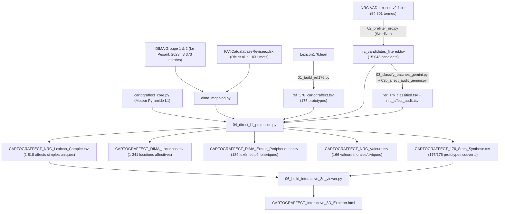

# Pipeline CARTOGRAFFECT / NRC-VAD + DIMA + FANCat (Pyramide des Couronnes L1)

Ce dépôt implémente le pipeline de traitement, de filtrage sémantique différentiel, d'hybridation multi-sources (**NRC-VAD v2.1**, **DIMA** de Denis Le Pesant 2023, et **FANCat** de Ric et al.) et de projection géométrique déterministe vers l'architecture pyramidale tridimensionnelle discrète **CARTOGRAFFECT** (176 positions phénoménologiques sur les strates $Z = 0 \dots 7$, certifiées formellement sous **Lean 4** ; Cabelguen, 2026).

---

## 1. Fondements Théoriques et Modèle Formel (Pyramide L1)

Le modèle CARTOGRAFFECT structure l'expérience affective humaine dans une pyramide topologique 3D fondée sur les principes de l'inférence active (*Active Inference*, Parr et al., 2022 ; Feldman & Friston, 2010) :

- **Axe X — Attente ($\mathbb{Z}$)** : Révisabilité épistémique du modèle interne (arbitrage entre maintien des croyances acquises et mise à jour pour réduire l'ambiguïté). Projeté continûment depuis la **Valence ($V$)**.
- **Axe Y — Contrôle ($\mathbb{Z}$)** : Contrôlabilité pragmatique de la situation (capacité d'action visant à transformer l'environnement et réduire le risque). Projeté continûment depuis l'éveil attentionnel ($A$) et la **Dominance ($D$)**.
- **Axe Z — Profondeur ($\{0, \dots, 7\}$)** : Profondeur temporelle et degré d'abstraction cognitive du traitement affectif (et **non** une simple intensité hédonique) :
  - $Z=0$ : Veille $(0, 0, 0)$ (origine structurale et homéostatique).
  - $Z=1$ : Opérateur de Surprise $(0, 0, 1)$ (rupture perceptive pure sans couronne périphérique).
  - $Z=2$ : Affects primaires (8 prototypes fondamentaux autour d'`Anticipation`, losange de rayon $R_{L_1}=2$).
  - $Z=3$ : Émotions réactives (16 positions autour d'`Émoi`, $R_{L_1}=4$).
  - $Z=4$ : Sentiments réflexifs et relationnels (24 positions autour de `Réserve`, $R_{L_1}=6$).
  - $Z=5$ : Dispositions et humeurs durables (32 positions autour de `Recul`, $R_{L_1}=8$).
  - $Z=6$ : Identités affectives (40 positions autour de `Saisissement`, $R_{L_1}=10$).
  - $Z=7$ : Sentiments transcendantaux (48 positions autour de `Suspension`, $R_{L_1}=12$).
- **Loi de la Pyramide des Couronnes L1** : Pour chaque strate $Z \ge 2$, le rayon du losange vaut $R_{L_1} = 2(Z - 1)$ et l'effectif périphérique vaut $4 \cdot R_{L_1} = 8(Z - 1)$, soit $8 + 16 + 24 + 32 + 40 + 48 = 168$ positions périphériques, totalisant avec les 8 opérateurs centraux exactement **176 positions**. L'involutivité de la symétrie antagoniste au sein de chaque couronne $Z$ et l'absence d'axiome *ad hoc* sont prouvées sous Lean 4 (`Lexicon176.lean`).

---

## 2. Architecture du Pipeline Hybride (NRC-VAD + DIMA + FANCat)

Le pipeline s'articule autour du noyau géométrique partagé `cartograffect_core.py` et du module d'intégration morpho-sémantique `dima_mapping.py` :



### Étapes d'exécution :
1. **`01_build_ref176.py`** : Extrait de `Lexicon176.lean` les 176 entrées de la pyramide, leurs coordonnées $(X, Y, Z)$, leur type géométrique (Centre, Axiale, Diagonale, Latérale), leur groupe d'orientation et leur correspondant antagoniste certifié sur la même couronne $Z$.
2. **`02_prefilter_nrc.py`** : Élimine les locutions de plus de 2 mots et les objets physiques stricts via les domaines lexicaux WordNet, produisant 15 043 candidats potentiellement affectifs.
3. **`03_classify_batches_gemini.py` & `03b_affect_audit_gemini.py`** : Évalue chaque candidat via Gemini, isole les affects purs (`statut = 1`) et dispositions (`statut = 2`), exécute l'audit affectif strict (`est_affect = 1` vs `est_affect = 0`), attribue la strate cognitive $Z_{cible} \in [0, 7]$ et fournit la traduction contextuelle française.
4. **`04_direct_l1_projection.py`** (via `cartograffect_core.py` et `dima_mapping.py`) :
   - Croise et projette les trois bases (**NRC-VAD v2.1**, **DIMA Groupe 1 & 2** et **FANCat**) sur la Pyramide $(X, Y, Z)$.
   - Applique les règles de pureté lexicale : **unigrammes stricts** (mots simples sans espace), **unicité stricte** (0 doublon sur `terme_fr`), et **filtrage morpho-sémantique de Le Pesant** (conservation de `ExpAffect`, `CausAffect`, `ObjAffect`, `HumAffect` ; séparation de `ComportAffect`, `CaractAffect`, `ParoleAffect`).
   - Produit **1 818 affects simples uniques certifiés** couvrant **176 / 176 prototypes** (**587** co-validés `NRC+DIMA`/`FANCat`, **849** affects français purs issus de `DIMA`/`FANCat`, et **382** affects issus de `NRC`/`FANCat`), **1 341 locutions affectives DIMA** et **166 valeurs morales/civiques/relationnelles/esthétiques**.
5. **`06_build_interactive_3d_viewer.py`** : Génère l'explorateur interactif 3D autonome (`CARTOGRAFFECT_Interactive_3D_Explorer.html`) de la Pyramide des Couronnes L1 ($Z = 0 \dots 7$) avec badges de source lexicale (`NRC+DIMA+FANCat`, `NRC+DIMA`, `DIMA`, `NRC`) et infobulles morpho-sémantiques DIMA.

---

## 3. Installation et Configuration

### Prérequis
- Python 3.10 ou supérieur
- Clé d'API Google Gemini (pour l'étape 3)

### Installation
```bash
# Création et activation de l'environnement virtuel
python -m venv .venv
# Sous Windows PowerShell :
.venv\Scripts\Activate.ps1

# Installation des dépendances
pip install -r requirements.txt
```

### Configuration des Clés d'API
Copiez le modèle `.env.example` vers `.env` et renseignez votre clé :
```ini
GEMINI_API_KEY=votre_cle_gemini_ici
```

---

## 4. Exécution du Pipeline

### Exécution automatique complète
Pour lancer le pipeline complet de bout en bout avec contrôle d'intégrité :
```bash
python run_pipeline.py
```

### Options de l'orchestrateur
- **Sauter l'appel LLM si la classification existe déjà** :
  ```bash
  python run_pipeline.py --skip-llm
  ```
- **Exécuter une seule étape** (ex. recalcul de la projection L1 uniquement) :
  ```bash
  python run_pipeline.py --step 4
  ```
- **Vérifier l'intégrité des fichiers sans recalcul** :
  ```bash
  python run_pipeline.py --verify-only
  ```

---

## 5. Fichiers et Résultats Produits

| Fichier | Description | Entrées |
| :--- | :--- | :--- |
| `ref_176_cartograffect.tsv` | Répertoire formel des 176 prototypes de la Pyramide CARTOGRAFFECT (Lean 4) | 176 lignes |
| `DIMA_GROUPE_1_v35-new.xlsx` | DIMA Catégorie I (Denis Le Pesant, 2023) : émotions/humeurs causées à un Expérienceur | 1 401 lignes |
| `DIMA_GROUPE_2_v35-new.xlsx` | DIMA Catégorie II (Denis Le Pesant, 2023) : sentiments/dispositions envers un Objet | 1 972 lignes |
| `FANCatdatabaseRevisee.xlsx` | Normes affectives françaises FANCat (Valence, Arousal et 10 émotions discrètes) | 1 031 lignes |
| `nrc_candidates_filtered.tsv` | Candidats NRC-VAD préfiltrés par WordNet | 15 043 lignes |
| `nrc_llm_classified.tsv` | Classifications et traductions sémantiques LLM (Gemini) | 15 043 lignes |
| `nrc_affect_audit.tsv` | Audit affectif strict et catégorisation sémantique fine (Gemini) | 4 866 lignes |
| `CARTOGRAFFECT_NRC_Lexicon_Complet.tsv` | Lexique affectif hybride certifié 100 % français (unigrammes stricts, 0 doublon, traçabilité `source_lexicale`, DIMA & FANCat) | **1 818 affects** |
| `CARTOGRAFFECT_DIMA_Locutions.tsv` | Locutions affectives polylexicales du DIMA projetées sur les 176 prototypes L1 | **1 341 locutions** |
| `CARTOGRAFFECT_DIMA_Exclus_Peripheriques.tsv` | Lexèmes périphériques du DIMA (`ComportAffect`, `CaractAffect`, `ParoleAffect` ; Le Pesant, p. 6) | **189 lignes** |
| `CARTOGRAFFECT_NRC_Valeurs.tsv` | Valeurs morales, civiques, relationnelles et esthétiques séparées des affects purs | **166 valeurs** |
| `CARTOGRAFFECT_176_Stats_Synthese.tsv` | Statistiques complètes et top-5 dédupliqué des termes français pour chaque prototype (176/176 couverts) | 176 prototypes |
| `CARTOGRAFFECT_NRC_Exclus_Sans_Antagoniste.tsv` | Termes isolés par la règle de clôture antagoniste (100 % français ; 0 terme exclu grâce à la couverture 176/176) | 0 ligne |
| `CARTOGRAFFECT_NRC_Exclus_Non_Affectifs.tsv` | Termes non affectifs, doublons et locutions exclus lors de l'audit strict avec motif d'exclusion | 3 680 lignes |
| `CARTOGRAFFECT_Centre_Proximite.tsv` | Classement de proximité à l'origine (0 attente, 0 contrôle) pour chaque Z (100 % français) | 80 lignes |
| `CARTOGRAFFECT_Interactive_3D_Explorer.html` | Explorateur topologique 3D interactif de la Pyramide des Couronnes L1 ($Z = 0 \dots 7$) | 176 pôles + 1 818 affects |

### 5.1 Symétrie Antagoniste Intra-Couronne (Lean 4, $Z = 0 \dots 7$)

Au sein de chaque couronne $Z$ de la pyramide, l'involution d'antagonisme régulateur $P \leftrightarrow P^*$ certifiée sous Lean 4 (`Lexicon176.lean`) opère à hauteur cognitive $Z$ constante :
- **24 couples axiaux et diagonaux** (48 prototypes) : symétrie centrale $(X^*, Y^*, Z) = (-X, -Y, Z)$.
- **60 couples latéraux** (120 prototypes) : réflexion contralatérale $(X^*, Y^*, Z) = (-Y, -X, Z)$ autour des diagonales.
- **8 opérateurs centraux** ($Z = 0 \dots 7$) : pivots auto-duaux $(0, 0, Z)$ sur l'axe vertical de la pyramide.

---

## 6. Tests d'Intégrité Axiomatique (Lean 4)

L'option `--verify-only` exécute en continu 4 assertions mathématiques et sémantiques :
1. **Assertion de non-inversion hédonique** : Invariance absolue du signe $X$ ($V \ge 0.35 \implies X_{\text{ancre}} \ge 0$ et $V \le -0.35 \implies X_{\text{ancre}} \le 0$).
2. **Assertion de non-contamination des pôles primaires** : Verrouillage de `disgust` $\in$ `DEGOUT`, `sex drive` $\in$ `DESIR`, `plucky` et `audaciousness` $\in$ `COURAGE`.
3. **Diagnostic de couverture des 176 prototypes** : Contrôle d'équité des bassins d'attraction géométriques sur toutes les couronnes $Z = 0 \dots 7$ (176/176 couverts, 0 orphelin).
4. **Assertion de pureté flottante** : Contrôle de l'absence d'artefacts d'arrondi IEEE 754 (précision $\le 4$ décimales sur toutes les colonnes numériques).
